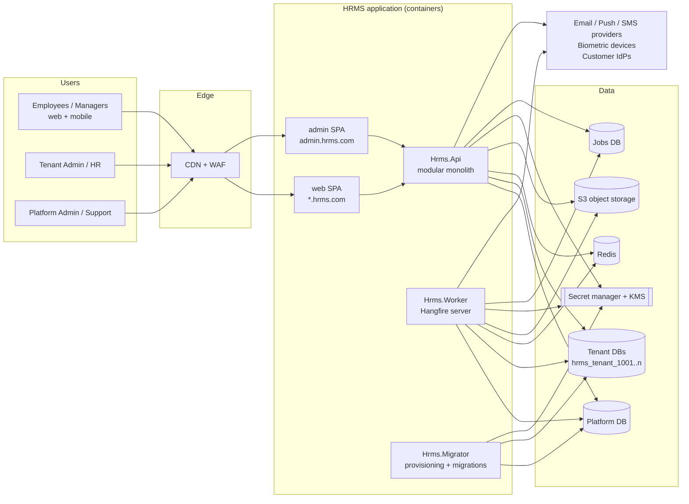
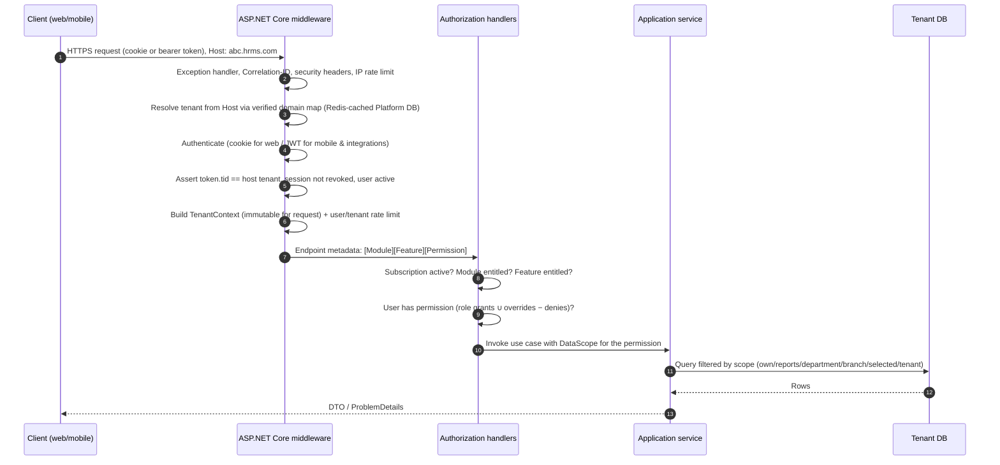

# 1. Architecture Overview

> **Final baseline note:** §1.6 is superseded by [14-module-catalogue-and-dependencies.md](14-module-catalogue-and-dependencies.md) (module codes, dependency classes H/O/I, full matrix). Everything else in this document remains valid.

## 1.1 Goals and quality attributes (in priority order)

1. **Tenant isolation** — no code path, credential or cache key may let Tenant A read or write Tenant B data.
2. **Security & compliance** — HR/payroll data is highly sensitive personal data (India DPDP Act 2023 assumed; GDPR-ready design).
3. **Correctness & traceability** — payroll/tax results must be reproducible and every change attributable.
4. **Modularity** — modules sold and enabled independently, minimal coupling, extractable later.
5. **Maintainability** — a mid-sized team can understand it; no pattern without a reason.
6. **Scalability** — thousands of tenants, from 10 to 50,000+ employees each, horizontal API scaling.
7. **Operability** — automated provisioning, migrations, backups, observability per tenant.

## 1.2 Assumptions (please confirm — see open questions)

| # | Assumption |
|---|---|
| A1 | First statutory market is **India** (TDS, PF, ESI, PT, LWF). Statutory logic is delivered as versioned, country-specific rule packs so other countries can be added. |
| A2 | Public cloud hosting with managed PostgreSQL, Redis, S3, KMS and a secret manager. **AWS (ap-south-1) is the working assumption** because the brief requires S3-compatible storage; design stays cloud-portable (containers, S3 API, OIDC, OTLP). |
| A3 | Code lives in a single GitHub monorepo; CI/CD on GitHub Actions. |
| A4 | Scale target for planning: 1,000 tenants in 3 years, typical tenant 50–2,000 employees, largest 50,000. |
| A5 | A person who works for two client companies has **two separate accounts** (one per tenant). Platform staff are never tenant users. |
| A6 | .NET 10 (LTS, supported to Nov 2028), PostgreSQL 17, React 19, Expo SDK current at scaffold time. |

## 1.3 System context



## 1.4 Architectural style: modular monolith

- **One codebase, three deployables built from it:**
  - `Hrms.Api` — HTTP API (+ SignalR hubs). Stateless, horizontally scaled.
  - `Hrms.Worker` — Hangfire server executing background jobs and outbox dispatch. Scaled independently (payroll month-end spikes).
  - `Hrms.Migrator` — provisioning and migration orchestrator, run as a job/one-off task, never inside the API.
- **Modules** are vertical slices with their own domain model, application services, persistence (own PostgreSQL schema + own `DbContext`), API endpoints, permissions, features and menus.
- Modules talk to each other **only** via their `*.Contracts` assembly (interfaces, DTOs, integration events). Enforced by architecture tests.
- Extraction path: a module that needs independent scale gets its Contracts implemented by an HTTP/gRPC client instead of in-process, its schema moved to its own DB, and its integration events moved from the in-process outbox dispatcher to a broker. No consumer code changes.

### Layering inside a module

```
Api (endpoints/controllers, request/response DTOs)       → thin: bind, authorize, call application, map result
  ↓
Application (commands/queries, application services,     → use cases, transactions, validation, authorization of data scope,
             validators, mappings, event handlers)          orchestration, publishes events
  ↓
Domain (entities, value objects, domain services,        → business rules, invariants; no EF/HTTP/IO dependencies
        domain events)
  ↑
Infrastructure (EF Core DbContext, configurations,       → implements Application abstractions
                migrations, repositories/queries, adapters)
```

Dependency rule: Domain depends on nothing (except SharedKernel). Application depends on Domain + abstractions. Infrastructure and Api depend inward. Enforced by NetArchTest rules.

### Pattern choices (and what we deliberately avoid)

| Use | Where | Avoid |
|---|---|---|
| Plain application services / handler classes, resolved by DI | All use cases | MediatR (commercial since v13), "pipeline behaviours for everything" |
| EF Core `DbContext` directly in Application for queries; small repositories only for aggregates with real invariants | Persistence | Generic `IRepository<T>` wrapping EF |
| Result type (`Result<T>` / error codes) for expected failures; exceptions for exceptional ones | Application → Api | Exceptions as control flow |
| FluentValidation (Apache-2.0) | Request validation | Duplicating rules in React |
| Mapperly (source-generated) or hand-written mapping | DTO mapping | AutoMapper (commercial since v15) |
| Domain events (in-transaction) + integration events via **outbox** | Cross-aggregate / cross-module | Distributed transactions, a message broker on day one |
| Specifications/query objects only where reused | Complex filtering | Over-abstracted CQRS with separate read DBs on day one |

## 1.5 Request pipeline (logical)



## 1.6 Module catalogue and dependency rules

| Module code | Kind | Hard dependencies | Optional integrations (consumed only if entitled) |
|---|---|---|---|
| `core.identity` | Foundation (always on) | — | — |
| `core.org` (company, branch, department, designation, grade, cost centre, location) | Foundation (always on) | identity | — |
| `core.employee` (minimal employee master needed for scoping) | Foundation (always on) | org | — |
| `core.audit`, `core.files`, `core.notifications`, `core.workflow`, `core.config`, `core.importexport`, `core.dashboard` | Platform services (always on) | — | — |
| `employee.ess` (self-service, documents, letters) | Optional | core.* | workflow |
| `attendance` | Optional | core.* | `attendance.biometric` (sub-module), leave, wfh |
| `leave` | Optional | core.* | attendance (calendar), payroll (LOP) |
| `payroll` | Optional | core.* | attendance, leave, loans, expense, tax |
| `tax` (projection, TDS) | Optional | payroll | documents |
| `recruitment`, `pms`, `loans`, `expense`, `assets`, `projects`, `mywork`, `workplace` (desk/room/WFH), `visitors`, `mailroom`, `calendar` | Optional | core.* | listed per module design later |
| `ai.assistant` | Optional premium | core.* | reads only from modules the tenant is entitled to *and* the user is permitted to see |

Rules:
1. **Hard dependencies may only point to `core.*`** or to a parent module for a sub-module (e.g. `tax → payroll`, `attendance.biometric → attendance`). The platform refuses to enable a module whose hard dependencies are not enabled.
2. **No optional module may require another optional module.** Integration is through `IOptionalIntegration<T>` resolution (see §6.4) — e.g. Payroll asks `IAttendanceSummaryProvider`; if Attendance is not entitled, the "manual input" provider is returned and Payroll uses manually entered/imported paid days.
3. Database foreign keys may point **only to `core.*` tables** (always present). References between optional modules are by ID without FK, validated in application code.
4. Module dependency graph is declared in each module's manifest, validated at startup and in CI (no cycles, rule 1 respected).
