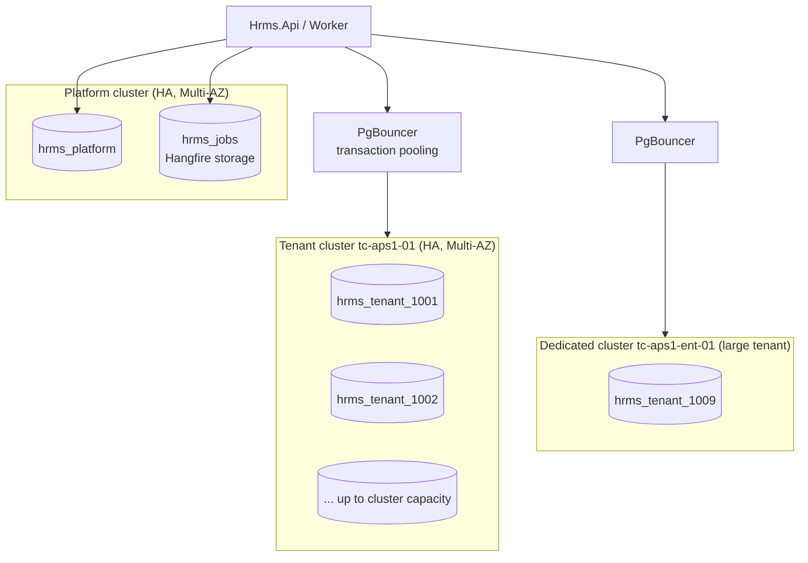
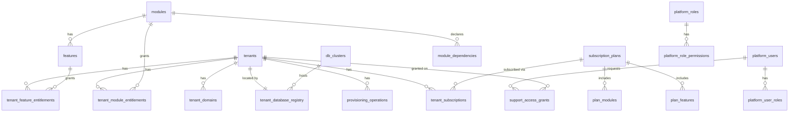
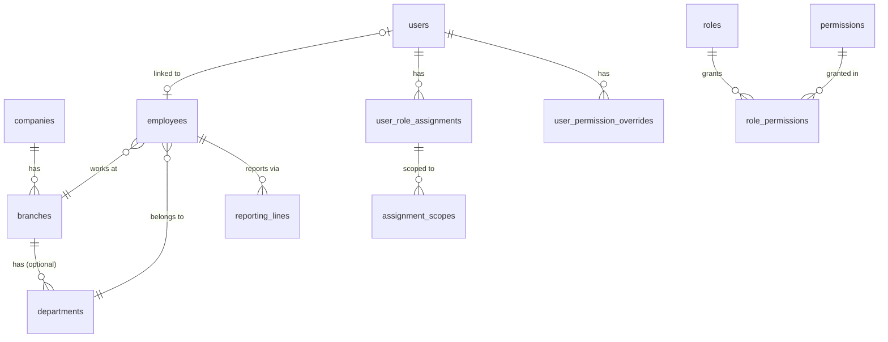
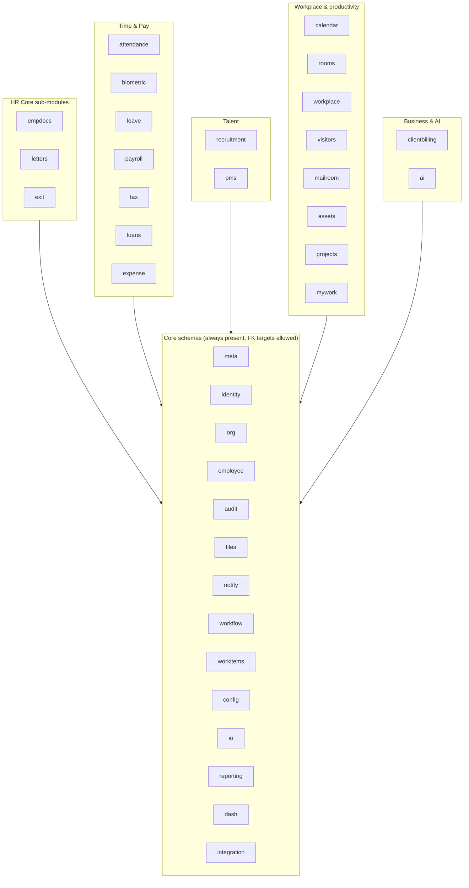
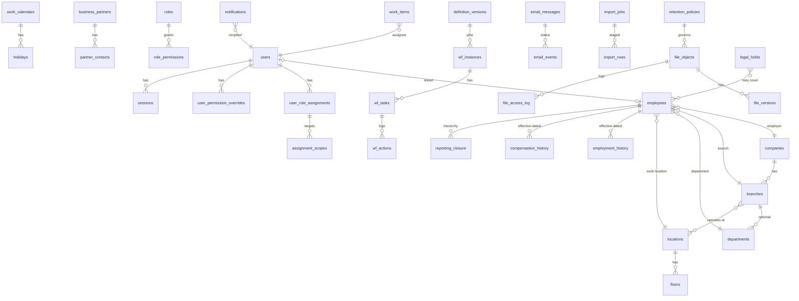
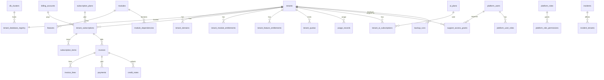

# 5–7. PostgreSQL Architecture, Platform DB and Tenant DB Schemas

## 5.1 Topology

- **Platform DB** `hrms_platform` — one per environment. Small, hot, heavily cached.
- **Jobs DB** `hrms_jobs` — Hangfire storage, kept out of the platform DB so job churn (high write volume) does not affect platform tables or backups.
- **Tenant DBs** `hrms_tenant_<tenant_number>` — one per tenant, placed on a **tenant cluster** chosen at provisioning time (region, capacity, tier). Large/regulated tenants can get a dedicated cluster. Naming is lowercase because PostgreSQL folds unquoted identifiers (the brief's `HRMS_Tenant_1001` would require quoting everywhere).
- **Per-tenant login role** `hrms_t1001_app` (DML only, no DDL) and `hrms_t1001_migrator` (DDL, used only by Migrator). Passwords generated at provisioning, stored only in the secret manager; the registry stores the **secret reference**, never the secret. A bug that builds the wrong connection string cannot authenticate to another tenant's DB.
- **PgBouncer** (transaction pooling) in front of each tenant cluster; Npgsql pools per connection string are kept small (`Max Pool Size` ~10, `Connection Idle Lifetime` short). Prepared statements: Npgsql auto-prepare disabled or PgBouncer ≥1.21 with `max_prepared_statements`.
- **Extensions** enabled in every DB: `citext` (case-insensitive codes/emails), `btree_gist` (effective-dating exclusion constraints), `pg_stat_statements` (cluster level), `pgcrypto` (only if needed).
- **Capacity rule of thumb** (to validate with load tests): ≤300 small/medium tenant DBs per cluster; move tenants by `pg_dump`/restore or logical replication with a short read-only window, then update the registry.

## 5.2 Schema-per-module inside each tenant DB

Each tenant module owns a PostgreSQL schema and its own EF Core `DbContext` + migration history table (`<schema>.__ef_migrations_history`). All schemas are created in **every** tenant DB, whether or not the tenant bought the module — enabling a module is then an entitlement change, not a DDL operation, and migrations are uniform across tenants (ADR-004).

| Schema | Owner module | Notes |
|---|---|---|
| `meta` | platform foundation | tenant identity row, schema/version info |
| `identity` | core.identity | users, roles, permissions, sessions, OpenIddict tables |
| `org` | core.org | company, branches, departments, designations, grades, cost centres, locations |
| `employee` | core.employee | minimal employee master + reporting lines (full module later) |
| `audit` | core.audit | audit entries, security events (partitioned) |
| `files` | core.files | file metadata, versions, access log |
| `notify` | core.notifications | notifications, templates, email/push outbox, preferences |
| `workflow` | core.workflow | definitions, instances, tasks, delegations |
| `config` | core.config | tenant settings, module settings (effective-dated) |
| `io` | core.importexport | import/export jobs, staged rows, errors |
| `dash` | core.dashboard | dashboard layouts, widget settings |
| `integration` | foundation | outbox, inbox (idempotency), idempotency keys |
| `attendance`, `leave`, `payroll`, `tax`, ... | business modules | added later |

## 5.3 Common table conventions

| Concern | Convention |
|---|---|
| Naming | `snake_case` tables/columns (EFCore.NamingConventions), plural table names |
| Primary key | `id uuid` generated as **UUIDv7** in the app (`Guid.CreateVersion7()`), time-ordered → good index locality, safe to expose, mergeable across DBs |
| Business keys | e.g. `employee_code citext` with `UNIQUE` (partial `WHERE NOT is_deleted` where soft-deleted) |
| Audit columns | `created_at timestamptz`, `created_by uuid`, `modified_at timestamptz`, `modified_by uuid` — set by EF interceptor from `ICurrentUser` (user or service principal); never from the client |
| Concurrency | PostgreSQL `xmin` mapped as row version (Npgsql `IsRowVersion()`), surfaced as `ETag`/`If-Match` on update APIs → 409/412 on conflict |
| Soft delete | only for entities where history/restore matters (`is_deleted`, `deleted_at`, `deleted_by`, global query filter). Hard delete + audit for the rest. Never soft delete financial records — they are reversed/voided. |
| Time | `timestamptz` (UTC) for instants; `date` for business dates; tenant/branch time zone stored on org entities |
| Money | `numeric(18,2)` (or `(18,4)` for rates) + `currency char(3)`; never float |
| Enums | stored as `text` with `CHECK` constraint (readable, migration-friendly) |
| Effective dating | `effective_from date NOT NULL`, `effective_to date NULL` + `EXCLUDE USING gist (key WITH =, daterange(effective_from, effective_to, '[)') WITH &&)` to forbid overlaps |
| JSON | `jsonb` only for genuinely variable data (workflow definitions, custom fields, audit before/after), never to avoid modelling |
| Indexes | every FK indexed; composite indexes for scoped queries (e.g. `employee(branch_id, status)`); `pg_stat_statements` reviewed per release |
| Sensitive fields | application-level encrypted columns `bytea` + `*_hash` blind index for equality search (PAN, Aadhaar-reference, bank account) — see security doc |

## 6. Platform DB schema (`hrms_platform`)

### `tenancy` schema
| Table | Key columns |
|---|---|
| `tenants` | `id uuid PK`, `tenant_number int UNIQUE` (1001…, used in DB name), `code citext UNIQUE` (abc), `legal_name`, `display_name`, `status` (`provisioning`/`active`/`suspended`/`read_only`/`deactivated`/`pending_deletion`/`deleted`), `region`, `data_residency`, `default_time_zone`, `default_locale`, `country_code`, audit columns, `xmin` |
| `tenant_domains` | `id`, `tenant_id FK`, `host_name citext UNIQUE` (`abc.hrms.com`, `hr.abc.com`), `kind` (`subdomain`/`custom`), `verification_status`, `verification_token_hash`, `verified_at`, `is_primary`, `tls_status` |
| `db_clusters` | `id`, `name`, `region`, `writer_host`, `pooler_host`, `port`, `admin_secret_ref`, `tier` (`shared`/`dedicated`), `max_tenants`, `status` |
| `tenant_database_registry` | `tenant_id PK/FK`, `cluster_id FK`, `database_name UNIQUE`, `app_secret_ref`, `migrator_secret_ref`, `status` (`provisioning`/`online`/`maintenance`/`read_only`/`offline`/`moving`/`archived`), `provisioning_status`, `schema_version` (release tag), `module_schema_versions jsonb` (per-schema last migration), `min_app_version`, `last_migrated_at`, `last_backup_at`, `last_backup_ref`, `last_restore_test_at`, `encryption_key_ref` (per-tenant KMS key/DEK reference), audit columns, `xmin` |
| `provisioning_operations` | `id`, `tenant_id`, `operation` (`create`/`migrate`/`move`/`suspend`/`export`/`delete`), `status`, `steps jsonb` (step, status, at, error), `requested_by`, `correlation_id`, `started_at`, `completed_at` |

### `catalog` schema
| Table | Key columns |
|---|---|
| `modules` | `id`, `code citext UNIQUE`, `name`, `kind` (`core`/`optional`/`submodule`), `parent_module_id`, `is_active`, `sort_order` — synced from code manifests |
| `module_dependencies` | `module_id`, `depends_on_module_id`, `kind` (`required`/`optional`), PK(both) |
| `features` | `id`, `module_id`, `code citext UNIQUE` (`payroll.multi_company`, `attendance.geo_fencing`), `name`, `value_type` (`boolean`/`limit`/`tier`), `default_value jsonb` |
| `subscription_plans` | `id`, `code UNIQUE`, `name`, `version int`, `status` (`draft`/`published`/`retired`), `billing_period`, `is_public`, `price_ref` |
| `plan_modules` | `plan_id`, `module_id` |
| `plan_features` | `plan_id`, `feature_id`, `value jsonb` (e.g. `{"limit": 500}`) |
| `addons` | optional purchasable module/feature bundles |

### `subscription` schema
| Table | Key columns |
|---|---|
| `tenant_subscriptions` | `id`, `tenant_id`, `plan_id`, `plan_version`, `status` (`trial`/`active`/`past_due`/`grace`/`suspended`/`cancelled`/`expired`), `starts_on`, `ends_on`, `trial_ends_on`, `grace_ends_on`, `employee_limit`, `billing_account_id`; exclusion constraint: one non-cancelled subscription per tenant per period |
| `tenant_module_entitlements` | `id`, `tenant_id`, `module_id`, `source` (`plan`/`addon`/`trial`/`manual`), `status` (`enabled`/`disabled`), `valid_from`, `valid_to`, `granted_by`, `reason`; materialised from plan + add-ons + manual overrides |
| `tenant_feature_entitlements` | `id`, `tenant_id`, `feature_id`, `value jsonb`, `source`, `valid_from`, `valid_to`, `granted_by`, `reason` |
| `entitlement_versions` | `tenant_id PK`, `version bigint` — bumped on any change; used as cache key and pushed via Redis pub/sub |

### `billing` schema (later phase)
`billing_accounts`, `invoices`, `invoice_lines`, `payments`, `tax_registrations` (GSTIN), `payment_provider_refs`.

### `pidentity` schema (platform identity)
`platform_users` (Identity user columns + `status`, `mfa_required=true`), `platform_roles`, `platform_permissions` (`platform.tenant.create`, `platform.subscription.manage`, `platform.support.request`, ...), `platform_role_permissions`, `platform_user_roles`, `platform_sessions`, OpenIddict tables for the platform realm.

### `support` schema
| Table | Key columns |
|---|---|
| `support_access_grants` | `id`, `tenant_id`, `platform_user_id`, `ticket_ref`, `reason`, `access_level` (`metadata_only`/`read_only`/`read_write`), `permission_codes text[]` (optional narrower list), `requested_at`, `approved_by_kind` (`tenant_admin`/`platform_break_glass`), `approved_by`, `starts_at`, `expires_at` (max e.g. 8h), `revoked_at`, `revoked_by`, `status` |

### `ops` / `config` / `reference` / `ai` / `audit` schemas
| Table | Purpose |
|---|---|
| `ops.usage_records` | `tenant_id`, `metric` (active_employees, storage_bytes, emails_sent, ai_tokens), `period`, `quantity` — fed by tenant outbox events |
| `ops.tenant_quotas` | `tenant_id`, `metric`, `limit`, `enforcement` (`soft`/`hard`) |
| `config.platform_settings` | `key`, `value jsonb`, `effective_from`, `modified_by` |
| `config.feature_flags`, `config.feature_flag_overrides` | release toggles (not commercial entitlements), per-tenant overrides |
| `reference.countries`, `reference.currencies`, `reference.statutory_rule_sets` | platform-maintained reference data; statutory rule sets are versioned (`country`, `code`, `version`, `effective_from`, `payload jsonb`, `published_at`, `checksum`) and copied into tenant DBs on publish for reproducibility |
| `ai.ai_plans`, `ai.tenant_ai_subscriptions`, `ai.ai_usage`, `ai.ai_policies` | AI plan, quota, usage metering and tenant-level data-use policy (placeholder) |
| `audit.platform_audit_events`, `audit.platform_security_events` | append-only, partitioned monthly (see audit doc) |
| `integration.outbox_messages` | platform outbox |

## 7. Tenant DB schema (foundation tables only)

### `meta`
| Table | Key columns |
|---|---|
| `tenant_identity` | single row: `tenant_id uuid`, `tenant_number`, `created_at`. **Verified by the connection factory on first use of each connection string** — guards against registry misconfiguration pointing tenant A at DB B. |
| `schema_info` | release tag, applied-at |

### `identity`
| Table | Key columns |
|---|---|
| `users` | ASP.NET Core Identity columns (`user_name`, `normalized_email`, `password_hash`, `security_stamp`, `lockout_end`, `access_failed_count`, `two_factor_enabled`), plus `employee_id uuid NULL FK employee.employees`, `user_type` (`employee`/`service`/`external`), `status` (`invited`/`active`/`locked`/`disabled`), `last_login_at`, `password_changed_at` |
| `user_logins`, `user_tokens`, `user_passkeys` | Identity external logins (tenant SSO), tokens, passkeys |
| `user_mfa_methods` | TOTP/passkey/recovery-code metadata |
| `password_history` | `user_id`, `password_hash`, `created_at` (reuse prevention) |
| `sessions` | `id` (= `sid` claim), `user_id`, `created_at`, `last_seen_at`, `expires_at`, `revoked_at`, `revoked_reason`, `client` (`web`/`mobile`/`api`), `device_id`, `ip`, `user_agent_hash` |
| `openiddict_*` | applications, authorizations, scopes, tokens (refresh token store, rotation) |
| `permissions` | `id`, `code citext UNIQUE` (`org.branch.view`), `module_code`, `kind` (`menu`/`page`/`action`), `action` (`view`/`create`/`edit`/`delete`/`approve`/`reject`/`import`/`export`/`download`/`process`/`finalize`/`share`), `supports_scope bool`, `is_sensitive bool` — synced from manifests |
| `roles` | `id`, `code citext UNIQUE`, `name`, `is_system bool` (seeded: Tenant Admin, HR Admin, Manager, Employee), `description`, `permission_version` |
| `role_permissions` | `role_id`, `permission_id`, `scope_level` (`own`/`direct_reports`/`all_reports`/`department`/`branch`/`selected_employees`/`tenant`), PK(role_id, permission_id) |
| `user_role_assignments` | `id`, `user_id`, `role_id`, `valid_from`, `valid_to`, `assigned_by`, `reason` |
| `assignment_scopes` | `assignment_id`, `target_kind` (`branch`/`department`/`employee`/`company`), `target_id` — *which* branches/departments/employees a `branch`/`department`/`selected_employees` level applies to; if none, defaults to the user's own branch/department |
| `user_permission_overrides` | `id`, `user_id`, `permission_id`, `effect` (`grant`/`deny`), `scope_level`, `valid_from`, `valid_to` (expiry encouraged), `reason NOT NULL`, `granted_by` |
| `api_clients` | tenant integration clients (client-credentials), hashed secrets, allowed scopes, IP allow-list |

### `org`
`companies` (legal entities: `name`, `legal_name`, `pan`, `tan`, `gstin`, `registered_address`, `country`), `branches` (`company_id`, `code UNIQUE`, `name`, `time_zone`, `address`, `state` — drives PT/LWF later, `is_active`), `departments` (`code`, `name`, `parent_department_id`, optional `branch_id`), `designations`, `grades`, `cost_centers`, `work_locations`. All effective-dated where re-organisations matter (department hierarchy via `department_versions`).

### `employee` (minimal core — needed by data scopes)
| Table | Key columns |
|---|---|
| `employees` | `id`, `employee_code citext UNIQUE`, `first_name`, `last_name`, `display_name`, `work_email citext`, `company_id`, `branch_id`, `department_id`, `designation_id`, `manager_employee_id`, `employment_status` (`pre_joining`/`active`/`notice`/`exited`), `date_of_joining`, `date_of_exit`, audit columns, `xmin` — current-state projection |
| `employment_history` | effective-dated assignment rows (`company_id`, `branch_id`, `department_id`, `designation_id`, `grade_id`, `manager_employee_id`, `effective_from`, `effective_to`, `reason`) with exclusion constraint; `employees` is updated from the current row |
| `reporting_closure` | `ancestor_employee_id`, `descendant_employee_id`, `depth` — closure table maintained on manager change, makes `direct_reports`/`all_reports` scopes a single indexed join |

### `audit`
`audit_entries` (partitioned by month), `security_events` (partitioned by month), `audit_chain_heads` — see audit doc.

### `files`
`file_objects`, `file_versions`, `file_access_log`, `retention_policies` — see common services doc.

### `notify`
`notifications` (in-app), `notification_preferences`, `templates`, `template_versions`, `email_messages` (outbox with status/attempts), `push_devices`, `push_messages`.

### `workflow`
`definitions`, `definition_versions` (`jsonb` steps, published, immutable), `instances` (pinned `definition_version_id`, `document_type`, `document_id`, `status`), `tasks` (`instance_id`, `step`, `assignee_user_id`, `due_at`, `status`), `actions` (append-only history: who, what, comment), `delegations`.

### `config`
`tenant_settings` (`key`, `value jsonb`, `effective_from`, `effective_to`), `module_settings` (`module_code`, `key`, `value`, effective-dated), `number_series` (employee code / document numbering with row lock).

### `io`
`import_jobs` (`type`, `file_id`, `status`, `total`, `succeeded`, `failed`, `mode` validate/commit), `import_rows` (staged, row number, `data jsonb`, errors), `export_jobs` (`type`, filter snapshot, `file_id`, `expires_at`).

### `integration`
`outbox_messages` (`id`, `type`, `payload jsonb`, `occurred_at`, `processed_at`, `attempts`, `error`, `correlation_id`), `inbox_messages` (`message_id`, `handler`, `processed_at` — consumer idempotency), `idempotency_keys` (`key`, `user_id`, `request_hash`, `response`, `expires_at` — for POSTs from mobile/integrations).

## 7.1 Payroll/financial design principles (for later modules, fixed now)

1. Finalised payroll/tax records are **immutable**; corrections are new records (arrears, reversals, off-cycle runs) linked to the original.
2. Each run stores an **input snapshot** (attendance/leave days, salary structure version, declarations), the **statutory rule set versions** and the **calculation engine version** used, so any payslip can be recomputed and explained.
3. Statutory values (slabs, rates, ceilings) are effective-dated reference data published by the platform and copied into the tenant DB on publish; never hard-coded in C# or React.
4. Every calculated line keeps its formula reference/explanation for audit and employee queries.

## 7.2 Final baseline — complete tenant DB schema map

> Naming: the brief's `HRMS_Platform` / `HRMS_Tenant_1001` are shown in the admin UI as display names; physical names remain lowercase `hrms_platform` / `hrms_tenant_1001` (ADR-037, pending approval).

Rules: FKs only from any schema → core schemas; never between optional schemas (IDs + application validation). Detailed per-module tables: HR Core/Documents/Letters [15](15-hr-core-documents-letters.md), Exit/FNF [16](16-exit-and-fnf.md), Time & Pay [17](17-time-and-pay-modules.md), Talent/Workplace/Productivity [18](18-talent-workplace-productivity-modules.md), Workflow/Inbox/Notify [19](19-workflow-inbox-notifications-email.md), Reporting/Import [20](20-dashboards-reporting-import.md), AI [21](21-ai-assistant.md), Client billing [22](22-billing.md).

### Core schema ERD (tenant DB)

## 6.1 Final baseline — Platform DB additions

| Schema.table | Purpose |
|---|---|
| `billing.billing_accounts`, `subscription_items`, `invoices`, `invoice_lines`, `credit_notes`, `debit_notes`, `payments`, `discounts`, `tax_rates`, `gst_registrations` | SaaS platform billing (§22A) |
| `ai.ai_plans`, `ai.ai_addons`, `ai.tenant_ai_subscriptions`, `ai.provider_configs`, `ai.ai_usage` | AI commercial & metering (§21) |
| `ops.incidents`, `ops.incident_tenants` | incident register (§24.1) |
| `ops.access_review_campaigns`, `ops.access_review_items` | platform user access reviews |
| `ops.backup_runs`, `ops.restore_tests` | per-tenant backup & restore evidence |
| `catalog.ai_tools` (synced) | AI tool registry metadata for admin visibility |

