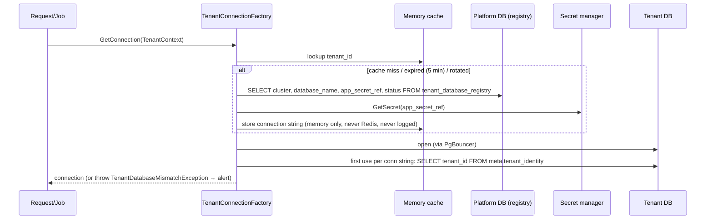

# 8. Tenancy: Resolution, Registry, Connection Management, Provisioning

## 8.1 Principles

1. The tenant is determined **only by the server**, from (a) the request host via a **verified** domain mapping and (b) the signed `tid` claim in the session/token. Both must agree.
2. Client-supplied tenant identifiers (`?tenantId=`, headers like `X-Tenant`, body fields) are **never** used to choose a database. Endpoints do not accept them for routing; an architecture test forbids `ITenantContext` from being constructed from request data outside the resolution middleware.
3. `TenantContext` is created once per request (or per job), is **immutable**, and every tenant `DbContext` takes its connection from it. No static/ambient tenant state outside it (`AsyncLocal` only inside the accessor, cleared after the request).
4. **Fail closed**: unknown host, unverified domain, suspended tenant, offline DB, mismatch between host and token → request rejected before any business code runs.

## 8.2 Host-based resolution

| Host | Meaning |
|---|---|
| `abc.hrms.com` | tenant web app + API for tenant `abc` (subdomain kind) |
| `hr.abc-corp.com` | verified custom domain (CNAME to us, DNS TXT verification, managed TLS) |
| `admin.hrms.com` | platform admin realm — **no tenant** |
| `auth.hrms.com` | public tenant-discovery endpoint for mobile (returns login URL + branding only) |
| `api.hrms.com` | mobile/integration API host; tenant comes **only** from the token `tid` claim (no host tenant), still validated against the registry |

Resolution steps (middleware `TenantResolutionMiddleware`):

1. Normalise host (lowercase, strip port, reject IP literals, reject hosts not under allowed suffixes or not in `tenant_domains`).
2. Lookup `host → tenant_id` in local memory cache (60 s) → Redis (`plat:host:{host}`) → Platform DB `tenant_domains WHERE verification_status='verified'`.
3. Load tenant summary (status, region, entitlement version) — cached, invalidated via Redis pub/sub on change.
4. After authentication, compare `tid` claim with resolved tenant. Mismatch → `401` + security event `TENANT_MISMATCH` (a strong signal of token theft or misuse).
5. For `api.hrms.com` (no host tenant): tenant = `tid` claim; the token's audience must be `hrms-api` and issuer must be our auth server.
6. Tenant status gate: `suspended` → 403 `tenant-suspended` for all but the billing/notice endpoint; `read_only` → only GET; `provisioning`/`offline`/`moving` → 503 with Retry-After.

Requests the brief explicitly calls out: changing `tenantId=123` in the browser does nothing — the value is not read. Changing the `Host` header to another tenant's host with a valid token for tenant A fails step 4. Forging `tid` is impossible without the signing key.

## 8.3 TenantContext

```csharp
public sealed record TenantContext(
    Guid TenantId,
    int TenantNumber,
    string TenantCode,
    TenantStatus Status,
    string Region,
    long EntitlementVersion,
    TenantDatabaseLocation Database);   // cluster, db name, secret ref — never the password
```

- `ITenantContextAccessor` exposes it; throws if accessed before resolution (prevents accidental use in anonymous endpoints).
- Background jobs carry `tenant_id` as a job argument; a Hangfire server filter rebuilds and validates the `TenantContext` (tenant active, DB online) before the job body runs.
- Platform-realm requests have **no** TenantContext; any attempt to resolve a tenant `DbContext` in that realm throws.

## 8.4 Tenant database registry & connection factory



- Connection strings exist **only in process memory**. Redis never holds secrets.
- Secret rotation: rotate in secret manager (dual-password window), bump `registry.xmin`/version → caches refresh.
- `TenantDbContextBase` receives the connection from the factory via an EF `DbContextOptions` built per scope (pooled `DbContextFactory` not used across tenants to avoid stale connections).

## 8.5 Tenant provisioning (Migrator, idempotent, resumable)

```mermaid
stateDiagram-v2
  [*] --> Requested
  Requested --> AllocatingCluster
  AllocatingCluster --> CreatingDatabase : pick cluster by region/tier/capacity
  CreatingDatabase --> CreatingRoles : CREATE DATABASE hrms_tenant_N
  CreatingRoles --> StoringSecrets : app + migrator roles, random passwords
  StoringSecrets --> Migrating : secret manager; registry stores refs only
  Migrating --> Seeding : all module schemas to current release
  Seeding --> CreatingAdmin : meta.tenant_identity, permissions, system roles, reference data, default settings
  CreatingAdmin --> Verifying : tenant admin user (invite link, forced MFA enrolment)
  Verifying --> Active : smoke checks, isolation check, domain verified
  Active --> [*]
  Migrating --> Failed
  Seeding --> Failed
  Failed --> Requested : retry resumes from last completed step
```



Each step is recorded in `provisioning_operations.steps`; re-running skips completed steps. Platform admin creates tenant → API enqueues `ProvisionTenant` job → Worker runs Migrator logic → status visible in admin portal.

Other lifecycle operations: **suspend** (status only), **read-only**, **move cluster**, **export** (full data export for offboarding/portability), **delete** (retention window → final backup to cold storage → drop DB → revoke secrets → registry `archived`; audited, two-person approval).

## 8.6 Migrations across N tenant databases

- EF Core migrations per module `DbContext`; Migrator applies them using **migration bundles** (`efbundle`) or generated idempotent scripts, with the per-tenant `migrator` role.
- **Expand → migrate data → contract**: release N only adds (nullable columns, new tables, new indexes `CONCURRENTLY`); code N works with schema N-1 and N; destructive changes ship in release N+1 or later.
- Rollout in **waves**: internal test tenants → canary (5%) → remaining tenants, parallelism limited per cluster. Each tenant's result recorded in registry (`schema_version`, `module_schema_versions`). Failure halts the wave and alerts; the failed tenant is set to `maintenance` (503) instead of running mixed schema.
- API refuses to serve a tenant whose `schema_version` is below the app's minimum supported (503 maintenance), so the system never runs code against an incompatible schema.
- Snapshot/PITR marker taken before each production wave.

## 8.7 Backups and restore

- Cluster-level automated backups + PITR (managed service), cross-region copy for DR.
- **Per-tenant logical backups** (`pg_dump -Fc`) nightly to an encrypted S3 bucket with Object Lock, recorded in `last_backup_at/last_backup_ref` — enables single-tenant restore, export and offboarding without restoring a whole cluster.
- Quarterly automated restore test per cluster + sample of tenants (`last_restore_test_at`).
- Targets (proposed): RPO ≤ 5 min (PITR), RTO ≤ 4 h for a cluster, ≤ 1 h for a single tenant restore.

## 8.8 Cross-tenant concerns

- **Platform analytics** (usage, active employees) are pushed from tenant DBs to `ops.usage_records` via outbox events — the platform never queries tenant business tables.
- **Redis keys** are always prefixed: `t:{tenantId}:...` (tenant) or `plat:...` (platform), built only through a `CacheKey` helper; raw string keys are banned by an analyzer/arch test.
- **Object storage keys** always start with `tenants/{tenantId}/`, built only by the file service.
- **SignalR groups** `t:{tenantId}:u:{userId}`; hub join derives tenant from the authenticated context only.
- **Logs/traces** carry `tenant_id` for filtering; no business PII.
