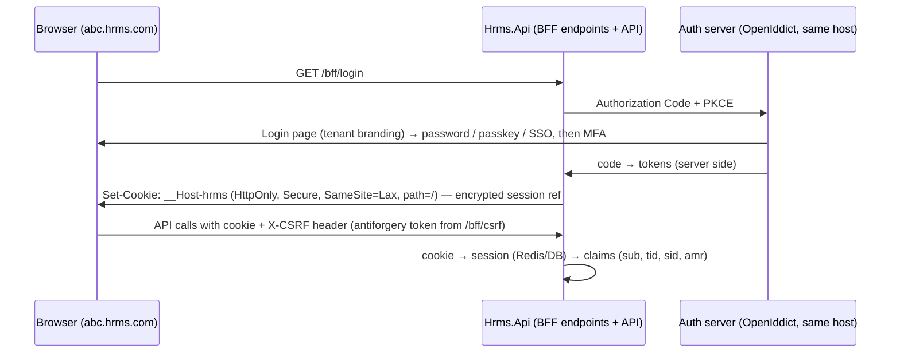

# 9. Authentication Architecture

## 9.1 Realms

| | Tenant realm | Platform realm |
|---|---|---|
| Users | employees, managers, HR, tenant admins, tenant API clients | platform admins, support, billing staff |
| Identity store | `identity` schema **in each tenant DB** | `pidentity` schema in Platform DB |
| Login host | `{tenant}.hrms.com` / custom domain (web), mobile via discovery | `admin.hrms.com` (IP allow-listed) |
| Token issuer | `https://{tenant-host}` or `https://auth.hrms.com/t/{tenantCode}` (decision in ADR-007) | `https://admin.hrms.com` |
| Token audience | `hrms-api` | `hrms-platform-api` |
| MFA | policy per tenant; **mandatory** for admin, HR and payroll roles | mandatory for everyone (passkey/TOTP) |
| SSO | optional per tenant: OIDC/SAML federation to customer IdP (Entra ID, Google Workspace, Okta) | company IdP (optional) |

A token from one realm is **never** accepted by the other (different issuer, audience and signing key set). There is no "god token".

## 9.2 Components

- **ASP.NET Core Identity** — user store, password hashing (PBKDF2-HMAC-SHA512, 100k iterations by default in current .NET; tuned upward if load test allows), lockout, security stamp, TOTP, recovery codes, passkeys (WebAuthn support added to Identity in .NET 10).
- **OpenIddict** (Apache-2.0) — OIDC/OAuth 2.0 server: Authorization Code + PKCE (web BFF and mobile), Client Credentials (tenant integrations, biometric connectors), refresh token rotation with reuse detection, token revocation, introspection. Chosen over Duende IdentityServer (commercial licence) and over an external IdP (see ADR-007 for trade-offs).
- Signing keys in KMS-backed key storage, rotated (e.g. 90 days) with overlapping validation; separate key sets per realm.

## 9.3 Web: Backend-for-Frontend session (no tokens in the browser)

Following the IETF *OAuth 2.0 for Browser-Based Apps* recommendation, the web SPA never holds access or refresh tokens.

- `__Host-` cookie prefix binds the cookie to the exact host, so `abc.hrms.com` cookies are never sent to `xyz.hrms.com`.
- CSRF: SameSite + mandatory antiforgery header on unsafe methods.
- Idle timeout (tenant-configurable, default 30 min) and absolute timeout (default 12 h); sliding refresh server-side.

## 9.4 Mobile: Authorization Code + PKCE

- Tenant discovery by company code → login in system browser (`expo-auth-session`, not an embedded WebView) → tokens.
- Access token **JWT, 10 min**, contains `sub`, `tid`, `sid`, `amr`, `client_id`, `aud=hrms-api` (no permissions in the token — they change too often and bloat it).
- Refresh token: opaque, **rotated on every use**, reuse detection revokes the whole session family; stored in `expo-secure-store` (Keychain/Keystore); optional biometric unlock before use. Lifetime: 30 days sliding, 90 days absolute (tenant-configurable).
- Device binding: `device_id` recorded in `sessions`; tenant admin can revoke a device.

## 9.5 Integrations (biometric devices, HRIS sync, customer systems)

- Client Credentials with per-tenant `api_clients`, scoped permissions, optional IP allow-list, secret rotation, short-lived tokens. Auditable as `source = Integration`.
- On-premise biometric connector (later) authenticates as a tenant API client and pushes punches; never connects to the DB.

## 9.6 Session & token revocation

- Every token/cookie carries `sid`. `identity.sessions` is the source of truth; Redis holds a **revocation set** `t:{tid}:revoked-sid:{sid}` (TTL = max token lifetime) checked on every request (O(1)).
- Security stamp change (password change, MFA reset, role change marked "force re-login", user disabled) revokes all sessions for the user.
- Logout revokes the session and the refresh token family.

## 9.7 Password, lockout and brute-force protection

- Password policy per tenant (min length ≥ 12 default, no forced periodic rotation by default per NIST SP 800-63B, block known-breached passwords via k-anonymity HIBP check as optional integration, history of last N).
- Identity lockout: 5 failures → 15 min lock (configurable); plus **per-IP and per-username rate limiting** at the login endpoint (Redis-backed) and progressive delay; CAPTCHA after threshold; generic error messages ("invalid credentials") to avoid user enumeration; constant-time responses on reset requests.
- Password reset tokens single-use, 30 min, invalidated by security stamp.

## 9.8 Security events emitted (to `audit.security_events`)

`LOGIN_SUCCEEDED`, `LOGIN_FAILED`, `ACCOUNT_LOCKED`, `ACCOUNT_UNLOCKED`, `LOGOUT`, `SESSION_EXPIRED`, `SESSION_REVOKED`, `TOKEN_REFRESH_REUSE_DETECTED`, `PASSWORD_CHANGED`, `PASSWORD_RESET_REQUESTED`, `PASSWORD_RESET_COMPLETED`, `MFA_ENROLLED`, `MFA_REMOVED`, `MFA_FAILED`, `SSO_LOGIN`, `TENANT_MISMATCH`, `API_AUTH_FAILED`, `API_CLIENT_SECRET_ROTATED`, `SUPPORT_SESSION_STARTED/ENDED`.
