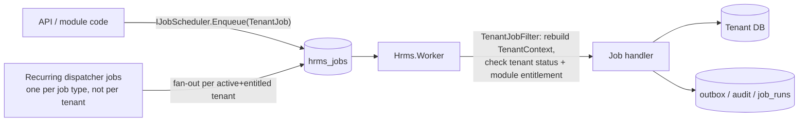

# 13–16. Common Services, API Versioning, Background Jobs, File Storage

All business modules consume these through `Hrms.BuildingBlocks.Application` abstractions; none may implement its own variant.

## 13.1 Service catalogue

| Service | Abstraction | Implementation notes |
|---|---|---|
| Current user / tenant | `ICurrentUser`, `ITenantContextAccessor` | from validated claims + TenantContext |
| Authorization | `IPermissionChecker`, `IDataScopeProvider` | §10 |
| Entitlement | `IEntitlementService`, `IOptionalIntegration<T>` | §11 |
| Audit | `IAuditWriter`, `ISecurityEventWriter` | §12 |
| Files | `IFileService` | §16 |
| Notifications | `INotificationService.Send(NotificationRequest)` | channels: in-app (SignalR + table), email, push (Expo push → FCM/APNs), SMS/WhatsApp later; per-user preferences; templated |
| Email | `IEmailSender` (used only by notifications) | provider adapters (Amazon SES / SMTP / SendGrid); `notify.email_messages` outbox with retries, bounces via webhook; dev uses Mailpit |
| Templates | `ITemplateRenderer` | **Scriban** (sandboxed, no code execution) for tenant-editable email/letter templates — never Razor for tenant-authored content; templates versioned |
| Documents/letters | `IDocumentGenerator` | HTML template → PDF (headless Chromium/Playwright in worker, or QuestPDF for coded layouts — QuestPDF licence is free only under a revenue threshold; decision pending) |
| Background jobs | `IJobScheduler` | §15 |
| Domain/integration events | `IDomainEvents` (in-transaction), `IOutbox` | outbox row in same transaction; Worker dispatches to in-process handlers (inbox table for idempotency); swappable for a broker later |
| Workflow / approvals | `IWorkflowService.Start(documentType, documentId, context)`, `IApprovalInbox` | in-house engine: versioned definitions (sequential/parallel steps, approver resolvers: reporting manager N levels, role-in-branch, specific user, dynamic rule), conditions on document fields, SLA escalation, delegation, reminders; modules register document types and receive `Approved/Rejected/Cancelled` events |
| Import/export | `IImportDefinition<TRow>`, `IExportDefinition<TQuery>` | upload → file service → job parses (ClosedXML, MIT) → module validators → staged rows with errors → preview → commit in batches → audit (`source=import`). Exports respect permission + scope; formula-injection safe (prefix `= + - @`); large exports async with expiring link; sensitive exports raise security events |
| Reporting | per-module query endpoints + export; later read replica + reporting schema | no ad-hoc SQL from users |
| Configuration | `ITenantSettings`, `IModuleSettings<T>` | typed settings, effective-dated, cached by version |
| Feature flags | `IFeatureFlags` | release toggles (platform + per-tenant override); distinct from commercial entitlements |
| Numbering | `INumberSeries` | gap-tolerant document numbers per tenant/company/FY |
| Caching | `ICacheService` (HybridCache — memory + Redis) | keys built only via `CacheKey.Tenant(...)` / `CacheKey.Platform(...)` |
| Clock | `IClock` | testable time, tenant time-zone helpers |
| Exception handling | global `IExceptionHandler` → RFC 9457 ProblemDetails | includes `traceId`/`correlationId`; never stack traces, SQL, or internal names |
| Logging & tracing | `ILogger<T>` + OpenTelemetry | structured, enriched with tenant/user IDs (no PII) |
| Correlation | `CorrelationIdMiddleware` | accepts `X-Correlation-ID` from trusted callers or creates one; propagated to logs, audit, jobs, outbox, outbound HTTP |
| Real-time | SignalR hubs (`/hubs/notifications`) | Redis backplane; groups per tenant/user; used for notifications, inbox counts, job progress |

## 14. API conventions and versioning

- **URL-segment versioning** `/api/v{major}/{module}/{resource}` via `Asp.Versioning.Mvc`. Only *breaking* changes create a new major version; additive changes (new optional fields/endpoints) do not.
- Each version supported for at least **12 months** after its successor ships (mobile apps in the wild); deprecated versions emit `Deprecation` and `Sunset` headers and are tracked in usage metrics.
- **OpenAPI** per version (built-in `Microsoft.AspNetCore.OpenApi`), grouped by module; UI (Scalar/Swagger UI) enabled in Dev/UAT, disabled or auth-protected in Prod. Spec published as CI artefact; `oasdiff` blocks unintended breaking changes.
- Conventions: JSON camelCase; `GET` list with `?page=&pageSize=` (max 200) or cursor for large sets, `sort=field,-field`, filter params explicit per endpoint (no generic expression language exposed); responses `{ items, page, pageSize, totalCount }`; `ETag`/`If-Match` for updates; `Idempotency-Key` header on POSTs that create money/approval effects; dates ISO 8601; errors RFC 9457 with `errors{field:[...]}` and stable `code`.
- Mobile `GET /api/v1/app-config` → `minSupportedVersion`, `latestVersion`, feature toggles.
- Platform API under `admin.hrms.com/api/v1/platform/...` — separate OpenAPI document and auth realm.

## 15. Background job architecture

**Hangfire** (core is LGPL-3.0, used unmodified as a library) with `Hangfire.PostgreSql` storage in the dedicated `hrms_jobs` database; `Hrms.Worker` hosts servers with named queues: `critical` (auth emails, notifications), `default`, `bulk` (imports, exports, bulk email), `payroll` (isolated capacity later), `maintenance`.



Rules:
1. **Job arguments are identifiers only** (`tenantId`, `importJobId`, `correlationId`) — never PII or secrets (Hangfire stores args in plain text).
2. Every tenant job implements `ITenantJob` and runs inside a rebuilt `TenantContext` with a **service principal** identity (`actor_type=job`), so audit columns and audit entries are attributed.
3. **Retries** with exponential backoff (default 5, configurable per job); poison jobs move to failed state with alert. Business-level progress/status kept in the module's own table (e.g. `io.import_jobs`) so the UI never reads Hangfire internals.
4. **Idempotency**: handlers are written to be re-runnable (natural keys, `integration.inbox_messages`, status checks); payroll processing uses a run-level lock (PostgreSQL advisory lock keyed by run ID) and step checkpoints.
5. **Recurring work** uses *dispatcher* recurring jobs (e.g. `DailyReminderDispatcher`) that enqueue per-tenant jobs — avoids N tenants × M recurring definitions and respects entitlements at dispatch time.
6. Correlation ID propagated from the triggering request into the job and every log/audit line.
7. Monitoring: Hangfire dashboard (platform realm only, behind admin auth), plus OpenTelemetry metrics (queue length, duration, failures by job type and tenant) with alerts.

Quartz.NET was the alternative (Apache-2.0, richer scheduling, no dashboard); see ADR-016.

## 16. File storage architecture

```mermaid
sequenceDiagram
  participant C as Client
  participant A as API (IFileService)
  participant S3 as S3 (quarantine/ and clean/ prefixes)
  participant W as Worker (scanner)
  C->>A: POST /files/upload-intents {purpose, fileName, size, contentType}
  A->>A: authorize (module permission for purpose), validate size/extension per purpose policy
  A-->>C: presigned PUT (5 min, exact content-length, content-type) to tenants/{tid}/quarantine/{fileId}
  C->>S3: PUT bytes
  C->>A: POST /files/{fileId}/complete
  A->>W: enqueue ScanFile
  W->>S3: read, magic-byte sniff, size check, malware scan (ClamAV / cloud scanner), optional image re-encode
  alt clean
    W->>S3: copy to tenants/{tid}/clean/{module}/{fileId}/{versionId}; delete quarantine
    W->>A: status=available, event FileAvailable
  else infected / invalid
    W->>A: status=rejected (quarantined, security event)
  end
  C->>A: GET /files/{fileId}/download
  A->>A: authorize via owning module's IFileAccessPolicy (permission + data scope), audit download
  A-->>C: 302 to presigned GET (60 s, Content-Disposition: attachment)
```

Metadata (`files.file_objects`): `id`, `tenant_id`, `owner_module`, `owner_entity_type`, `owner_entity_id`, `purpose` (e.g. `employee.document`, `expense.receipt`), `original_name` (display only), `content_type` (sniffed), `size_bytes`, `sha256`, `classification` (`public`/`internal`/`confidential`/`restricted`), `status` (`pending_upload`/`scanning`/`available`/`rejected`), `current_version_id`, `retention_policy_id`, `expires_at`, `legal_hold`, soft-delete columns, audit columns. `file_versions` (storage key, size, hash, created_by). `file_access_log` (who, when, action `view`/`download`/`share`, ip).

Policies:
- **Tenant isolation**: shared bucket per environment, keys always `tenants/{tenantId}/...` generated server-side (user file names never used in keys); bucket private, Block Public Access, SSE-KMS (per-tenant KMS key for enterprise tier); the app's IAM role can only presign — clients never get credentials.
- **Validation**: per-purpose allow-list of extensions + MIME + magic bytes, size limits (e.g. 10 MB documents, 5 MB images, 50 MB imports); reject executables, HTML/SVG (or serve only as attachment from a separate download domain).
- **Malware scanning** integration point `IMalwareScanner` (ClamAV container in dev; cloud scanner in prod); nothing is downloadable until `available`.
- **Versioning**: new upload to same document = new version; old versions retained per policy.
- **Retention/expiry**: retention policies per purpose (e.g. payslips 8 years, visitor ID images 30 days); daily job applies expiry → soft delete → hard delete after grace, except legal hold.
- **Download audit** for confidential/restricted classes; bulk download/export raises security event.
