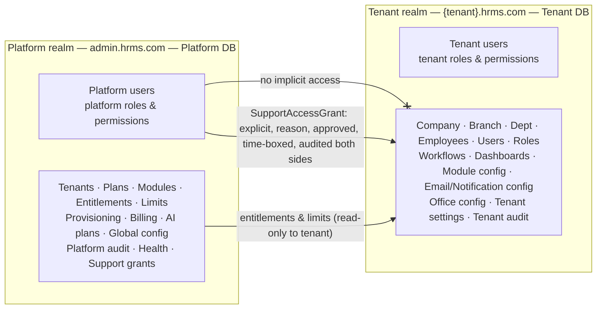
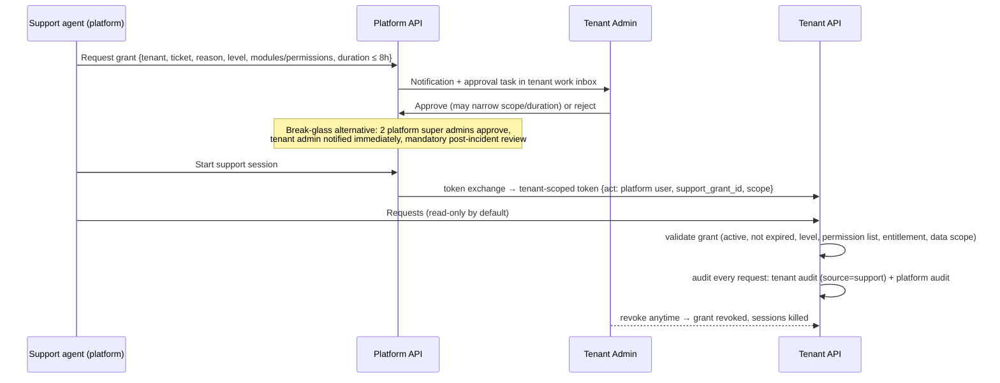
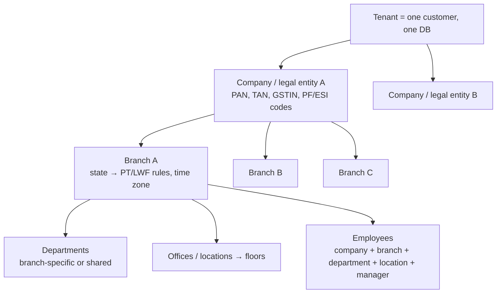

# 13. Platform Administration and Tenant Administration

Two security realms (ADR-009). This document fixes **what each realm can do**, the permissions behind it, and the hard line between them.

## 13.1 Platform Admin capabilities → platform permissions

| Capability | Permission codes (`platform.*`) | Notes / controls |
|---|---|---|
| Register / create tenant | `platform.tenant.create` | starts provisioning workflow (§4.5); creates initial Tenant Admin **invitation** — platform never sets the tenant admin's password |
| Activate / deactivate / suspend / read-only | `platform.tenant.activate`, `platform.tenant.suspend`, `platform.tenant.deactivate` | deactivate & delete require **two-person approval** + reason; tenant admins notified |
| Delete / offboard tenant | `platform.tenant.delete` | retention window, final export, crypto-shred keys, DB drop; two-person approval |
| Manage tenant domains | `platform.tenant.domain.manage` | DNS verification, TLS status |
| Manage plans | `platform.plan.manage` | plans are versioned; published plans immutable (new version for changes) |
| Manage modules & features catalogue | `platform.catalog.manage` | catalogue rows are synced from code manifests; admins edit commercial metadata (names, availability, add-on flag), not technical dependencies |
| Manage subscriptions | `platform.subscription.manage` | assign plan, renewals, trials, grace, cancellation |
| Enable / disable modules for a tenant | `platform.entitlement.module.manage` | dependency closure validated (cannot enable `tax` without `payroll`; disabling `payroll` warns that `tax` will also be disabled) |
| Manage feature entitlements | `platform.entitlement.feature.manage` | boolean / limit / tier features |
| Manage tenant limits | `platform.tenant.limits.manage` | employees, users, companies, branches, storage GB, API req/min, emails/day, SMS/month, AI tokens/month (`ops.tenant_quotas`, soft/hard) |
| Tenant DB provisioning | `platform.tenant.db.manage` | provision, migrate, move cluster, maintenance mode, backup/restore requests; **no data browsing** |
| Monitor tenant status | `platform.tenant.view`, `platform.health.view` | status, schema version, last backup, job backlog, error rate, usage — metadata only |
| Platform users | `platform.user.manage` | MFA mandatory, SSO optional, periodic access review |
| Platform roles & permissions | `platform.role.manage` | cannot grant above own permissions (same ceiling rule as tenant §10.5) |
| Support access | `platform.support.request`, `platform.support.approve_breakglass`, `platform.support.manage` | see §13.3 |
| Platform billing | `platform.billing.view`, `platform.billing.manage`, `platform.billing.refund` | SaaS billing only (§22A) |
| AI plans & add-ons | `platform.ai.plan.manage`, `platform.ai.provider.manage` | model/provider config, quotas, pricing, regional hosting (§21) |
| Platform audit | `platform.audit.view`, `platform.audit.export` | export is step-up MFA + itself audited |
| System health | `platform.health.view` | dashboards, Hangfire dashboard (platform realm only) |
| Global configuration & feature flags | `platform.config.manage`, `platform.featureflag.manage` | changes audited, effective-dated where relevant |
| Statutory reference data | `platform.statutory.publish` | publish versioned rule packs (PF/ESI/PT/LWF/tax slabs) to tenants; maker-checker |

### Seeded platform roles

| Role | Typical permissions |
|---|---|
| Platform Super Admin (≤ 3 people, break-glass) | all `platform.*`; every use alerted |
| Tenant Operations | tenant view/create/activate, domains, db manage, limits |
| Commercial / Billing | plans, subscriptions, entitlements, billing |
| Support Agent | tenant view, `platform.support.request` |
| Support Lead | Support Agent + approve support grant extensions (not break-glass) |
| Security & Compliance Auditor | platform audit view/export, health view (read-only) |
| Platform Observer | read-only metadata |

## 13.2 What Platform Admin can **not** do

- Read or modify tenant employee, payroll, document, audit or any business data.
- Log in as a tenant user, reset a tenant user's password, or read tenant users' MFA secrets.
- Query tenant databases (no SQL console; DB credentials are only usable by Migrator/app workloads).
- Download tenant files.

The only path to tenant data is §13.3. Platform tokens are rejected by tenant APIs (different issuer, audience, signing keys).

## 13.3 Support access (explicit, permission-controlled, time-limited, reason-based, audited)

Levels: `metadata_only` (config, settings, workflow definitions, no personal data), `read_only` (listed modules, still subject to data-scope settings in the grant), `read_write` (rare, separate approval, every write requires reason). Payroll/salary/bank/document modules excluded unless explicitly listed by the tenant admin.

## 13.4 Tenant Admin capabilities

| Area | Owner module | Key permissions (`*.configure` = settings) |
|---|---|---|
| Company (legal entities, multiple per tenant) | core.org | `org.company.*` |
| Branch | core.org | `org.branch.*` |
| Department (tenant-wide or branch-specific) | core.org | `org.department.*` |
| Designation, Grade | core.org | `org.designation.*`, `org.grade.*` |
| Location / Office → Building → Floor (physical sites) | core.org | `org.location.*` |
| Cost centre | core.org | `org.costcenter.*` |
| Holiday calendars & weekly-off patterns (shared by Attendance & Leave) | core.org | `org.workcalendar.*` |
| Clients & vendors (shared business-partner master) | core.org | `org.partner.*` |
| Reporting hierarchy | core.employee | `employee.reporting.edit` |
| Employees | core.employee | `employee.*` |
| Users (invite, lock/unlock, reset MFA, deactivate, link to employee) | core.identity | `identity.user.*` |
| Roles, permissions, overrides | core.identity | `identity.role.*`, `identity.override.*` — ceiling rule applies |
| Workflows | core.workflow | `workflow.definition.*` |
| Dashboards | core.dashboard | `dashboard.layout.configure` |
| Module configuration (only entitled modules) | each module | `{module}.settings.configure` |
| Email configuration (sender, SMTP/provider, templates) | core.notify | `notify.email.configure`, `notify.template.*` |
| Notification configuration (events, channels, defaults, user override policy) | core.notify | `notify.settings.configure` |
| Office configuration (zones, seats, rooms) | workplace / rooms | `workplace.layout.configure`, `rooms.room.configure` |
| Security settings (password, MFA policy, session timeouts, SSO, IP allow-list) | core.identity | `identity.security.configure` (step-up MFA) |
| Support access approvals | core.identity | `identity.support.approve` |
| Tenant audit | core.audit | `audit.entry.view`, `audit.security.view`, `audit.export` |
| Data export / retention / legal hold | core.config + core.files | `compliance.*` |
| Subscription view (read-only) & usage | platform contract | `tenant.subscription.view` |

Tenant Admin can never exceed the subscription: un-entitled modules don't appear in configuration and their APIs return `module-not-enabled`.

## 13.5 Organisation model

- **Company** = legal/statutory employer. **Branch** = organisational unit within a company (statutory registrations per state). **Location/Office** = physical site; a branch may have several, a site may host several branches. **Department** = functional unit; optional `branch_id` (branch-specific) or shared across branches.
- Data scopes (`company`, `branch`, `department`) and approval conditions use these attributes.
