# 15. Employee / HR Core, Employee Documents, Letter Management

Module architecture only (domain model, rules, integration points). Implementation follows the roadmap.

## 15.1 Employee / HR Core (`core.employee`, always enabled)

### Domain model

```mermaid
erDiagram
  employees ||--o{ employment_history : "effective-dated"
  employees ||--o{ compensation_history : "effective-dated"
  employees ||--|| employee_personal : has
  employees ||--o{ employee_contacts : has
  employees ||--o{ emergency_contacts : has
  employees ||--o{ family_members : has
  employees ||--o{ nominees : has
  employees ||--o{ bank_accounts : "effective-dated"
  employees ||--|| statutory_profile : has
  employees ||--o{ education : has
  employees ||--o{ experience : has
  employees ||--o{ employee_skills : has
  employees ||--o{ lifecycle_events : has
  employees ||--o{ custom_field_values : has
  employees ||--o{ reporting_closure : "ancestor/descendant"
```

| Table (`employee.*`) | Content | Notes |
|---|---|---|
| `employees` | `employee_code` (unique, from number series), names, display name, work email/phone, photo file id, **current** company/branch/department/designation/grade/location/cost centre/manager/employment type, `employment_status`, joining date, probation end, confirmation date, exit dates, user link | current-state projection, rebuilt from history; `xmin` concurrency |
| `employment_history` | company, branch, department, designation, grade, location, cost centre, manager, employment type, `effective_from/to`, `event_type` (joining, transfer, promotion, re-designation, manager change, department change, branch change, confirmation, exit), `reason`, `lifecycle_event_id` | exclusion constraint (no overlaps); **source of truth** for "as of" queries and payroll/branch history |
| `lifecycle_events` | joining, probation extension, confirmation, transfer, promotion, increment, manager change, exit — with status (draft → pending approval → approved → effective), workflow instance, letter id | approvals via `core.workflow`; effective on date via job |
| `employee_personal` | DOB, gender, marital status, nationality, blood group, personal email/phone, addresses (current/permanent) | `confidential` classification |
| `emergency_contacts`, `family_members`, `nominees` | name, relation, DOB, contact, nominee share % (PF/gratuity/insurance) with check sum = 100 per nomination type | |
| `bank_accounts` | bank, IFSC, **account number encrypted** + blind index + last-4, account holder, `effective_from`, verification status | change = sensitive action: reason, workflow (configurable), security event, notification to employee |
| `statutory_profile` | PAN (encrypted + masked), UAN, PF number, PF applicability/opt-out, ESI number/applicability, PT state (derived from branch, overridable), LWF applicability, **Aadhaar: masked/last-4 or reference token only** (no full number stored unless legal sign-off; see §23), passport (encrypted), default tax regime | statutory numbers validated by format; changes audited |
| `compensation_history` | annual CTC, currency, grade, effective date, reason (joining/increment/promotion/correction), source (`hr`, `payroll`, `pms_recommendation`) | **HR-level salary history**; component breakdown is owned by Payroll (§17.4). When Payroll is enabled, payroll structure revisions write here via Employee contract → single history. Conflict resolution documented in findings |
| `education`, `experience`, `employee_skills` (+ `skills` master with proficiency levels) | | |
| `custom_field_definitions`, `custom_field_values` | tenant-defined fields per entity (type, validation, required, section, visibility permission, `is_sensitive`) | typed values (`text/number/date/bool/option/file`); no generic EAV for core fields |
| `reporting_closure` | ancestor/descendant/depth | maintained on manager change; powers `direct_reports`/`all_reports` scopes and workflow "manager level N" |

### Rules
- Effective-dated everywhere history matters: org assignment, manager, compensation, bank account, statutory applicability. Future-dated changes allowed (applied by daily job), back-dated changes require `employee.history.backdate` permission and reason and raise `PayrollInputChanged` if they touch a processed period.
- Employee profile sections have separate permissions (`employee.personal.view`, `employee.bank.view/edit`, `employee.statutory.view/edit`, `employee.compensation.view/edit`, `employee.family.view`...) each with data scope. Self-service = `own` scope with field-level edit rules (e.g. employee can edit personal phone, bank change requires approval).
- Employee code generated by `INumberSeries` (per company/prefix configurable); manual codes allowed if configured; unique per tenant.
- Hiring paths: direct creation, Excel import (`core.io`), Recruitment conversion (integration via `IEmployeeOnboarding` contract).
- Integration events: `EmployeeJoined`, `EmployeeTransferred`, `EmployeeManagerChanged`, `EmployeeCompensationChanged`, `EmployeeExitInitiated`, `EmployeeExited`, `EmployeeReactivated` — consumed by entitled modules only.

## 15.2 Employee Document Management (`employee.documents`)

Builds on `core.files` (storage, scanning, versions, presigned URLs, retention engine).

| Table (`empdocs.*`) | Content |
|---|---|
| `document_categories` | e.g. Identity, Education, Employment, Statutory, Payroll, Exit, Medical; default classification & retention policy |
| `document_types` | category, name, allowed file types, max size, `has_expiry`, `requires_verification`, `is_confidential`, `employee_can_upload`, `employee_can_view`, retention policy, mandatory-for (joining checklist) |
| `employee_documents` | employee, type, `file_id` (current version), document number (encrypted if sensitive), issue/expiry dates, `verification_status` (`pending`/`verified`/`rejected`), `verified_by`, `verified_at`, rejection reason, `is_confidential`, soft-delete |
| `employee_document_versions` | → `files.file_versions`, uploader, upload source |
| `document_access_rules` | per type: which permission/scope can view/download; confidential types require `empdocs.confidential.view` |

Rules: download → permission + scope + confidentiality check → audit (`document.downloaded`) → 60 s presigned URL. Expiry job notifies employee/HR N days before expiry and creates work items. Retention per category (e.g. statutory 8 years after exit); deletion per policy unless legal hold; employee-uploaded documents in `pending` are not visible to others until verified (configurable).

## 15.3 Letter Management (`employee.letters`)

| Table (`letters.*`) | Content |
|---|---|
| `letter_types` | offer, appointment, confirmation, promotion, increment, transfer, experience, relieving, warning, custom; default workflow; numbering series |
| `letter_templates` / `letter_template_versions` | HTML body (Scriban), header/footer/letterhead per company/branch, page settings, variables used; **published versions immutable**; maker-checker publish |
| `letter_variables` (registry, code-defined) | namespaces `employee.*`, `company.*`, `branch.*`, `salary.*` (only if Payroll entitled and caller has `employee.compensation.view`), `exit.*`, `candidate.*` (Recruitment), `letter.*` (number, date) |
| `letters` | type, template version, subject (employee/candidate), variable **snapshot jsonb**, status (`draft`→`pending_approval`→`approved`→`issued`→`revoked`), number, generated `file_id`, signed-by, issued-at, emailed-at |
| `letter_deliveries` | email message id, recipient, status |

Flow: choose template → resolve variables (each resolver checks permission of the requesting user; salary variables unavailable without permission) → preview → workflow approval (`core.workflow`) → PDF render in Worker (HTML→PDF) → stored via `core.files` (classification `confidential`) → optional e-mail via `core.notify` with attachment or secure link → audit for generate/approve/download/email. Re-issue creates a new letter with a reference to the previous one; issued letters are never edited. Digital signature/e-sign provider is an integration point (decision later).
