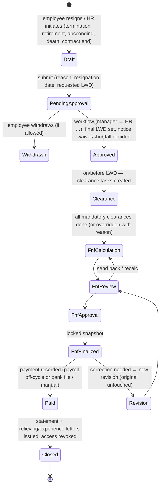

# 16. Employee Exit and Full & Final Settlement (`employee.exit`)

Mandatory capability. Sub-module of HR Core: **hard** dependency only on `core.*`; every other module is an **optional** provider (§14.4), so Exit/FNF works for an Employee-only tenant with manual inputs and becomes automatic as modules are enabled.

## 16.1 Menu

```
Employee
 └─ Exit Management
     ├─ Resignation           (employee self-service + HR-initiated separation)
     ├─ Exit Approval
     ├─ Notice Period
     ├─ Exit Clearance
     ├─ FNF
     └─ Exit Documents
```

## 16.2 Lifecycle



## 16.3 Data model (`exit.*`)

| Table | Key content |
|---|---|
| `separation_types`, `exit_reasons` | configurable masters (voluntary/involuntary, reason codes) |
| `notice_policies` | by employment type/grade/probation status: notice days, waiver rules, recovery basis (basic/gross/CTC per day), buy-out allowed; effective-dated |
| `separations` | employee, type, reason, resignation date, `expected_lwd` (policy-computed), `final_lwd`, notice required days, notice served days, **shortfall days**, notice pay recovery/payout decision, waiver (approved by, reason), status, workflow instance, exit interview id, rehire eligibility |
| `exit_interviews` | questionnaire version, responses (confidential classification, restricted permission) |
| `clearance_templates` | configurable departments: HR, Manager, Finance, IT, Admin, Assets, Department, custom; per item: owner role/user resolver, mandatory flag, due offset from LWD, recovery amount allowed |
| `clearance_tasks` | separation, department, item, assignee, status (`pending`/`cleared`/`not_applicable`/`dues_found`), dues amount + description, cleared by/at, comments — published to `core.workitems` |
| `fnf_settlements` | separation, **revision number**, `parent_settlement_id` (for revisions), status, period of last salary, calculation engine version, rule-set versions, input snapshot id, totals (earnings, deductions, recoveries, TDS, net payable — can be negative = recoverable), payment mode/status/reference, finalized by/at, **locked** flag |
| `fnf_lines` | settlement, component code, category (see §16.4), quantity/basis (days, rate), amount, `source` (`payroll`, `leave`, `loans`, `expense`, `assets`, `attendance`, `tax`, `manual`), `source_ref`, explanation/formula text, manual-override flag + reason |
| `fnf_input_snapshots` | jsonb snapshot of every consumed provider response (attendance days, leave balance, loan outstanding, pending claims, asset recoveries, payroll variables, tax projection) + hash |
| `exit_documents` | links to letters (FNF statement, relieving, experience, custom) and files |

## 16.4 FNF calculation components

| Category | Components | Source (optional provider → fallback) |
|---|---|---|
| Earnings | Salary payable (days worked in final period), salary arrears, leave encashment, bonus, incentives, variable pay, overtime, gratuity (eligibility rules), reimbursements pending | Payroll `IPayrollCalculator.CalculateFinalSettlement`, Attendance paid days, Leave `GetEncashableBalance`, Expense `GetApprovedForPayroll` → manual lines |
| Recoveries | Notice pay recovery (shortfall × daily rate per policy), loan outstanding, salary advance outstanding, asset recovery (unreturned/damaged), excess leave availed, other deductions | Exit notice policy, Loans `GetOutstanding`, Assets `GetRecoveryAmounts`, Leave → manual lines |
| Statutory | PF, ESI, PT, LWF on final payout as applicable; TDS on final settlement | Payroll statutory engine, Tax `CalculateFinalTds` → manual |
| Result | Final net payable (or net recoverable) | computed |

**No duplicated payroll logic**: salary/statutory/TDS amounts come from Payroll/Tax contracts when entitled; Exit only orchestrates, snapshots and adds exit-specific lines (notice pay, clearance recoveries).

## 16.5 Lock & revision rules

1. **Finalize** (`exit.fnf.finalize`, step-up MFA): snapshot hashed, `locked = true`; DB trigger + domain rule reject updates to locked settlements and lines.
2. Correction = **new revision** (`exit.fnf.revise` + reason) copying the original, linked by `parent_settlement_id`; the revision shows delta vs. original; approval flow repeats; payment of delta only. Original remains visible and immutable.
3. Every transition audited with before/after and reason (`FNF finalized`, `FNF revised`, `FNF paid`).
4. If Payroll is enabled, the finalized FNF payout can be pushed to a payroll **off-cycle run** (Payroll owns payment/bank file) — Payroll then treats the FNF as an immutable input.

## 16.6 Exit documents

FNF statement (PDF from snapshot), relieving letter, experience letter, service certificate, custom — generated via `employee.letters` if entitled (else simple built-in FNF statement template from `core.files`/document generator). Delivered by email/self-service until the ex-employee portal access expires (configurable alumni access, read-only, limited to own exit documents/payslips/tax forms).

## 16.7 Post-exit access revocation (on effective LWD, by job, idempotent)

| Step | Mechanism |
|---|---|
| Deactivate user login | `identity.users.status = disabled` (or `alumni` with restricted role if alumni access enabled) |
| Revoke sessions/tokens | revoke all `sessions`, refresh-token families, push devices; security event |
| Revoke application access | remove role assignments (kept in history), cancel delegations, reassign open work items/approvals to manager (rule configurable) |
| Revoke biometric access | `IBiometricAccessProvider.RevokeEmployeeAccess` → connector command queue (§17.2); fallback manual clearance task |
| Revoke integrations | API clients owned by the user disabled; calendar sync tokens revoked |
| Preserve history | employee record → `exited`, all history, payroll, documents retained per retention policy; nothing deleted |

Integration events: `EmployeeExitApproved`, `ClearanceCompleted`, `FnfFinalized`, `EmployeeExited` → Attendance stops rostering after LWD, Leave stops accrual, Payroll excludes from regular runs, Assets opens return tasks, Workplace releases reserved seat, Projects removes from active members.
