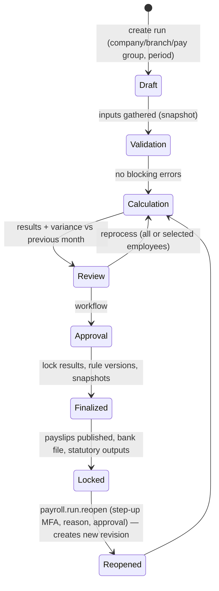

# 17. Time & Pay Modules: Attendance, Biometric, Leave, Payroll, Tax, Loans, Expense

Architecture-level definitions (aggregates, ownership, integration). Detailed module designs are reviewed before each module is built.

## 17.1 Attendance (`attendance`)

| Area | Design |
|---|---|
| Capture sources | `web`, `mobile` (optional geo-fence/selfie as features, consent-based), `manual` (HR entry with reason), `import`, `biometric` (sub-module), `workplace_checkin` (integration). All write the same `punches` model with `source` |
| Masters | shifts (start/end, break, grace in/out, half-day thresholds, night shift crossing midnight, OT rules), shift policies, rosters (per employee/date, rotation patterns), office timings per location; **holidays & weekly offs come from `core.org` work calendars** |
| Processing | daily attendance computation job per tenant/branch time zone: punches → `attendance_days` (status present/absent/half-day/leave/holiday/weekly-off/OD/WFH/comp-off, first-in/last-out, worked minutes, late, early-out, OT minutes) with `computation_version`; re-computable until period locked |
| Requests | regularisation, on-duty, WFH, comp-off earning, OT approval — all via `core.workflow`, appear in work inbox |
| Period lock | attendance period locked per company/branch before payroll; unlock requires `attendance.period.unlock` + reason; changes after lock raise `PayrollInputChanged` |
| Optional providers | Leave (show approved leave on days; without Leave, leave days are absent unless regularised), Biometric |
| Provides | `IAttendanceSummaryProvider` (paid days, LOP days from attendance, OT) |
| Comp-off | Attendance records **earning** (worked on holiday/weekly off, approved); **balance and availing are owned by Leave** (comp-off leave type). Without Leave, earned comp-off is reported only (decision in findings) |
| WFH | WFH request + attendance status owned by Attendance; Workplace hybrid policy only plans office days (optional integration) |

## 17.2 Biometric integration (`attendance.biometric`, hard → attendance)

```mermaid
flowchart LR
  subgraph Site["Customer site"]
    D1[Device ZK/eSSL/Suprema/...] --> CON[HRMS Connector agent<br/>(.NET worker service, outbound HTTPS only)]
  end
  VC[Vendor cloud API] -->|pull adapter| WRK
  CON -- client credentials token (tenant API client),<br/>push raw punches in batches, idempotency keys --> API[/api/v1/biometric/ingest/]
  API --> RAW[(biometric.raw_punches)]
  RAW --> WRK[Worker: dedupe → map device user → employee → processed punch]
  WRK --> ATT[(attendance.punches)]
  WRK -. commands: enroll/revoke user, sync time .-> CON
```

| Table (`biometric.*`) | Content |
|---|---|
| `device_vendors`, `device_types` | adapter code, protocol, capabilities |
| `devices` | serial number (unique), vendor/type, branch/location, IP, port, timezone, `credential_secret_ref` (secret manager — never plaintext), connector id, status, `last_sync_at`, `last_heartbeat_at`, firmware |
| `connectors` | on-prem agent registration (API client id), version, last heartbeat |
| `device_user_mappings` | device/vendor user id ↔ employee, effective-dated |
| `raw_punches` | device, device user id, punch time (device local + UTC), direction, verify mode, payload hash, **received batch id**, `ingested_at` — append-only |
| `processed_punches` | raw punch → employee, status (`processed`/`duplicate`/`unmapped`/`invalid`), reason |
| `sync_batches` | connector/device, range, counts, status, error, retry count |
| `device_commands` | enroll/revoke/time-sync commands queued for connector, status |
| `integration_logs` | structured log of sync attempts/failures (no biometric data) |

Rules: vendors/devices **never** access the tenant DB; connector authenticates as a tenant API client (`source=integration`), outbound-only HTTPS; duplicate handling by (device, device user, timestamp) unique key + tolerance window; offline devices sync later (punch time preserved, late-arriving punches trigger recompute if period unlocked, else exception queue); manual reprocessing of unmapped/failed batches (`biometric.punch.reprocess`); device health dashboard (heartbeat, last sync, error rate). **Biometric templates (fingerprints/face) are never stored in HRMS** — only device user IDs.

## 17.3 Leave (`leave`)

Leave types (paid/unpaid, half-day/hourly, gender/eligibility rules, attachment required), policies (effective-dated, per company/branch/grade/employment type), eligibility, **ledger-based balances** (`leave_ledger` entries: opening, accrual, availed, cancelled, lapse, carry-forward, encashment, adjustment — balance = sum; never a mutable balance column without ledger), accrual & year-end jobs (idempotent per period), applications with workflow, cancellation (pre/post approval), comp-off leave type (credited by Attendance events), negative balance rules (limit, convert to LOP), sandwich rules, holiday calendar & weekly off from `core.org`. Provides `ILeaveLedgerProvider` (LOP days, encashable balance). Payroll/FNF consume LOP/encashment **optionally**; without Payroll, encashment is reported for external processing.

## 17.4 Payroll (`payroll`)



| Concept | Design |
|---|---|
| Components | earnings/deductions/employer contributions/reimbursements/variables; formula expressions in a **sandboxed expression engine** (no arbitrary code), dependency-ordered evaluation, rounding rules; effective-dated |
| Salary structures | templates by grade/company; employee structure assignments (effective-dated, CTC → component breakup); revisions update Employee `compensation_history` via contract |
| Statutory | PF, ESI, PT, LWF, bonus act, gratuity provisions using **platform-published, versioned rule packs** copied to tenant (`payroll.statutory_rule_versions`) |
| Inputs | attendance/LOP (optional provider), leave encashment, loans EMI, reimbursements, arrears, incentives, variable pay, OT, one-time earnings/deductions via import; manual inputs table always available (fallback) |
| Runs | regular, off-cycle (FNF, bonus, arrears), supplementary; per pay group; concurrency lock per run |
| Reproducibility | `payroll_runs` store input snapshot ids, rule versions, structure versions, engine version; `payroll_results` and `payroll_result_lines` (with formula trace) immutable after finalize; corrections only through reopen-revision or arrears in a later run |
| Outputs | payslips (PDF via document generator, published to ESS), bank transfer files, statutory returns data (PF ECR, ESI, PT), registers, journal/GL export |
| Security | separate permissions for view/process/approve/finalize/reopen/export/payslip.download; salary data `restricted` classification; step-up MFA for finalize/reopen/export |
| Scale | runs execute in Worker `payroll` queue, chunked by employee batches with checkpoints, idempotent per (run, employee, revision) |

## 17.5 Tax / TDS (`payroll.tax`, hard → payroll)

Tax regime per employee per FY (old/new, with lock rules), income & salary projection (actual YTD + projected remaining months + known one-time items), exemptions (HRA, LTA, etc.), Chapter VI-A deductions, investment declarations → proof submission (files via `core.files`/documents, verification workflow) → tax calculation using **effective-dated platform tax rule packs** (slabs, rebates, surcharge, cess, standard deduction) → monthly TDS spread, actual vs projected variance, tax summary & employee tax statement, Form 16/24Q data outputs (format adapters versioned by FY). Previous-employer income capture. Payroll calls `ITdsCalculator`; no tax rule in React; React shows server-computed projections.

## 17.6 Loans & Salary Advance (`loans`)

Loan types (interest method flat/reducing, max amount by grade/salary multiple, tenure, eligibility rules: service length, confirmed status, no active loan of same type), request → workflow approval → disbursement record (payment reference; or payroll earning if configured) → EMI schedule (generated, versioned on restructure) → interest accrual → recovery (payroll deduction via `ILoanRecoveryProvider` when Payroll enabled; otherwise manual repayment entries) → prepayment (part/full, schedule regeneration) → closure. Salary advance = loan type with single/short recovery. Outstanding balance from ledger. Exit/FNF reads outstanding. Perquisite valuation for concessional loans is exposed to Tax (optional).

## 17.7 Expense & Reimbursement (`expense`)

Expense types & categories (travel, local conveyance, meals, medical, **LTA (leave travel allowance)**, telephone, fuel, other configurable), policies (limits per grade/city tier/period, per-diem, receipt required above amount, tax-exempt flag), claims with lines and receipts (`core.files`, OCR integration point later), workflow approval (conditions on amount/category/department), rejection/send-back, finance processing queue (`expense.claim.process`), reimbursement via payroll (`IReimbursementPayoutProvider`, optional) or direct payment with payment status/reference, advances against travel and settlement. "Leave reimbursement" interpreted as **LTA/leave-travel claims**; leave **encashment** stays in Leave/Payroll/FNF (see findings). Projects (optional) for project-tagged expenses.
