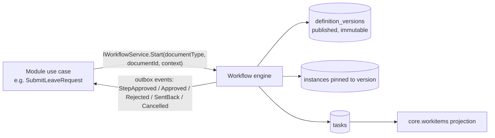
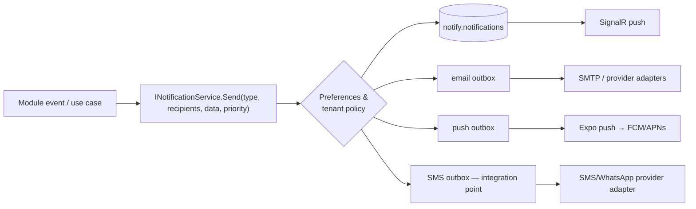

# 19. Workflow, Unified Work Inbox, Notifications and Email

## 19.1 Dynamic approval workflow (`core.workflow`)

One engine for every module; no module hard-codes its approval chain (ADR-027, amended).



| Concept | Design |
|---|---|
| Document types | registered by modules in manifest: code (`leave.request`, `expense.claim`, `exit.separation`, `payroll.run`, `fnf.settlement`, `letter.issue`, `loan.request`, `recruitment.requisition`, ...), **context schema** (fields available to conditions: amount, branch, department, designation, employee, manager, role, custom fields), callbacks via events, permission required to view the document |
| Definitions | versioned JSON: stages (sequential), each with one or more approver groups (parallel: all/any/N-of-M), conditions, SLA, escalation, reminders, allowed actions; draft → publish (maker-checker optional) → immutable version; running instances keep their version |
| Definition selection | rules by document type + conditions (e.g. *expense amount > 50,000 and branch = Pune* → definition B); most specific match wins, default fallback required |
| Conditions | expression over context fields: amount, branch, department, designation, employee, manager, role, grade, employment type, custom fields; evaluated by a **sandboxed expression evaluator** (same engine as payroll formulas, no code execution); conditions can also skip stages |
| Approver resolvers | reporting manager (level N via `reporting_closure`), department head, branch head, role-in-scope (e.g. "HR Admin of employee's branch"), specific user, user group, document field (e.g. project manager), custom resolver provided by module contract; fallback approver when none resolves; self-approval prevention (requester skipped/escalated) |
| Actions | **Approve, Reject, Send Back** (to requester or previous stage, with comment; resubmission continues same instance), **Delegate** (task-level reassignment with reason; and standing delegations with date range in `delegations`), **Escalate** (manual or SLA-driven to next resolver/escalation user), **Cancel** (by requester before final, or admin with reason), Comment, Withdraw |
| Authorization | acting user must be the current assignee (or active delegate) **and** still pass the document's view permission + scope; modules can demand extra permission (e.g. `payroll.run.approve`) |
| SLA & escalation | dispatcher job checks due tasks per tenant: reminders, auto-escalation, optional auto-approve/auto-reject policies (off by default, audited) |
| Audit | every action → `workflow.actions` (append-only: who, on-behalf-of, action, comment, from/to stage, timestamp, source) **and** `core.audit` entry on the document |
| Concurrency | optimistic concurrency on task; idempotency key on action endpoints (double-click / mobile retries) |

## 19.2 Unified work inbox (`core.workitems`)

```
My Work
 ├── Pending Approvals          (workflow tasks)
 ├── Tasks                      (mywork / projects / HR checklists)
 ├── Attendance Regularization  ├── Leave Requests ├── Expense Claims
 ├── Recruitment Actions        ├── PMS Actions    ├── Payroll Actions
 ├── FNF / Clearance Actions    └── Other Workflow Items
```

- **Projection table** `workitems.work_items`: `id`, `module_code`, `item_type`, `source_ref` (document id/task id), `assignee_user_id` (or group), `title` (non-sensitive, e.g. "Leave request — Priya S. — 3 days"; **never amounts/salary**), `due_at`, `priority`, `status`, `deep_link`, `created_at`, `completed_at`.
- Written by modules through `IWorkItemPublisher` (in-transaction with the source change) — workflow engine publishes approval tasks automatically.
- Query: `assignee = me (or delegated to me)` ∧ module entitled ∧ item type visible; counts per category pushed via SignalR.
- **Opening/acting on an item always calls the owning module's API**, which re-checks permission + scope — the inbox is a pointer, not an authority.
- Disabling a module hides its items (entitlement filter) without deleting them.

## 19.3 Notification system (`core.notify`)



| Feature | Design |
|---|---|
| Notification types | code-registered per module (`leave.request.approved`, `document.expiring`, ...), default channels, priority (`low`/`normal`/`high`/`critical`), whether user may opt out (critical/security ones cannot) |
| Templates | per type × channel × locale; tenant-customisable copies of system defaults; Scriban, versioned |
| Preferences | tenant policy (which channels allowed/forced per type) → user preferences where permitted (`notify.preferences.edit` own) → quiet hours / digest options |
| In-app | read/unread, archive, priority, deep link, history, retention (e.g. 180 days) |
| Recipient resolution | user ids or rules (role in scope, manager of X); content rendering checks recipient may see the referenced data — otherwise generic text + link |
| Delivery tracking | per channel message status (queued, sent, delivered, failed, bounced), attempts, provider ids, failure reason |

## 19.4 Email (central, part of `core.notify`)

| Requirement | Design |
|---|---|
| SMTP & provider/API | `IEmailTransport` adapters: SMTP (MailKit), Amazon SES, SendGrid/others; platform default sender plus **tenant email configuration** (own SMTP or provider, from-address/domain, reply-to); tenant SMTP passwords/API keys stored in secret manager (tenant DB holds only `secret_ref`); domain verification (SPF/DKIM/DMARC check) before custom sender is activated |
| Templates & variables | `notify.templates` (subject/body HTML + text, Scriban variables from registered variable providers, same permission-aware resolution as letters), preview with sample data, versioning |
| Attachments | from `core.files` only (permission checked at compose time), size limits, or secure expiring links for confidential docs instead of attachments (tenant policy) |
| Bulk email | recipient lists from filters (scope-enforced), batched via Worker `bulk` queue, per-tenant rate/quotas (`ops.tenant_quotas`), unsubscribe for non-transactional mail |
| Scheduled email | `scheduled_at`, cancellable until dispatched |
| Queue & retry | `notify.email_messages` outbox → Worker; exponential retry; dead-letter after N attempts |
| Delivery status & failure logs | provider webhooks (bounce, complaint, delivered) → status; `email_events` log; suppression list for hard bounces |
| History | per recipient/employee email history (permission `notify.email.history.view`, scoped) |
| Compose from HRMS | users with `notify.email.send` can send HRMS emails (template-based or free-text) to employees within their scope / approved external recipients; rate-limited; audited (`email.sent` with recipients, template, attachments ids — not body for confidential templates) |
