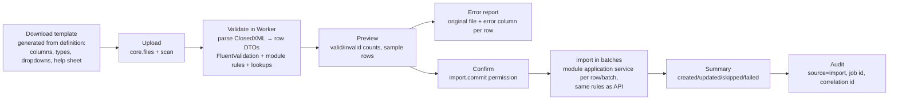

# 20. Dashboards, Reporting, Excel Import/Export

## 20.1 Dashboard framework (`core.dashboard`)

| Concept | Design |
|---|---|
| Realms | **Platform dashboards** (admin portal; platform metrics only, no tenant business data) and **tenant dashboards** |
| Levels | tenant default → role dashboards → user personal dashboards (users can add/remove/arrange allowed widgets if `dashboard.personalize`) |
| Widget registry | modules register widgets in manifest: `code`, type (`kpi`, `chart`, `table`, `list`, `pending_approvals`, `calendar`, custom), **required module + feature + permission**, data endpoint, parameters schema, refresh policy |
| Data | each widget calls a dedicated module query endpoint that applies the **same permission + data scope** as the module's normal APIs (`ApplyScope`) — widgets never have their own data path |
| Visibility rule | widget shown only if module entitled ∧ user has permission; data filtered by scope → *a widget never shows anything the user cannot see elsewhere* (asserted by tests that compare widget totals with scoped list endpoints) |
| Initial widgets | KPI (headcount, joiners/leavers, attendance %), charts, tables, pending approvals, attendance today, payroll status, leave balance/requests, recruitment pipeline, PMS cycle progress, tasks, notifications, assets assigned, visitors in building, workplace occupancy, custom report widgets |
| Performance | short-TTL cache per (tenant, user-scope hash, widget, params) in HybridCache; heavy KPIs pre-aggregated by jobs into module summary tables |

## 20.2 Reporting (`core.reporting`)

- **Report definitions are code-registered by modules** (`IReportDefinition`): parameters (date range, company, branch, department, employee, status...), required permission (`{module}.report.{code}.view`), scope-applied query, columns with classification, output formats.
- Formats: on-screen grid (paged), **Excel** (ClosedXML), **CSV** (formula-injection safe), **PDF** (document generator), **print** view.
- Execution: small reports synchronous with row limit; large reports async in Worker → file in `core.files` (expiring link) → notification.
- **Scheduled reports** (`reporting.schedules`): owner, report, parameters, cron, recipients (internal users only by default). At each run the report executes **as the owner with the owner's current permissions and scope**; if the owner lost access or exited, the schedule is suspended. Recipients receive a secure link requiring login (or attachment only for non-confidential reports by tenant policy).
- Sensitive reports (salary, bank, statutory) → step-up MFA + security event on export.
- Custom report builder (user-defined) is **out of scope for v1**; later as a governed builder over curated, scope-aware datasets (no raw SQL).

## 20.3 Excel import / export engine (`core.io`)

One engine, module-provided definitions (`IImportDefinition<TRow>`):

| Concern | Design |
|---|---|
| Definition | columns (name, type, required, lookup source, allowed values), key columns for upsert, mode (`create`/`update`/`upsert`), batch size, permission (`{module}.{entity}.import`) |
| Business rules | imports call the **same application services** as APIs (no direct DB writes), so validation, scope, audit, events and workflows are identical |
| Scope | importer can only create/update records within their data scope; rows outside scope fail with error |
| Staging | `io.import_jobs`, `io.import_rows` (row number, raw data, normalised data, errors, status) — supports preview and resume |
| Idempotency | job-level idempotency; re-running a committed job is blocked; partial failures reported, successful rows committed per batch (configurable all-or-nothing for small files) |
| Limits | file size, row count per plan; virus scan; formula/macro content rejected (`.xlsm` disallowed) |
| Examples | Employee, Branch, Department, Salary/structure assignment, Attendance, Leave opening balances, Loans, Assets, Payroll inputs, Holidays, Users |
| Export | `IExportDefinition`: same column registry, permission `{module}.{entity}.export`, scope applied, sensitive columns require extra permission, CSV injection protection, large exports async, security event for sensitive exports |
