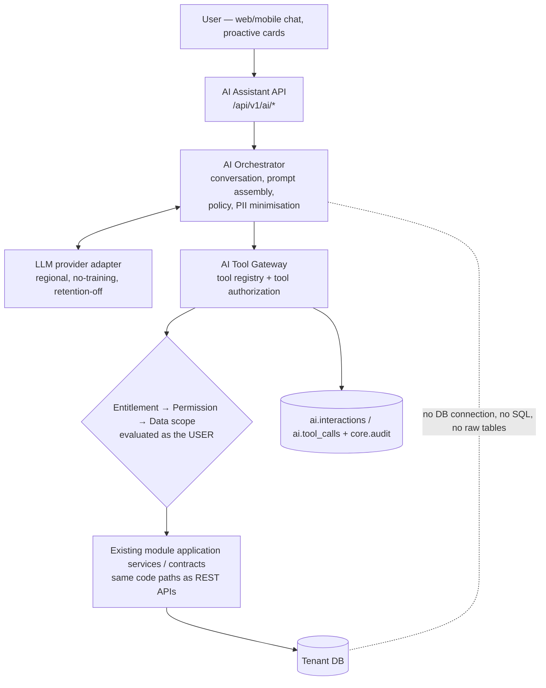

# 21. Personal AI Assistant (`ai.assistant`, premium optional add-on)

## 21.1 Commercial & enablement

- Requires the platform AI plan/add-on (`ai.ai_plans`, `ai.tenant_ai_subscriptions`) **and** tenant module entitlement `ai.assistant` **and** tenant admin opt-in (data-use policy acknowledgement) **and** user permission `ai.assistant.use`.
- Quotas: tokens/requests per tenant and per user per month (`ops.tenant_quotas`, usage metered to platform `ai.ai_usage`). Hard stop or degrade when exceeded.
- Disabling AI removes endpoints, jobs, UI; no other module depends on AI.

## 21.2 Architecture

Core rules:
1. **AI never gets database access** (no connection string, no SQL generation, no direct table reads). It can only call registered tools.
2. Every tool maps to an existing application service / Contracts method and executes **on behalf of the calling user** inside the user's `TenantContext` — so module entitlement, permission and data scope are enforced by the same code as the UI/API. If the user cannot view payroll, the payroll tools are not even offered to the model, and if called anyway they return `forbidden`.
3. Tools are declared in module manifests (`AiToolDefinition`: name, description, input schema, required module/feature/permission, **category** `read`/`suggest`/`execute`, sensitivity, confirmation requirement). Only tools of entitled modules for which the user holds the permission are exposed per request.
4. The orchestrator is a module in the monolith (extractable later); it uses an `ILlmClient` abstraction with provider adapters.

## 21.3 Action categories

| Category | Examples | Behaviour |
|---|---|---|
| **Read** | "You have 5 pending approvals", my checklist, meetings today, leave balance, team members with pending regularisation (within scope), HR policy Q&A | executes immediately; result summarised; audited (`ai.read`) with tool, parameters, record ids |
| **Suggested** | draft daily update, propose reminders, suggest approval comment, draft email | returned as a proposal card; nothing changes until user acts |
| **Executed** | create personal task/reminder, mark checklist item done, apply leave, approve/reject a request, send email | **non-sensitive** low-risk writes (own tasks/reminders) may execute directly per tenant setting; **sensitive writes require explicit confirmation**: tool returns a server-generated *confirmation token* bound to user, tool, exact parameters and expiry; UI shows a native (non-LLM-rendered) confirmation dialog; the write executes only when the user confirms through the normal API with that token. Payroll finalize, FNF, role/permission changes, bulk actions and data exports are **not available as AI tools** |

## 21.4 Proactive reminders

- Per tenant/user settings (`ai.user_settings`: enabled, channels, quiet hours, digest time).
- Dispatcher job per tenant enqueues per-user jobs; each job runs **as that user** (service principal acting on behalf of user, `actor_type=job`, `on_behalf_of=user`) and calls the same read tools (pending approvals, overdue tasks, meetings, team regularisations within scope) → deterministic summary (LLM optional for phrasing) → `core.notify` (in-app/push/email).
- If the user lost permission or exited, the job yields nothing.

## 21.5 Security controls

| Threat | Control |
|---|---|
| Data leakage across users/tenants | tool execution under user identity; per-request tool filtering; no cross-tenant caches; conversation stored in tenant DB (`ai.conversations`, `ai.messages`) with retention policy |
| Prompt injection (e.g. text inside a document/leave reason instructing the model) | tool outputs wrapped and treated as data; model cannot escalate privileges because tools enforce authorization; writes need human confirmation; allow-listed tools only; output never rendered as HTML |
| Excessive data to LLM | data minimisation: tools return only needed fields; sensitive classes (bank, salary, statutory ids, medical) masked or excluded unless the tool is explicitly a sensitive read the user is allowed and tenant policy permits sending to the LLM |
| Provider data use | contract: no training on customer data, zero/limited retention, regional hosting (India) — provider choice is a pending decision (e.g. Azure OpenAI / AWS Bedrock in-region / self-hosted model) |
| Abuse / cost | per-user rate limits and token quotas; anomaly alerts |
| Audit | `ai.interactions` (user, session, timestamps, model, token counts, prompt/response hashes, stored content per tenant policy) and `ai.tool_calls` (tool, category, parameters, result ids, authorization outcome, confirmation token id) + `core.audit` entries for executed actions with `source=ai` |

## 21.6 Data model

Platform DB: `ai.ai_plans`, `ai.ai_addons`, `ai.tenant_ai_subscriptions`, `ai.provider_configs` (model, region, secret refs), `ai.ai_usage`.
Tenant DB (`ai.*`): `tenant_ai_settings` (opt-in, data policy, allowed tool categories, store-transcripts flag), `user_settings`, `conversations`, `messages`, `tool_calls`, `pending_confirmations`, `reminder_runs`.
