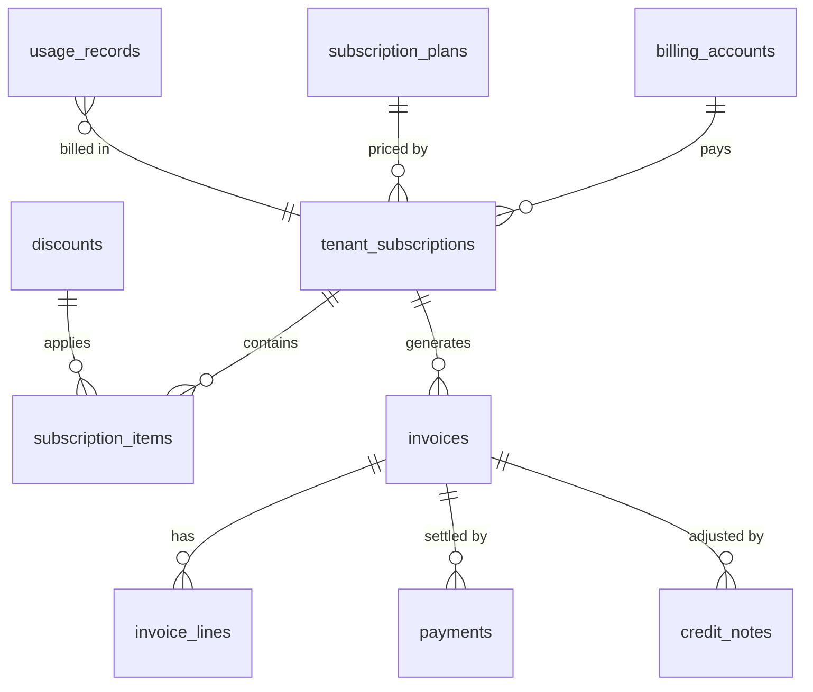

# 22. Billing Architecture — Two Separate Domains

| | **A. SaaS platform billing** | **B. Tenant client billing / invoice management** |
|---|---|---|
| Who bills whom | We (platform) bill tenants for HRMS subscriptions | A tenant (e.g. staffing/payroll outsourcing company) bills **its own clients** |
| Realm / DB | Platform realm, **Platform DB** `billing` schema | Tenant realm, **Tenant DB** `clientbilling` schema |
| Module | `Hrms.Platform.Billing` (platform module) | `clientbilling` optional tenant module (sold via entitlement) |
| Users | platform billing staff; tenant admins see their own invoices read-only via platform contract | tenant finance users |
| Shared code | none except generic building blocks (money, GST calculation library, PDF generator, number series pattern) | |

They never share tables, permissions or invoice numbering.

## 22A. SaaS platform billing (Platform DB)

| Concept | Design |
|---|---|
| Plans | versioned (`catalog.subscription_plans`), base price, included modules/features, per-employee pricing tiers, billing period (monthly/annual) |
| Subscription items | plan, add-on modules, AI add-on, extra storage, extra SMS/email packs; quantity (employee count) |
| Employee count & usage | daily active-employee count + usage metrics pushed from tenants via outbox (`ops.usage_records`); billing uses **max or average active employees** per period (policy decision) |
| Lifecycle | trial → active → renewal (auto) → past due → grace period → suspension (read-only first, then suspended) → cancellation → data retention → deletion; each transition audited and notified |
| Invoices | generated per period with proration on mid-cycle changes; immutable once issued; corrections via credit/debit notes |
| Tax | **GST**: CGST+SGST vs IGST by place of supply, GSTIN validation, SAC code for SaaS, reverse charge where applicable; e-invoicing (IRN/QR via IRP) integration point when turnover threshold applies; tax rates effective-dated |
| Discounts | percentage/fixed, coupon, contract-level, time-bound |
| Payments | payment gateway adapter (e.g. Razorpay/Stripe — decision pending), mandates/auto-debit, bank transfer reconciliation, webhooks verified by signature, idempotent |
| Security | `platform.billing.*` permissions, maker-checker for refunds/credit notes, audit |

## 22B. Client billing / invoice management (`clientbilling`, tenant module)

Optional providers: Payroll (`IPayrollCalculator` results — gross/CTC/net per employee per period), Attendance (paid days/man-days), Projects (`ITimesheetProvider` billable hours). Hard: core only (client master = `core.org` business partners).

| Table (`clientbilling.*`) | Content |
|---|---|
| `client_profiles` | → `org.business_partners` (client), billing address(es), GSTIN, place of supply, payment terms, currency, invoice contacts |
| `client_contracts` | client, period, billing basis, rate card, PO numbers |
| `deployments` | employee ↔ client (↔ contract/site), effective-dated — which employees are billable to which client |
| `rate_cards` / `rate_card_lines` | billing components: per head, per man-day, per hour, % of gross, % of CTC, fixed fee, reimbursable pass-through; **service charge** (percentage or fixed); effective-dated |
| `billing_runs` | client, period, inputs snapshot (payroll run ids/versions, attendance/timesheet snapshot), status (`draft`→`calculated`→`review`→`approval`→`finalized`) |
| `invoices` / `invoice_lines` | number (tenant-configurable series per company/FY), lines with basis & source refs, taxable value, GST split, totals, status (`draft`/`pending_approval`/`issued`/`partially_paid`/`paid`/`cancelled`), PDF file id |
| `credit_notes` / `debit_notes` | linked to invoice, reason, GST adjustment |
| `payments` | received amounts, date, mode, reference, TDS deducted by client, allocation to invoices |

Flow: billing run gathers inputs (snapshot) → calculation per rate card → review → invoice approval via `core.workflow` → finalize (immutable) → PDF (document generator, company letterhead) → email via `core.notify` → payment tracking → credit/debit notes for corrections. GST logic reuses the shared GST calculation building block (not the platform billing module). E-invoice integration point. Audit on every invoice event (`invoice.generated`, `invoice.approved`, `invoice.cancelled`).
