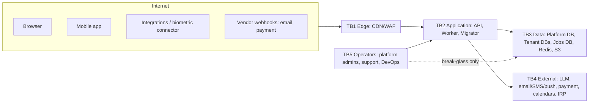

# 23. Security Review and Threat Model

Extends [09-security.md](09-security.md) (controls by layer remain valid). Method: STRIDE per trust boundary, then the explicit checklist from the review brief.

## 23.1 Trust boundaries

## 23.2 STRIDE summary

| Boundary | S (spoofing) | T (tampering) | R (repudiation) | I (info disclosure) | D (DoS) | E (elevation) |
|---|---|---|---|---|---|---|
| TB1→TB2 | stolen cookies/tokens → `__Host-` cookies, short JWTs, refresh rotation + reuse detection, MFA | request tampering → server-side validation, ETags | missing logs → correlation IDs + security events | verbose errors → ProblemDetails only | floods → WAF, rate limits, quotas | tenant switching → host+`tid` match |
| TB2→TB3 | wrong DB → per-tenant roles + `meta.tenant_identity` | audit rewrite → INSERT-only, triggers, hash chain, WORM | — | over-fetching → DTOs, scope filters, field encryption | slow queries → timeouts, pool limits, PgBouncer | SQL injection → EF parameterisation |
| TB2→TB4 | webhook spoofing → signature verification | — | — | PII to LLM/providers → minimisation, DPAs, regional providers | provider outage → retries/outbox | SSRF → allow-listed HttpClients |
| TB5 | admin impersonation → MFA, SSO, IP allow-list | config tampering → audited, maker-checker | denial → dual audit | staff browsing data → no implicit access, support grants | — | privilege creep → access reviews |

## 23.3 Checklist (brief §39)

| Topic | Threat | Controls (doc reference) | Residual risk / follow-up |
|---|---|---|---|
| **Authentication** | credential stuffing, phishing, session fixation | Identity + OpenIddict, passkeys/TOTP, breached-password check, lockout + IP/user rate limits, generic errors, new session id on login (§9) | self-hosted IdP burden (ADR-007) → external pen test |
| **Authorization** | missing checks on new endpoints | fail-closed endpoint metadata, arch tests, generated authz matrix (§10, §18) | business-logic flaws → per-module threat review |
| **Tenant isolation** | tenant ID tampering, cache/storage key collisions | host+token resolution, prefixed keys built by helpers, isolation suite T1 (§8) | — |
| **Database isolation** | misrouted connection, shared credentials | DB per tenant, per-tenant roles, identity check on connect, migrator vs app roles (ADR-003/006) | DBA/cloud-admin access → break-glass + audit logs of cloud console |
| **Encryption** | disk theft, backup leak, DB dump | TLS everywhere (`verify-full`), KMS at rest, SSE-KMS, field-level envelope encryption with per-tenant DEKs (ADR-026) | key-management mistakes → runbooks, rotation tests |
| **Secrets** | secrets in git/config/logs/job args | secret manager + workload identity, gitleaks, redaction, IDs-only job args, tenant SMTP/device creds as secret refs | — |
| **MFA** | MFA bypass, SIM swap | TOTP/passkeys (no SMS OTP for admins), recovery codes hashed, step-up for sensitive actions, MFA reset = security event + notification | — |
| **Session management** | long-lived sessions, stolen devices | idle/absolute timeouts, `sid` revocation list, device list & remote revoke, revoke on exit/password change | — |
| **Token security** | token theft/replay | no tokens in browser, 10-min access tokens, audience/issuer per realm, key rotation, refresh reuse detection, `act` claim for support | — |
| **Rate limiting** | brute force, scraping, cost abuse | per IP/user/tenant limits, login/OTP stricter, export & AI quotas, WAF bot control | — |
| **File upload security** | malware, polyglots, stored XSS, path traversal | presigned uploads to quarantine, magic-byte sniffing, allow-lists, AV scan, server-generated keys, `Content-Disposition: attachment`, separate download domain (§16) | zero-day malware → defence in depth only |
| **API security** | OWASP API Top 10 | authz on every object, pagination caps, schema validation, idempotency keys, versioning, oasdiff, no internal ids in errors | — |
| **SQL injection** | raw SQL | EF LINQ; raw SQL only via `FromSql` interpolation (parameterised); analyzer bans string-concatenated SQL; dynamic sort/filter via allow-listed column maps | — |
| **XSS** | stored XSS in names/comments/templates | React escaping, strict nonce CSP, sanitized rich text (DOMPurify) allow-list, Scriban HTML-encoding by default, letters/emails rendered server-side from sanitised templates | — |
| **CSRF** | cross-site actions with cookies | SameSite + antiforgery header for cookie auth; bearer for mobile | — |
| **CORS** | credentialed cross-origin reads | same-origin BFF; explicit allow-list only; never `*` with credentials | — |
| **SSRF** | webhooks, calendar/email/AI URLs, PDF rendering fetching remote resources | named HttpClients with allow-lists, block private IP ranges & metadata endpoints, PDF renderer with network disabled (assets embedded) | — |
| **Broken access control** | horizontal/vertical escalation | permission + scope + ceiling rule (§10.5), no self-role edit, deny-wins | — |
| **IDOR** | guessing ids | UUIDv7 + mandatory scope check; 404 outside scope; file access only via owner-module policy | — |
| **Mass assignment** | client sets `employeeStatus`, `salary`, `tenantId`, `createdBy` | **separate request DTOs per use case** (never bind to entities), explicit mapping, audit columns set server-side only, unknown JSON properties rejected (`JsonUnmappedMemberHandling.Disallow`) on write endpoints, arch test: controllers may not accept entity types | — |
| **Sensitive data exposure** | over-broad DTOs, logs, exports, notifications | DTO per view with field permissions (e.g. bank masked unless `employee.bank.view`), data classification + redaction, notification text without sensitive values, export permissions + security events | — |
| **Audit tampering** | DB admin or app bug altering audit | INSERT-only grants, trigger, hash chain + verifier, daily WORM export (§12) | super-user at cloud level → WORM copy is the control |
| **Logging** | PII/secret leakage, log injection | structured logging (no string concatenation), redaction, no request bodies on sensitive endpoints, log retention & access control | — |
| **Backup security** | stolen backups, restore into wrong tenant | encrypted backups (KMS), separate backup account/vault with Object Lock, restore runbook verifying `meta.tenant_identity`, access audited (§24) | — |
| **Support access** | insider browsing | grant model, tenant approval, time-box, dual audit, banner, revocation (§13.3) | — |
| **AI security** | prompt injection, data leakage, over-privileged agent | tool gateway under user identity, no DB access, confirmation tokens for writes, data minimisation, provider contract (§21.5) | model behaviour → red-team tests before GA |
| **Integration security** | biometric/vendor compromise | outbound-only connector, client credentials per connector, IP allow-list, payload validation, no DB access (§17.2) | — |
| **Supply chain** | malicious packages | lockfiles, CPM, SBOM, scanning, signed images (§17.2 of 09) | — |

## 23.4 Security acceptance gates (per release)

1. Authz matrix + isolation suites green. 2. No new `AllowAnonymous` without security review. 3. SAST/secret/dependency/container scans clean (or risk-accepted). 4. ZAP baseline on UAT. 5. Threat-model delta reviewed for new modules/integrations. 6. External pen test before GA and annually.
