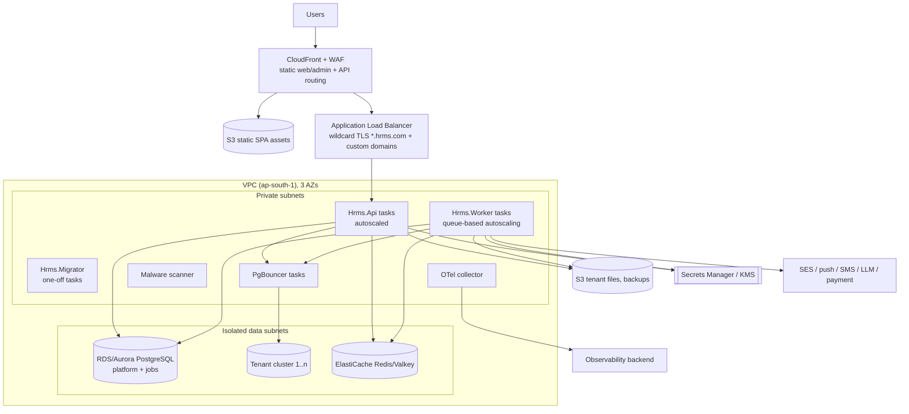

# 24. Compliance Controls, Backup/DR and Deployment Architecture

## 24.1 Compliance-supporting controls

The software does **not** make an organisation ISO 27001 / SOC 2 / DPDP compliant by itself. It provides technical controls and evidence that support the customer's and our own compliance programmes.

| Control area | Technical capability | Evidence produced |
|---|---|---|
| Audit trails | data-change + security audit, tamper-evident (§12) | audit exports, verifier reports |
| Data retention | `config.retention_policies` per data category (employees after exit, payroll, documents, candidates, visitors, AI transcripts, notifications, logs) with min/max; daily retention job: archive → anonymise/delete | retention job runs & counts (audited) |
| Backup | platform & tenant backups, per-tenant logical dumps, object storage versioning (§24.2) | backup status in registry, reports |
| Disaster recovery | multi-AZ, cross-region copies, DR runbook, drills | drill reports |
| Access reviews | quarterly review campaigns: list of users × roles × overrides per tenant (tenant-run) and platform users (platform-run); reviewers confirm/revoke; expiring overrides | review records (audited) |
| Permission reviews | role permission diff reports, "who can do X" queries, dormant account report, sensitive-permission holders report | reports |
| Security event logging | security events → SIEM, alerting (§11/§22) | SIEM records |
| Data export | per-employee data access export (data-principal request), full tenant export (offboarding/portability) as async encrypted package | export jobs (audited) |
| Data deletion where legally permitted | erasure requests workflow: checks legal holds & statutory retention → anonymise personal fields while keeping statutory/financial records → audit | erasure records |
| Legal hold | `config.legal_holds` (scope: tenant / employee / record type / date range, reason, owner); blocks retention deletion and file deletion; release audited | hold register |
| Encryption | in transit, at rest, field-level (§17, ADR-026); key rotation | KMS logs |
| Incident logging | `ops.incidents` (platform) — detection source, severity, affected tenants, timeline, notifications sent (DPDP breach notification), RCA; tenant-visible incident notices | incident register |
| Change management | PR reviews + CODEOWNERS, CI evidence, signed images, deployment records with approvers, migration logs per tenant, feature-flag change audit | CI/CD logs |

## 24.2 Backup architecture

| Asset | Mechanism | Retention (proposal) |
|---|---|---|
| Platform DB | managed automated backups + **PITR** (5-min RPO), daily snapshot copied cross-region | 35 days PITR; monthly snapshots 1 year |
| Jobs DB | automated backups + PITR (lower importance; jobs are re-creatable) | 7 days |
| Tenant DB clusters | automated backups + PITR, cross-region snapshot copies | 35 days PITR |
| **Per-tenant logical backups** | nightly `pg_dump -Fc` per tenant DB → encrypted S3 backup bucket (separate AWS account, Object Lock) → `tenant_database_registry.last_backup_*` | daily 35 days, monthly 12 months (configurable per plan) |
| Object storage | **S3 versioning** + Object Lock where required, lifecycle to infrequent/Glacier, **cross-region replication** of tenant buckets | per retention policy; deleted-object versions kept 30 days |
| Audit WORM exports | S3 Object Lock compliance mode | ≥ audit retention (e.g. 8 years) |
| Secrets/keys | secret manager replication; KMS multi-region keys for DR | — |
| Config/IaC | Git (Terraform state in versioned, locked backend) | — |

**Tenant-level restore** (no other tenant affected):
1. Restore the tenant's logical dump (or extract the tenant DB from a PITR clone of its cluster for point-in-time) into a new DB `hrms_tenant_<n>_restore_<ts>`.
2. Verify `meta.tenant_identity`, run migrations to current schema version.
3. Either swap (registry points to restored DB, old DB kept for 7 days) or selectively recover records (support-assisted, audited).
4. Restore matching object versions by `tenants/{tenantId}/` prefix if needed.

Restore testing: automated weekly restore of a sample tenant into an isolated environment + integrity checks; quarterly full cluster PITR drill; results recorded (`last_restore_test_at`).

## 24.3 Disaster recovery

| Scenario | Strategy | RPO | RTO |
|---|---|---|---|
| Single instance/AZ failure | Multi-AZ PostgreSQL & Redis, multi-AZ containers | 0 | minutes (automatic) |
| Single tenant data corruption | tenant-level PITR/logical restore | ≤ 5 min (PITR) / 24 h (logical) | ≤ 1 h |
| Cluster loss | restore cluster from PITR / promote cross-region replica (enterprise tier) | ≤ 5 min | ≤ 4 h |
| Region loss | warm standby in secondary region (ap-south-2): cross-region snapshots/replicas, replicated S3 & secrets, IaC to stand up compute | ≤ 15 min (replica) / ≤ 24 h (snapshot tier) | ≤ 8 h |

Targets are proposals per plan tier and require approval (cost impact).

## 24.4 Deployment architecture (proposed, AWS)

- Container orchestration: **ECS Fargate (proposed)** or EKS — pending decision OQ6.
- Separate AWS accounts: `shared-services`, `dev`, `uat`, `prod`, `backup` (cross-account backup vault), `security` (log archive, SIEM).
- Network: no public DB endpoints; VPC endpoints for S3/Secrets Manager/KMS; egress via NAT with allow-listed destinations.
- Admin portal origin `admin.hrms.com` restricted by WAF IP allow-list + SSO/MFA.
- Mobile: EAS Build/Submit; API via `api.hrms.com`.
