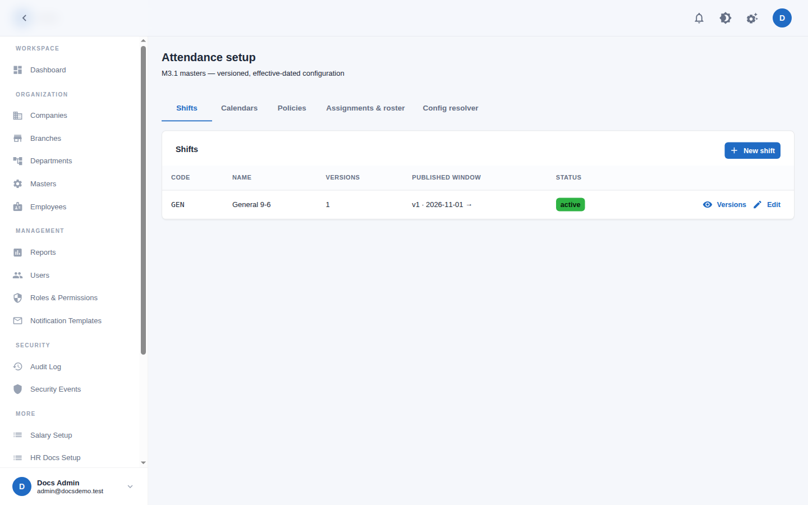
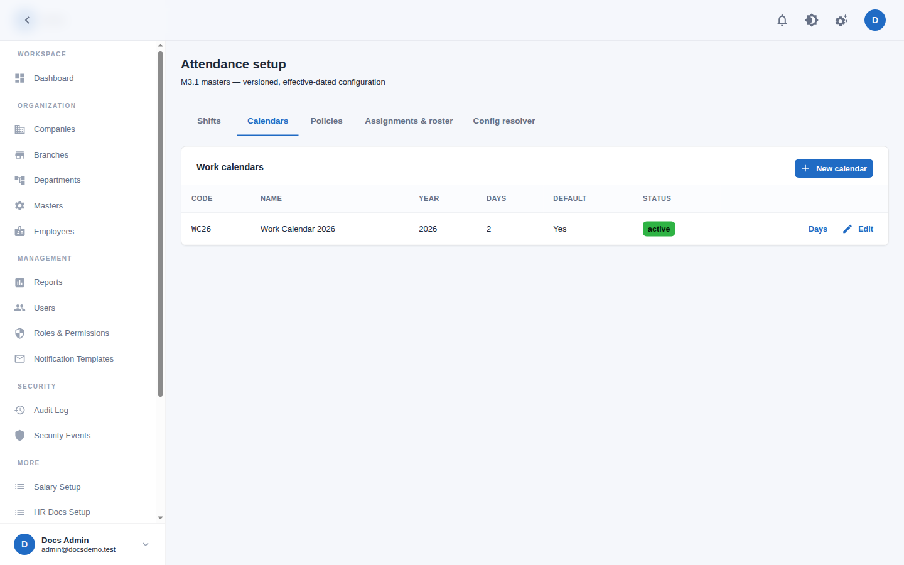
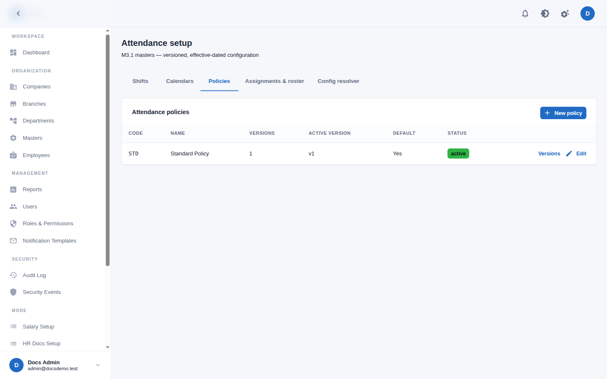
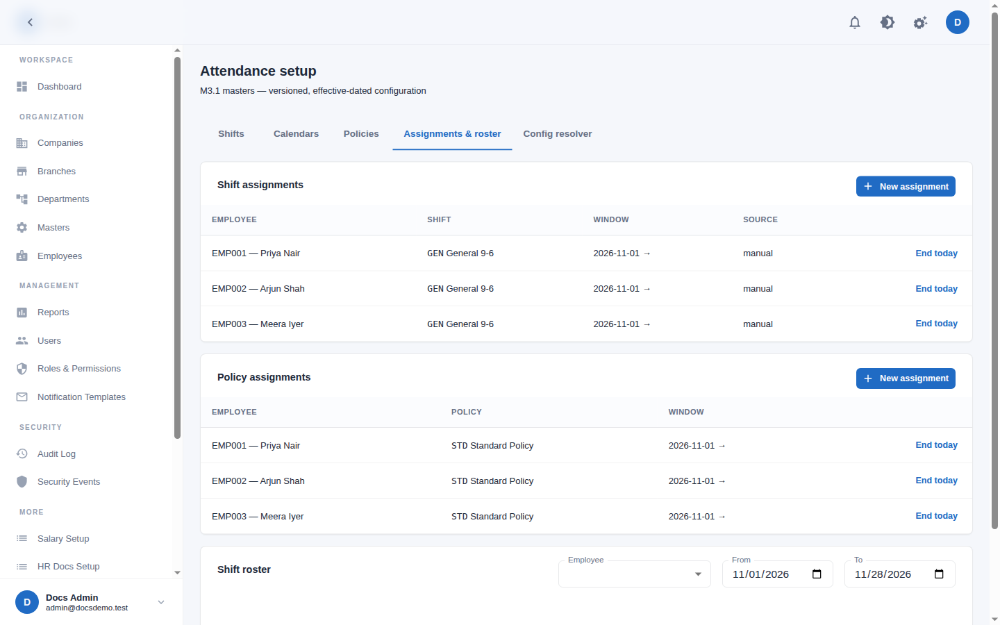
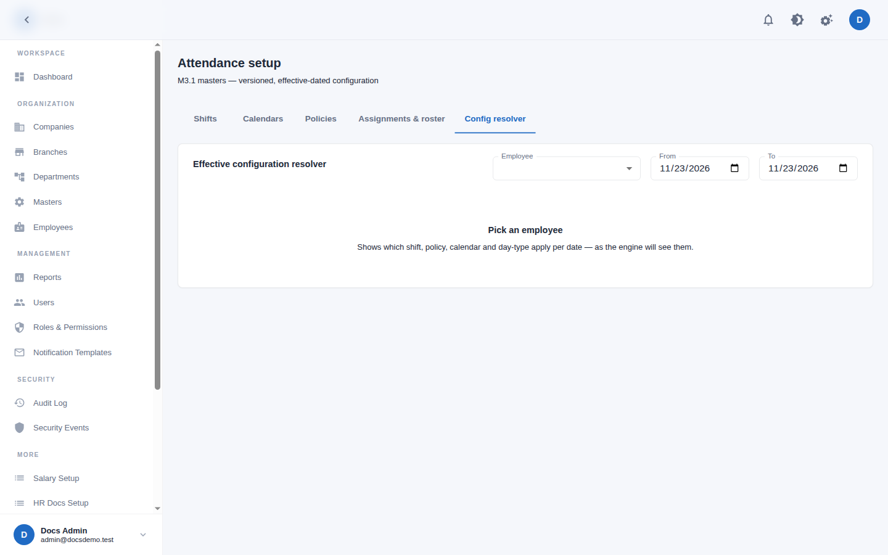

# Attendance — Masters & Configuration (M3.1)

Version: 1.0 · Last updated: 2026-11-23 · Applies to: milestone M3.1 (merged, `5517b3d`)

> Screenshots are real captures from the running application on demo tenant
> `docsdemo` (seeded dummy data only). All procedures verified against the
> running build and API tests.

## 1. Introduction

Attendance masters define **how each employee's day is supposed to look** —
the shift they work, the calendar that marks holidays and weekly offs, and the
policy that decides how punches will be judged in M3.3 (grace, late marks,
half-day/absent thresholds, overtime, regularization windows).

Every master is **versioned and effective-dated**: editing a live shift or
policy creates a new draft version that must be *published* with an
`effective from` date; historical versions keep governing the dates they
covered. Assignments bind employees to a shift/policy for a window of time.
The **config resolver** shows exactly which shift + policy + calendar a given
employee's date resolves to — the same view the M3.3 engine will use.

## 2. Prerequisites

| Requirement | Where |
|---|---|
| `attendance` module entitlement enabled | Platform admin → tenant |
| Employees exist with branch/department | Employee management (M2) |
| `attendance.masters.view` / `attendance.masters.manage` / `attendance.assignments.manage` permissions | Tenant roles |

## 3. Required permissions

| Permission code | Grants | Typical role |
|---|---|---|
| `attendance.masters.view` | Read masters, resolver | HR Admin, managers |
| `attendance.masters.manage` | Create/edit/publish/retire shift, calendar, policy versions | HR Admin |
| `attendance.assignments.manage` | Assign shifts/policies to employees, maintain rosters | HR Admin |

## 4. Initial setup order

1. **Shift** — create the shift, add a version (times, break, grace, OT flag),
   publish with an effective-from date.
2. **Calendar** — create the work calendar, mark holidays / special days.
3. **Policy** — create the policy, add a rule version, publish.
4. **Assignments** — assign each employee a shift and a policy for a window.
5. **Verify** — use the Config resolver tab to check what a given employee
   resolves to on a given date.

All screens live under **Attendance → Setup** (`/attendance/admin`), five tabs.

## 5. Screens

### 5.1 Shifts tab

*Captured: `docsdemo` — shift `GEN` (General 9-6) with one published version
`v1` effective `2026-11-01 →`. `Versions` opens the version drawer (draft,
publish, retire); `Edit` changes master fields.*

| Field | Meaning |
|---|---|
| Code / Name | Stable identifier + display name. |
| Version fields | Shift type (fixed/rotational/flex), start/end, crosses-midnight, break minutes + paid flag, core window, grace in/out, punch windows, weekly-off config, OT allowed. |
| Status | `draft` until published; `published` governs from its effective-from until the next version's window or retirement. |

### 5.2 Calendars tab

*Captured: `docsdemo` — `WC26` (Work Calendar 2026), default, 2 day entries
(Founders Day 2026-11-26, Christmas 2026-12-25). `Days` opens the day editor.*

| Field | Meaning |
|---|---|
| Year + day entries | Per-date `dayType`: working / holiday / weekly_off / half-day (+ name, minutes). |
| Default | One default calendar applies to employees without a closer-scoped assignment. Enforced unique. |

### 5.3 Policies tab

*Captured: `docsdemo` — `STD` (Standard Policy), default, `v1` active.*

Rule groups inside a policy version:

| Group | Fields |
|---|---|
| late / early | grace minutes, mark-after minutes, count-from basis |
| thresholds | half-day-below, absent-below minutes; worked vs paid basis |
| punch | mode (first+last / all), duplicate window, min session |
| missingPunch | day status when no punch, lock treatment, reminder delay |
| overtime | enabled, eligible types/grades, caps, rounding, approval flag |
| regularization | window days, quota, HR-approval rule, escalation |
| selfPunch | allowed, geofence required, selfie required |

### 5.4 Assignments & roster tab

*Captured: `docsdemo` — all three employees assigned `GEN` shift and `STD`
policy from `2026-11-01`; `End today` closes an assignment; roster editor
below.*

| Control | Meaning |
|---|---|
| Shift / policy assignment | Employee + master + `effective from`/`to` window. Overlaps rejected. |
| End today | Closes the assignment at today (history preserved). |
| Shift roster | Per-day shift override for an employee — wins over the standing assignment. |

### 5.5 Config resolver tab

*Captured: `docsdemo` — pick an employee and date range to preview the
resolved shift, policy, calendar, day type and planned times per day, with the
source of each resolution (assignment / default / roster).*

Use this to verify configuration before M3.3 consumes it — if the resolver
shows a gap, that date will have no shift for the employee.

## 6. Worked example

Create `GEN` → version `09:00–18:00`, 60m unpaid break, grace 10m → publish
from `2026-11-01` → assign to `EMP001` → resolver for EMP001 on `2026-11-23`
returns shift `GEN v1`, policy `STD v1`, calendar `WC26`, day type `working`,
planned 09:00–18:00.

## 7. Validation rules

| Rule | Result |
|---|---|
| Second default calendar / policy | `409` conflict |
| Overlapping assignment window for one employee | rejected |
| Publishing a version backdated past a sibling version | rejected |
| Editing a published version's fields | blocked — create a new version |
| Rotation cycle < 2 days or all-days-off | rejected |
| `days` values outside 0–6 | rejected |

## 8. Troubleshooting

| Symptom | Cause | Fix |
|---|---|---|
| Employee resolves no shift | assignment window misses the date | extend/create assignment or roster entry |
| `409` on save | duplicate default or overlap | retire/adjust the conflicting row |
| Edit button won't take | version already published | draft a new version instead |
| Holiday not applying | day not added to the *default* calendar | add the day to WC26 or assign the right calendar |

## 9. FAQ

1. **Why versions?** So a rule change never rewrites history — payroll and
   attendance calc must reproduce what was in force on the day.
2. **What wins: assignment or default?** Employee assignment > roster entry >
   default calendar/policy.
3. **Do masters compute attendance?** No — M3.1 only defines configuration.
   M3.2 stores raw punches; M3.3 computes days against these masters.
