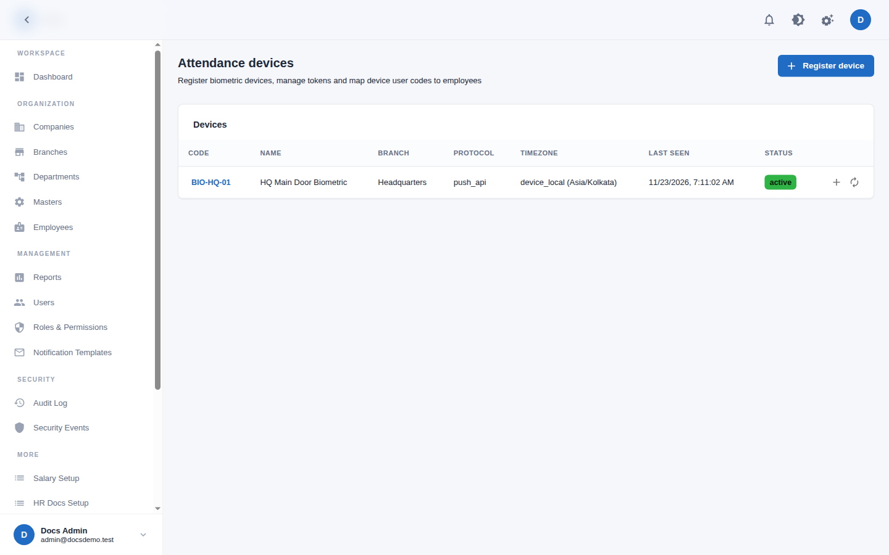
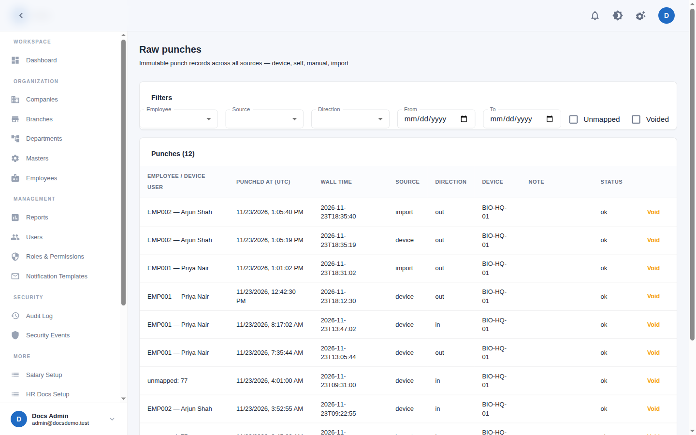
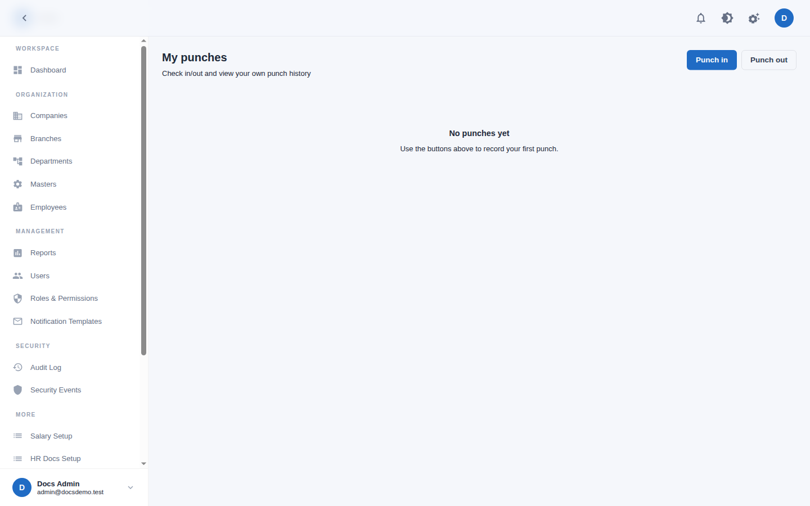
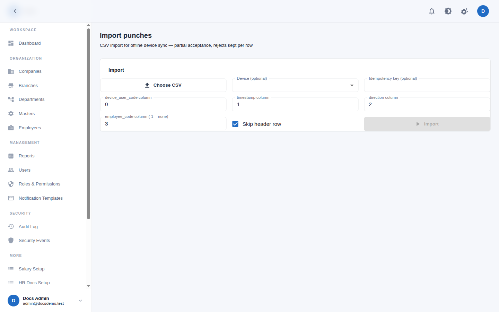
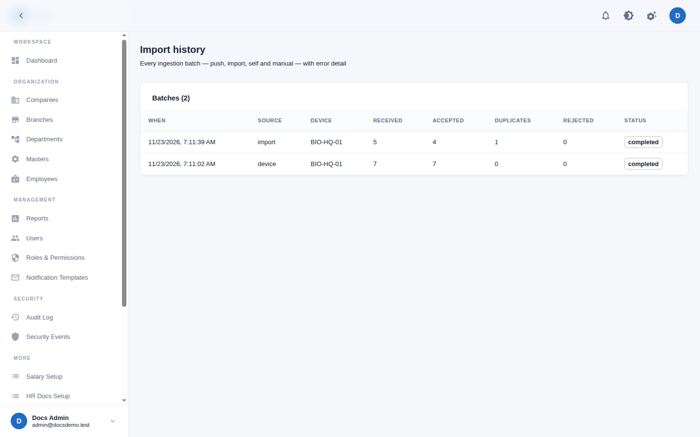

# Attendance — Punch Ingestion & Raw Punch Records (M3.2)

Version: 1.1 · Last updated: 2026-11-23 · Applies to: milestone M3.2 (PR #4, pending merge)

> Screenshots are real captures from the running application on demo tenant
> `docsdemo` (seeded dummy data only). All procedures below were verified
> against the running build and API tests.

## 1. Introduction

This module collects the **raw punch evidence** that attendance calculation
(M3.3) will later interpret. It registers biometric devices, accepts punches
from four sources (device push, CSV import, manual entry by HR, employee
self-punch), deduplicates and stores them **immutably** — a punch once written
can never be edited or deleted, only *voided* with a reason.

What it does **not** do (by design): compute late marks, overtime, absent or
payable days, attribute punches to shifts, or run approvals. Those arrive in
M3.3+ and will read this raw store.

## 2. Prerequisites

| Requirement | Where |
|---|---|
| `attendance` module entitlement enabled on the tenant | Platform admin → tenant subscription |
| Company, branch, department and employees exist | Employee management (M2) |
| Shifts/policies/calendars configured (needed by M3.3, not by ingestion) | Attendance Setup (M3.1) |
| For CSV import: file upload works (file storage configured) | Tenant file service |

## 3. Required permissions

| Permission code | Grants | Typical role |
|---|---|---|
| `attendance.devices.manage` | Register devices, rotate tokens, manage device→employee mappings | HR Admin / IT admin |
| `attendance.punches.import` | Upload and commit CSV punch imports | HR Admin |
| `attendance.punches.manual` | Record manual punches and void punches | HR Admin |
| `attendance.view` | View raw punches and import history (tenant-wide) | HR Admin |
| `attendance.my.view` | View own punches | Every employee (ESS) |
| `attendance.my.punch` | Submit own punch (self-punch) | Every employee (ESS) |

Employees with a **data scope** (e.g. a branch manager) see only punches of
employees inside their scope — except unmapped punches, which require
tenant-wide scope to view or void.

## 4. Initial setup — one time per device

1. Go to **Attendance → Devices** (`/attendance/devices`).
2. Click **Add device**. Enter: device code (unique per tenant), display name,
   timezone mode (`Device timezone` + IANA zone e.g. `Asia/Kolkata`, or `UTC`),
   and optional location/branch.
3. On save, the device **auth token is shown once**. Copy it immediately — it
   is stored only as a SHA-256 hash and cannot be recovered. Use **Rotate
   token** later to issue a new one (old token stops working instantly).
4. Open the device → **User map** tab. Map each badge/ID the device reports
   (`device user code`) to an employee, with `effective from`/`effective to`
   dates. Punches from unmapped codes are still stored (employee left blank)
   and back-filled automatically once a mapping exists.

## 5. Screens

### 5.1 Devices (`/attendance/devices`)

*Captured: `docsdemo` — device `BIO-HQ-01` registered, `push_api` protocol,
device-local timezone `Asia/Kolkata`, `active` status, last-seen updated by
pushes. `+ Register device` (top right) starts registration; the two row icons
open the user map and rotate the token.*

| Field / control | Meaning |
|---|---|
| Code | Stable device identifier used in the push URL (`POST …/devices/{code}/punches`). Not editable after creation. |
| Name | Display name. |
| Timezone mode + timezone | How the device reports timestamps. `Device timezone` = values are wall-clock in the named IANA zone; `UTC` = values are already UTC. |
| Active | Inactive devices' tokens are rejected. |
| Last seen | Updated on every authenticated push. |
| Rotate token | Issues a new token, shown once. |

Steps to register: see §4. **Expected result:** device appears in the list with
a generated token shown once in a green banner.

### 5.2 Raw Punches (`/attendance/punches`)

Tenant-wide punch ledger. Filters: employee, source (`device`, `import`,
`manual`, `self`), device, mapped/unmapped, voided/active, date range.

*Captured: `docsdemo` — 12 stored punches. Note `EMP001 — Priya Nair` rows from
both `device` and `import` sources, the `manual` row for `EMP003 — Meera Iyer`,
and the `unmapped: 77` row (badge code with no employee map). `Void` acts per
row.*

| Column | Meaning |
|---|---|
| Punched at (UTC) | Normalized instant — device wall time converted through the device timezone. |
| Local wall time | The timestamp exactly as the device/file reported it (no timezone applied). Preserved as evidence. |
| Employee | Resolved via device map / employee code; blank when unmapped. |
| Source + Device | How and from where the punch arrived. |
| Status | `stored` or `voided` (with reason). |
| Received at | Server receipt time. |

Actions: **Manual punch** (top-right) and **Void** (per row, `attendance.punches.manual`).

### 5.3 My Punches (`/attendance/my`)

Employee self-service: own punch list + **Punch in/out** button
(`attendance.my.punch`) recording a self punch with the current time.

*Captured: `docsdemo` admin account, which is not linked to an employee record —
the page correctly shows the empty state with `Punch in` / `Punch out` buttons.
An account without an employee link gets `422 punch.no_employee` on submit.*

### 5.4 Import Punches (`/attendance/import`)

*Captured: `docsdemo` — ① `Choose CSV` uploads the file, ② `Device (optional)`
assigns rows to a device so they deduplicate against its pushes, ③ the column
pickers map CSV columns to badge / timestamp / direction / employee code, ④
`Skip header row`, ⑤ `Idempotency key (optional)`, ⑥ `Import` commits the batch.*

CSV import, two steps:

1. **Upload** — pick the `.csv` file (stored via file service).
2. **Map columns** — choose which CSV column holds badge code *or* employee
   code, and the timestamp column; set **Skip header** and optionally assign a
   device so rows deduplicate against that device's pushes.

**Expected result:** a batch row appears in Import History with counts for
accepted / duplicate / rejected rows.

### 5.5 Import History (`/attendance/imports`)

*Captured: `docsdemo` — batch 1 (`device`, 7 received / 7 accepted) is the live
device push; batch 2 (`import`, 5 received / 4 accepted / 1 duplicate) is the
CSV import where one row deduplicated against a push from earlier (cross-channel
dedup at work).*

Every batch: source, file, counts (received / accepted / duplicates /
rejected), status (`processing`, `completed`, `failed`) and per-row error
summary. Re-uploading the **identical file with identical settings** replays
the saved result (idempotent — no double import); changing the file, mapping,
header setting or device creates a new batch.

## 6. Worked examples

**Device push (integration):**
`POST /api/v1/attendance/devices/{code}/punches` with header
`Authorization: Device <token>` and body `{"punches":[{"deviceUserCode":"42","timestamp":"2026-11-23 09:02:11","direction":"in"}],"idempotencyKey":"shiftA-2026-11-23"}`.
Result: punches stored; `employeeId` resolved from the device map effective on
the punch's wall-clock date; replaying the same `idempotencyKey` + identical
payload returns the same batch, a different payload under the same key returns
`409`.

**Unmapped badge → backfill:** badge `77` punches while unmapped → stored with
no employee. Admin adds map `77 → Priya` → the `attendance.device.map` job
(also runable manually) assigns the stored punches to Priya by wall-clock
date.

**Duplicate safety:** the same physical punch arriving via device push and
later inside a CSV import is deduplicated on its `dedup_key` (source +
device + subject + wall time); the import row counts as `duplicate`, not
`accepted`.

## 7. Validation rules

| Rule | Result |
|---|---|
| Push body > 1 MB | `400 ingest.too_large` — split the batch |
| Missing/unparseable timestamp | Row rejected with error `punch.timestamp` |
| Device token unknown/inactive | `401 device.auth` |
| Same `idempotencyKey`, different payload | `409` conflict |
| Batch > configured row cap | rejected |
| Import file: wrong purpose / deleted / unavailable | rejected before parsing |
| Duplicate `dedup_key` (same or earlier batch) | counted as duplicate, not stored twice |
| Attendance module entitlement off | endpoint returns entitlement error |

## 8. Common errors & troubleshooting

| Symptom | Cause | Fix |
|---|---|---|
| `401 device.auth` | wrong token, or token rotated | rotate token, update device config |
| `csrf.invalid` on device push | a session cookie was sent along | device calls must not send cookies |
| Punches stay unmapped | badge code ≠ `device user code` in map, or effectivity range misses the punch date | correct the map; backfill job re-resolves by wall-clock date |
| Import shows all duplicates | identical re-import (by design) or same punches already pushed by the device | expected — check batch counts |
| Rows rejected in import | column mapping mismatch / bad timestamps | fix mapping → new batch (not a replay) |
| `409` on push retry | same idempotency key reused for a *different* payload | generate a new key per logical batch |

## 9. Reports & exports

Raw punch list is filterable on-screen (employee, source, device, date range,
status). Dedicated report exports arrive with the reporting milestone —
**Status: PENDING**.

## 10. FAQ

1. **Can a punch be edited or deleted?** No — raw records are append-only
   (enforced by a DB trigger). Mistakes are corrected by *voiding* the punch
   with a reason; the original row remains.
2. **Which timestamp is authoritative?** `punched_at` (UTC, normalized).
   `local_wall_time` is kept verbatim so any mapping/calculation can re-derive
   the device's intended local date.
3. **What timezone should the device use?** Prefer `Device timezone` + the
   site's IANA zone when the device sends naive local time; `UTC` when it sends
   offsets/UTC. DST-ambiguous and nonexistent local times are normalized
   deterministically.
4. **Is `.xlsx` supported?** Not in M3.2 — CSV only (decision D4). XLSX parsing
   is deferred to a later milestone.
5. **What happens if the device is offline?** Devices buffer punches and push
   later; dedup + batch idempotency make retries safe at any delay.
6. **Who sees unmapped punches?** Only tenant-wide viewers — scoped users are
   not shown punches that could belong outside their scope.
