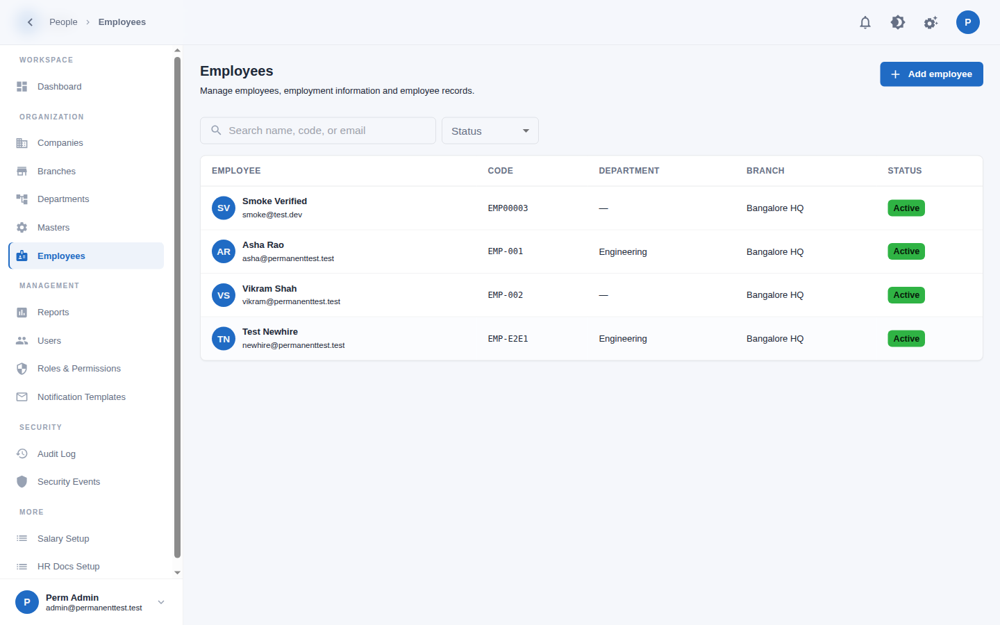
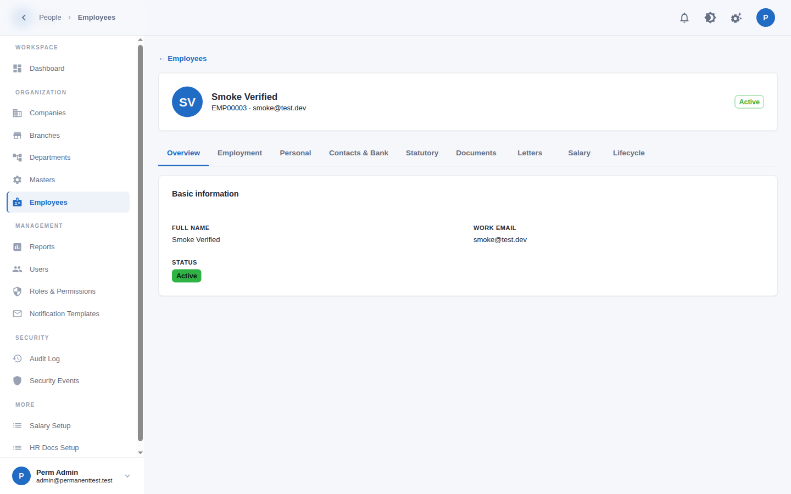

# Employee Management — User Manual (M2)

Version: 1.0 · Last updated: 2026-11-23 · Applies to: milestone M2 (merged)
Audience: HR Admin, Tenant Admin

> Screenshots are real captures from a demo tenant with demo people only.

## 1. Introduction

Employee Management is the heart of the tenant workspace: the employee master
record, employment history, salary assignment, documents and letters, and the
lifecycle events from joining to exit. Everything downstream — attendance,
leave, payroll — resolves people through this module.

## 2. Prerequisites

- Companies, branches, departments, designations, grades exist (see the
  [tenant admin guide](../tenant-admin/tenant-admin-guide.md) §4).
- Salary components/structures defined if you will assign salary at onboarding.
- Letter templates configured if you will issue offer/appointment letters.

## 3. Required permissions

| Permission code | Grants |
|---|---|
| `employee.directory.view` / `.create` / `.edit` | See, add, edit employees |
| `employee.contacts.edit` | Personal contacts |
| `employee.bank.view` / `.edit` / `.verify` | Bank details incl. verification |
| `employee.documents.view` / `.upload` / `.verify` / `.manage` | Employee documents |
| `employee.history.view` / `.backdate` | Employment history; backdated entries |
| `salary.structure.view` / `salary.assignment.create` / `.approve` | Salary view/assign/approve |
| `employee.exit` | Exit/separation flows (FNF module pending) |

Employees holding only `employee.directory.view` + `attendance.my.*` are ESS
users — they see themselves only.

## 4. Screens

### 4.1 Employees list (`/employees`)

| Control | What it does |
|---|---|
| Search | Filter by name, code or email. |
| Status filter | Active / inactive / lifecycle states. |
| Add employee | Opens the onboarding form. |
| Row click | Opens the employee detail. |

### 4.2 Employee detail (`/employees/:id`)

Tab-by-tab:

| Tab | Contents |
|---|---|
| Overview | Identity card: name, code, email, status. |
| Employment | Company, branch, department, designation, grade, manager, joining date, employment type, probation. |
| Personal | Personal details (guarded by data scope). |
| Contacts & Bank | Contact records; bank accounts with verify state. |
| Statutory | PF/ESI/PT/TDS identifiers (tax module pending). |
| Documents | Uploaded documents with verify state. |
| Letters | Issued letters (immutable PDFs; reissue/revoke). |
| Salary | Current + history of structure assignments. |
| Lifecycle | Timeline of events: joining, confirmation, transfer, promotion, separation. |

## 5. Onboarding — step by step

1. **Add employee** → identity fields: code (or auto by numbering config),
   name, work email.
2. **Employment tab** → company → branch → department → designation/grade,
   manager, joining date, employment type.
3. **Contacts & Bank** → contacts; bank account (mark verified after check).
4. **Documents** → upload ID/contract proofs; verify where required.
5. **Salary tab** → assign a salary structure with effective date; approval
   step applies if configured.
6. **Letters tab** → generate the appointment/offer letter from a template;
   issued letter is a permanent PDF snapshot.

**Expected result:** employee appears Active in the directory; lifecycle shows
the joining event.

## 6. Lifecycle events

Transfers, promotions, confirmations and separations are recorded as dated
events in `org.employment_history` — history is appended, never rewritten; a
branch/department change preserves the old rows. Backdated entries need
`employee.history.backdate`.

## 7. Validation rules

- Employee code unique per tenant.
- Required org references must exist and be active.
- Effective dates on assignments must not contradict history (e.g. a salary
  assignment before joining is rejected).
- Issued letters cannot be edited — only reissued or revoked with a reason.

## 8. Troubleshooting

| Symptom | Cause | Fix |
|---|---|---|
| Employee invisible to a manager | manager's data scope doesn't cover that org unit | widen the manager's scope |
| Salary tab read-only | viewer lacks `salary.*` grants | grant structure/assignment view |
| Letter shows blank fields | template merge field vs missing employee data | fix data or the template version |
| Can't edit an issued letter | by design — letters are immutable | reissue with a new version |

## 9. Reports & exports

Employee directory export exists (`employee.directory.export`). Formal report
packs are pending with the reporting milestone — **Status: PENDING**.

## 10. FAQ

1. **Employee vs user?** An employee is the HR record; a user is a login. They
   link when the employee gets ESS access.
2. **Can an employee move branches?** Yes — record a transfer lifecycle event;
   old history stays intact.
3. **What happens on separation?** An exit event is recorded; the FNF
   settlement module is pending (see blueprint).
4. **Who sees bank/statutory data?** Only roles with those specific
   permissions — they are separately guarded fields.
5. **Can deleted employees return?** Deactivation is reversible; records and
   history are preserved for audit and statutory retention.
