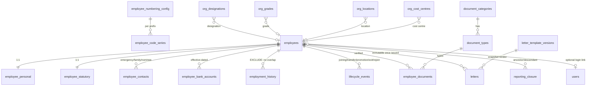

# M2 — HR Core: Design & Dependency Analysis (rev 2, for final approval)

Scope: M2.1 org reference masters → M2.2 Employee Master → M2.3 Onboarding → M2.4 Documents & Letters → M2.5 Relationships/history. Builds on `docs/architecture/15-hr-core-documents-letters.md` inside the existing DB-per-tenant architecture. Everything lives in the tenant DB; no platform-DB changes; no cross-tenant access.

## 0. Current state / dependencies

- `employees` exists as a **minimal directory** (code, name, work email, company/branch/dept, manager, status `PreJoining|Active|Notice|Exited`, RowVersion). It is **extended, not replaced** — existing rows migrate forward intact.
- `reporting_closure` exists (powers `direct_reports`/`all_reports` data scopes) — maintained on every manager change.
- Reusable infra: `FileService`, Scriban (email), notifications outbox, audit (`[Audited("core.employee")]`), `Result<T>` conventions, `xmin` concurrency, OrgMasters drawer UI pattern.
- Already stored config consumed, not rebuilt: company logo, weekly-off rules, dept approvers/HOD, branch geofence.

## 1. Schema

### M2.1 — Org reference masters

| Table | Columns | Rules |
|---|---|---|
| `org_designations` | id, code (unique/tenant), name, level?, description, is_active, row_version | `org.master.*` perms |
| `org_grades` | id, code (unique), name, sort_order int, description, is_active, row_version | |
| `org_locations` | id, code (unique), name, branch_id? (FK Restrict), location_type (office/floor/desk_zone/client_site), is_active, row_version | |
| `org_cost_centres` | id, code (unique), name, company_id? (FK), description, is_active, row_version | `Department.CostCentre` free-string stays; no data move |

`employees` gains nullable FKs: `designation_id`, `grade_id`, `location_id`, `cost_centre_id` (Restrict; null = unset).

### Employee code generation (concurrency-safe, configurable)

| Table | Columns |
|---|---|
| `employee_numbering_config` | company_id? (null = tenant default), prefix, next_value_hint, pad_width, allow_manual bool, is_active |
| `employee_code_series` | series_key (prefix, tenant-scoped, unique), next_value bigint — one row per active series |

Rules:
- `series_key` = the resolved prefix itself (`company:{company_id}` is only the *config* lookup — two companies sharing a prefix share one series row). Key space is the tenant DB: `UK(series_key)`.
- Lazy init: `INSERT INTO employee_code_series(series_key, next_value) VALUES (@key, 1) ON CONFLICT (series_key) DO NOTHING` then the atomic `UPDATE … SET next_value = next_value + 1 WHERE series_key = @key RETURNING next_value - 1` — one transaction, no lock contention beyond the row, races collapse onto the unique row.
- Prefix resolution: `employee_numbering_config` for the employee's company → tenant default row → literal `EMP`. Config rows are created explicitly (admin UI / seed), never mid-transaction.
- **Codes are never reused or reassigned.** Cancelled onboarding / soft-deleted / exited employees keep their code permanently; the series never rewinds; gaps are acceptable. Manual codes (when `allow_manual`) validated against uniqueness, don't move the series.
- `employee_code` unique index per tenant DB already exists and stays.

### M2.2 — Employee Master

**Update boundary (M2.2)**: ordinary profile updates (names, photo, phone, addresses, dob, contacts, bank detail fields, statutory numbers, personal fields) = direct `PUT` on section endpoints with `reason` where sensitive. Anything that changes *org assignment or standing* — company/branch/department/designation/grade/location/cost-centre/manager/employment_type/status/joining/probation/confirmation — **must** go through a `lifecycle_events` record so `employment_history` stays complete. Section `PUT`s reject those fields.

**`employees` (extend)** — add `first_name/middle_name/last_name`, `work_phone`, `photo_file_id`, `employment_type`, `joining_date`, `probation_end_date`, `confirmation_date`, `user_id` (→ identity.users, Restrict, unique where not null). Existing columns + `employee_code` unique index preserved; `employment_status` stays `PreJoining|Active|Notice|Exited` (rejoin returns to Active via lifecycle event, no new status).

| Table | Columns | Invariants |
|---|---|---|
| `employee_personal` (1:1) | employee_id PK/FK, dob, gender, marital_status, nationality, blood_group, personal_email/phone, current/permanent_address jsonb | confidential |
| `employee_contacts` | id, employee_id FK, kind (emergency/family/nominee), name, relation, dob?, phone, email, is_primary, nominee_share_pct | **nominee share**: service enforces Σ share ≤ 100% per employee (atomic check inside transaction on every add/edit; pct in 1–100). **Primary emergency**: partial unique index `(employee_id) WHERE kind='emergency' AND is_primary` guarantees *at most one*; `is_primary` is optional — the onboarding checklist (not the DB) requires ≥1 emergency contact before submit, and ≥1 nominee only where PF/nomination is declared. Flagging a second primary auto-demotes the old one in the same transaction. |
| `employee_bank_accounts` | id, employee_id FK, bank_name, branch_name, `account_number_encrypted bytea`, `account_last4`, ifsc, holder_name, is_primary, effective_from, effective_to?, verification_status (pending/verified/rejected), verified_by/at | **one active primary**: partial unique index `(employee_id) WHERE is_primary AND effective_to IS NULL`. Replacement = close old row (`effective_to`) + insert new — full history retained; change requires `reason` + security event + notification to employee. |
| `employee_statutory` (1:1) | employee_id PK/FK, `pan_encrypted`, pan_last4, uan, pf_number, pf_applicable, esi_number, esi_applicable, pt_state?, lwf_applicable, aadhaar_last4 (last-4 only — full Aadhaar never stored), `passport_encrypted`?, passport_last4?, tax_regime | encrypted via `IFieldProtector` |
| `employment_history` | id, employee_id FK, org + designation/grade/location/cost-centre snapshot, manager_employee_id, employment_type, event_type, `effective` **daterange** (`[from,to)`), reason, lifecycle_event_id?, row_version | **DB-enforced no-overlap**: `EXCLUDE USING gist (employee_id WITH =, effective WITH &&)` (requires `btree_gist`, created in the migration); current row = `upper_inf(effective)`. Single point of truth for as-of queries. |
| `lifecycle_events` | id, employee_id FK, event_type (joining, probation_extension, confirmation, transfer, promotion, manager_change, branch_change, rejoin, exit), status (draft→submitted→approved/rejected→effective/cancelled), payload jsonb, effective_date, requested_by, approved_by?, approved_at?, reason | see §5 lifecycle rules |

**Current projection vs history**: `employees` = denormalized current state (the open history row's fields, mirrored for fast reads + FK targets). `employment_history` = truth. Any drift is repaired by "reproject from history" (also used when a backdated correction shifts the current row). Writes always go through lifecycle/assignment code paths — never direct edits to both.

### M2.3 — Onboarding

`employees(PreJoining)` + mandatory `document_types` checklist + `lifecycle_events(joining)`:
create → collect (joining, personal, statutory, bank, docs) → `submit` (checklist validated: mandatory docs uploaded+verified or explicitly waived w/ reason) → approver reviews → `approved` → `effective` at joining_date (synchronous if ≤ today; daily activation job `employee.activation` flips future-dated PreJoining → Active at 00:05 tenant TZ and emits `EmployeeJoined`).
- Rejoin = `lifecycle_events(rejoin)` on the **same employee** (history preserved; new history row opens).
- Cancelled onboarding (`cancelled` event) frees the user-link and documents but **not** the employee code.
- Multiple concurrent employments: out of M2 scope (single active assignment enforced by the open-row invariant).

### M2.4 — Documents & Letters

`document_categories` (code, name, default_retention_years?, is_confidential) · `document_types` (category, code, name, allowed_extensions, has_expiry, requires_verification, is_confidential, employee_can_upload, employee_can_view, mandatory_for) · `employee_documents` (employee_id, type_id, current_file_id, doc_number_encrypted?, doc_last4?, issue/expiry, verification_status, verified_by/at, rejection_reason, replaced_by? self-FK).

Rules:
- Upload via existing FileService purpose `employee.document` (signature/size checks, tenant-isolated keys). Replacement = new version row linked via `replaced_by`; old file retained per retention.
- Verification: `pending → verified | rejected(reason)`; rejected docs must be replaced before checklist completion. Employee-uploaded docs invisible to others until verified (unless `employee_can_view` configured).
- Expiry: daily job flags `expiry_date - N` (N per document type, default 30) → notification to employee + HR + work-item entry; expired documents block nothing automatically in M2 but surface badges.
- Retention: `default_retention_years` per category (statutory default 8y post-exit); hard delete only via admin purge honoring legal hold — retention engine hook aligned with files retention later.
- Confidential downloads: `empdocs.confidential` required + every download audited (`document.downloaded`) via existing 60s presigned flow.

**Letters** (full inventory):

| Table | Columns | Constraints / indexes |
|---|---|---|
| `letter_types` | id, code, name, series_prefix, is_active | `UK(code)` |
| `letter_templates` | id, type_id FK, code, name, company_id? (null = tenant-wide), is_active, row_version | `UK(code)` |
| `letter_template_versions` | id, template_id FK Cascade, version_no, body_html (Scriban), header/footer jsonb?, is_published, published_by/at | `UK(template_id, version_no)`; **no UPDATE/DELETE endpoint** once `is_published` |
| `letters` | id, type_id FK, template_version_id FK Restrict, employee_id FK Restrict, variables_snapshot jsonb, status, number, file_id, issued_by/at, revoked_reason?, supersedes_id? self-FK, row_version | `UK(number)`; `IX(employee_id)`, `IX(status)`; update path only advances status |

`letter_numbers` reuse the `employee_code_series` mechanism (`series_key = 'letter:{type_code}'`).
- Issued letters are **immutable**: no update endpoint; revoke sets status + reason only; re-issue creates a new letter with `supersedes_id`.
- Variables resolve server-side, each resolver permission-checked (`employee.*`, `company.*`, `branch.*`; `salary.*` unavailable in M2 — payroll domain absent).
- Render: HTML via FileService in M2; PDF decision deferred (recommend QuestPDF evaluation next phase).

### M2.5 — Relationships & history

- `POST /employees/{id}/link-user` / `DELETE`: validates target `identity.users` row is free and same-tenant; `user_id` unique-partial index; sets + bumps auth version (session re-check). Unblocks `own` scope + ESS.
- `reporting_closure` rebuilt for the affected subtree on every approved `manager_change`/transfer (existing algorithm).
- Transfer / promotion / dept / designation changes = `lifecycle_events` → on effective: close open history row (`upper(effective)=new_from`), insert new row, update `employees` projection + `display_name`-level snapshot fields, refresh closure, audit + notification.
- Exit = `lifecycle_events(exit)` → `Notice` on approval → `Exited` on effective date (activation job handles the flip; user-link revocation bundled here).

## 2. Sensitive-data protection

- `IFieldProtector` = ASP.NET Data Protection, purpose `hrms.employee.sensitive`; DP key ring already persisted in `hrms_dpkeys` volume → **key recovery = key-ring recovery**: ciphertext is irrecoverable if the ring is lost; ops guidance: back up the volume with the DBs (documented in §8 runbook).
- Storage: `*_encrypted bytea` + `*_last4`; **all DTOs return masked only** (`ABCDE****F`, `****1234`) — no reveal endpoint in M2.
- **Log discipline**: request/response DTOs are never logged (existing behavior); sensitive props marked `[SensitiveData]` (excluded from audit payload serialization — audit stores field names + masked fingerprints, never plaintext/encrypted bytes); EF log filtering unchanged (params not logged by default).
- `employee_personal/statutory/bank` = `confidential` classification.

## 3. Permissions (naming convention finalized)

Convention: `<domain>.<entity-or-section>.<action>` — matches existing `employee.directory.view`, `org.department.edit`.

New codes seeded in the migration (idempotent): `org.master.view|create|edit` · `employee.personal.view|edit` · `employee.bank.view|edit` · `employee.statutory.view|edit` · `employee.history.view|backdate` · `employee.onboarding.manage` · `employee.lifecycle.manage|approve` · `employee.link.manage` · `empdocs.view|upload|verify|confidential` · `letters.view|manage|generate|approve|issue`.

Data-scope: all employee reads through existing `ApplyScope` (8 scopes incl. `own`, `direct_reports`, `all_reports`). **Section redaction**: base record returns; sections without permission return `redacted: true` flags (not 404, not silently missing) so the UI can render locked tabs. Sensitive values are masked even for editors (no reveal permission in M2).

**Least-privilege grants onto existing roles** (seeded idempotently in the migration; custom roles unchanged — admins opt in):

| Role | New grants | Scope |
|---|---|---|
| `tenant_admin` | all new codes | Tenant |
| `manager` | `org.master.view`, `employee.history.view`, `empdocs.view`, `letters.view` | DirectReports |
| `employee` | `employee.personal.view`, `empdocs.view`, `empdocs.upload`, `letters.view` | Own |

Edit-level and sensitive sections (`bank`, `statutory`, `onboarding`, `lifecycle`, `verify`, `confidential`, `letters.manage/approve/issue`, `link.manage`, `history.backdate`) go to `tenant_admin` only; HR roles are tenant-created and grant themselves.

### Org-master deactivation vs references

Masters are **soft-deactivated** (`is_active=false`), never hard-deleted once referenced: `employees`/`employment_history` FKs stay valid, history keeps the snapshot names, dropdowns and new assignments exclude inactive rows. Deactivation is blocked (409) only while an *open* history row or PreJoining/Active employee references the master — historical/closed references never block. Hard delete allowed only for never-referenced rows.

## 4. Lifecycle approval rules

- **Separation of duties**: approver must differ from submitter when tenant config `require_separate_approver` (default true) — `requested_by != approved_by` enforced server-side; `employee.lifecycle.approve` also required (manage ≠ approve).
- **Cancel**: draft/submitted only, by submitter or `lifecycle.manage` — frees checklist state, leaves history untouched.
- **Reject**: approver + mandatory reason; event terminal; a corrected new event may reference it.
- **Future-dated**: approved now, applied by the daily job at effective date (`status=effective` transition applies history+projection).
- **Backdated**: requires `employee.history.backdate` + reason; rejected if it would overlap an approved-later event's range or touch a range the exclusion constraint rejects (constraint is the final guard); flags the event `payroll_affecting=true` — a `PayrollInputChanged` hook placeholder for the future payroll module (no-op in M2, persisted for audit).

## 4b. Jobs (activation/exit/expiry) — idempotency & timezone

Daily job `employee.activation` per tenant: reads `lifecycle_events(status='approved', effective_date <= today_in_tenant_tz)` → applies transition inside one transaction (`status='effective'`, close/open history, update projection, `EmployeeJoined`/exit notifications). Idempotent: state transition is `approved→effective` guarded — re-runs no-op; retry = whole event re-evaluated (no partial writes; transaction abort rolls back). Tenant TZ resolved from `Branch.TimeZone` → company default → UTC; job runs 00:05 local per tenant (sequential over tenants, each isolated — a failed tenant doesn't block others). Same pattern for document-expiry notifications (`expiry_date - N days`, dedup key `doc_id+date` so re-runs don't re-notify).

## 4c. Correcting historical records

Two paths, never raw SQL: (1) **Correction event** — `lifecycle_events(type=correction)` replacing an existing history row's fields (same range; requires `employee.history.backdate`); (2) **Re-range** — adjusts `effective` bounds of adjacent rows, validated by the exclusion constraint. Both write an audit + `correction_of` link, then **reproject**: `employees` row is rebuilt from the open history row. Overlap violations surface as 409 field errors, never silent drift.

## 5. Migration & rollout

- One tenant EF migration `HrCore`: `CREATE EXTENSION IF NOT EXISTS btree_gist`, all new tables, exclusion constraint on `employment_history`, nullable `employees` columns, partial unique indexes (one active primary bank; one primary emergency contact; `user_id`), FKs Restrict. **Additive only.**
- **Safety**: existing `employees` rows/IDs/codes untouched (additive columns only); `employees` rows get bootstrap history; series seeded above `max(employee_code)` — **code continuity test is a required migration test**. Per-tenant DB snapshot + `hrms_dpkeys` volume backup are runbook prerequisites before `migrate-tenants`; each tenant migrates in its own transaction and is verified independently (post-check: row counts, open history row per employee, series continuity).
- Idempotent data seed in the same migration: (a) bootstrap `employment_history` row per existing employee (`event_type='initial_assignment'`, `effective=[coalesce(joining_date, created_at), infinity)`); (b) `employee_code_series` seeded per company prefix from `max(employee_code)` numeric suffix + 1; (c) new permission codes + grants onto existing system roles; (d) default document categories/types + letter types.
- **Migration test**: API test fixture spins a tenant seeded with directory employees (existing shape), applies the migration, asserts: all rows present, history bootstrapped, series continues past max code, permissions present, no overlap violations.
- Rollout: `migrate-tenants` per environment (tenant-by-tenant, each DB its own transaction; a failed tenant is reported and isolated — others unaffected).
- Rollback: additive schema → safe to roll back code while leaving new tables; per-tenant DB snapshot recommended before `migrate-tenants` (documented runbook step, no automated restore in M2).

## 6. Future-module compatibility (verified)

- **Attendance**: employee has `location_id` + org effective-config inheritance already resolves weekly-off/shift config to employee level; `joining/exit` dates bound eligibility; `employee.status` drives attendance enrollment.
- **Leave**: entitlement inputs present (joining_date, employment_type, dept/branch chain); `lifecycle_events` provides confirmation date for probation-gated leave.
- **Payroll/TDS**: `employee_statutory` (PAN/UAN/PF/ESI/PT/tax_regime), `employee_bank_accounts` (verified primary), `employment_history` (as-of org/grade for payroll-period resolution, backdated flags preserved).
- **ESS**: `employees.user_id` + `own` scope + `employee_can_upload/view` doc flags — ESS screens come with attendance/leave; schema ready.
- Letter `salary.*` variables resolve once payroll lands (resolver contract already permission-aware).

## 7. API endpoints (`/api/v1`, tenant realm)

Org masters: `GET/POST /org/{designations|grades|locations|cost-centres}`, `PUT/DELETE …/{id}`.
Employees: `GET /employees` (filters + status), `GET/PUT /employees/{id}`, `POST /employees`; `GET/PUT …/personal`, `…/contacts`, `…/bank-accounts`, `…/statutory` (CRUD); `GET …/history`, `GET …/lifecycle`; `POST …/lifecycle` + `…/lifecycle/{id}/{submit|approve|reject|cancel}`; `GET /lifecycle/pending`; `POST|DELETE …/link-user`; `…/documents` CRUD + `verify` + `download`; `GET /document-types`; `letter-templates` CRUD + publish; `letters` CRUD + `{submit|approve|issue|revoke}` + `preview`.

## 8. Frontend (drawer+DataList pattern)

Masters pages under Organization · Employee directory w/ filters + employee drawer (Profile/Personal/Contacts/Employment & History/Statutory/Bank/Documents/Letters/Lifecycle — permission-gated tabs) · stepped onboarding wizard + pending-onboarding inbox · lifecycle dialogs (transfer/promote/manager/rejoin/exit) + approvals inbox · doc upload/verify/expiry badges · letter template editor + generate→approve→issue.

## 9. Test plan

API/integration: masters CRUD/dup-code · **concurrent employee create → distinct codes** · cancelled-code non-reuse · section redaction · encryption round-trip + masked DTOs · nominee ≤100% + single primary emergency + single active primary bank (index violations) · history exclusion constraint + backdate rules · onboarding submit→approve→Active + future-dated job · transfer/manager-change closure refresh + SoD (self-approve rejected) · exit Notice→Exited · link-user busy/cross-check · doc verify + confidential download gate + expiry flag · letter immutability (no update on issued) · cross-tenant ref rejection · **migration test on pre-existing employees**.
Unit (`tests/unit` first real usage): series allocation, masked formatting, lifecycle guard, nominee-sum validator, range math.
E2E recorded: onboard→drawer sections→transfer→docs→letter; mobile pass. Frontend: tsc/lint/build.

## 10. Deferrals

Workflow engine (schema-ready `workflow_instance_id` later) · compensation/salary (Payroll) · skills/education/experience tables · custom-field engine · full Aadhaar · e-sign · concurrent multi-employment · attendance enforcement of geofence/weekly-off · ESS edit flows (post-link).

## 11. Sequence

1. M2.1 masters → 2. M2.5a schema core (history/lifecycle/series/IFieldProtector + migration) → 3. M2.2 sections → 4. M2.3 onboarding+activation job → 5. M2.4 docs then letters → 6. M2.5b link/transfers/exit → 7. tests+E2E. Committable per step; branch `m2-hr-core` after PR #1 merges (or continue on `m1-platform-foundation` — your call).
