# M3 — Attendance Management — Technical Design (Rev 3)

Status: **design only — awaiting approval before implementation.** No code, no migration.

Rev 3 changes vs Rev 2: master versioning (history protection), immutable punch store + revision log, explicit punch-to-workday algorithm (overnight shifts), roster overrides, timezone/DST rules, concurrency model, two-step approval chain, period locking + payroll contract, ER diagram, full API specs, M3.1 scope with acceptance criteria.

---

## 0. Grounding — what exists today (verified in code)

| Existing asset | Where | M3 use |
|---|---|---|
| Module `attendance` (Optional) + `attendance.biometric` (SubModule) | `PlatformManifest.cs` | Entitlement gate already in catalogue — M3 adds permissions under it |
| Org work-schedule fields: `DefaultShiftName`, `WorkStart/End`, `BreakMinutes`, `GraceMinutes`, `OvertimeAllowed`, `AttendanceMode`, `WeeklyOffPattern` + `WeeklyOffConfigJson`, `HolidayCalendarCode`, `AttendancePolicyCode` (company `Default*` variants) | `Organization.cs` (Company/Branch/Department) | Config fallback chain dept → branch → company; codes resolve to M3 masters |
| `Branch.TimeZone` (IANA, default `Asia/Kolkata`), `Tenant.TimeZone` | `Organization.cs`, `Tenancy.cs` | Per-branch local-day classification |
| `Branch.Latitude/Longitude/GeofenceRadiusMeters` | `Organization.cs` | Geofence for self/mobile punches |
| Department approvers: `RegularizationApproverEmployeeId`, `OtApproverEmployeeId`, `OdApproverEmployeeId`, `CompOffApproverEmployeeId`, `EscalationLevel` | `Organization.cs` | Approver resolution before falling back to manager |
| `WeeklyOffRules` — `fixed`, `alternate_saturday`, `nth_weekday`, **`rotating`** (anchor + cycle + offsets), `shift_based` (returns false — "resolved by the attendance module") | `WeeklyOffRules.cs` | Reused as-is; M3 implements the `shift_based` branch |
| `EmploymentHistory` — effective-dated, DB-enforced no-overlap (gist exclusion), `PayrollAffecting` flag | `EmployeeCore.cs` | As-of branch/department/manager for each work date; transfer handling |
| `ReportingClosure` (ancestor, descendant, depth) | `Organization.cs` | Manager chain + DirectReports scope |
| `IDataScopeService.ApplyEmployeeScope<T>(query, selector, scope)` | `DataScope.cs` | Scope every attendance query by employee id |
| `IJobScheduler.EnqueueTenant` + `[JobHandler]`; runner re-establishes validated tenant context | `Jobs.cs` | Processing/recalc jobs |
| `RecurringSweepWorker` (hourly) + `EmployeeLifecycleSweepJob` (per-tenant "today" in tenant TZ) | `RecurringSweepWorker.cs`, `LifecycleJobs.cs` | Same pattern for nightly attendance processing |
| `[Audited("<module>")]` + `audit.audit_entries` + sealing job `audit.seal.tenant` | `AuditAttributes.cs`, `Jobs.cs` | Field-level audit on every M3 entity |
| `INotificationService`, `TenantEmailOutbox` | `NotificationService.cs`, `Email.cs` | Request + anomaly notifications |
| FileService (owner-scoped, audited downloads) | `FileService.cs` | Attachments on regularization requests |
| Per-service approval state machines (lifecycle, salary: draft → submitted → approved/rejected, SoD) | `LifecycleEventService.cs`, `SalaryService.cs` | Pattern reference |
| `btree_gist` extension | enabled by M2.7 migration | Exclusion constraints on effective-dated M3 tables |

**Gap found:** there is **no generic multi-step workflow engine** — existing approvals are single-step, per service. M3 needs manager → HR. Proposal (§C): a small reusable `ApprovalChain` in `Hrms.Application/Approvals` used by attendance requests first (Leave reuses it later). Lifecycle/salary are **not** refactored — no change to M2 behaviour.

---

## 1. Core principles

1. **Raw is never edited.** Punches are append-only facts. Everything else is derived.
2. **Derived is reproducible.** A day record is a pure function of (punches, roster, shift version, policy version, calendar, approved requests, overrides). Same inputs → same output → same `input_hash`.
3. **Masters are versioned.** Changing a shift/policy creates a new version effective from a date; old days keep pointing at the version they were computed with.
4. **Locked is final.** Once a period is locked, its day rows and summary are frozen (DB-enforced). Later corrections flow as adjustments into the next open period.
5. **Every change has provenance.** Who/what/why for punches, overrides, recalcs, approvals — via `[Audited]` + a dedicated day revision log.
6. **Nothing hardcoded.** Every threshold, rounding, cap, treatment and precedence switch lives in a policy version.

---

## 2. Database schema (tenant DB only — schema `att`, additive)

New schema `att` keeps attendance separate from `hr`/`org` (clean migration + permissions boundary). All tables have `id uuid` (v7), `created_at/by`, `modified_at/by` via `AuditableEntity`; masters add `row_version` (`IConcurrencyAware`).

### 2.1 Masters

**`att.shifts`** — identity of a shift (stable code)
| col | type | notes |
|---|---|---|
| code | varchar(32) | UNIQUE |
| name | varchar(128) | |
| is_active | bool | |

**`att.shift_versions`** — immutable once referenced by a day
| col | type | notes |
|---|---|---|
| shift_id | uuid FK | |
| version | int | UNIQUE(shift_id, version) |
| effective_from / effective_to | date / date null | EXCLUDE gist (shift_id, daterange) — no overlap |
| status | varchar | `draft` \| `published` \| `retired` |
| shift_type | varchar | `fixed` \| `flexi` \| `open` |
| start_time / end_time | time | local wall-clock |
| crosses_midnight | bool | derived: end ≤ start; validated |
| break_minutes, break_paid | int, bool | |
| core_start / core_end | time null | flexi only |
| required_minutes | int | flexi/open: minutes needed |
| grace_in_minutes / grace_out_minutes | int null | null → policy value |
| in_window_before_minutes | int | earliest valid check-in before start (default 120) |
| out_window_after_minutes | int | latest valid check-out after end (default 240) |
| ot_allowed | bool | shift-level OT eligibility |
| weekly_off_config_json | jsonb null | only for `shift_based` weekly-off pattern (same JSON shape as `WeeklyOffConfig`) |

**`att.work_calendars`** — `code` UNIQUE, `name`, `year`, `is_default`, `is_active`. Resolved by `Branch.HolidayCalendarCode` → `Company.DefaultHolidayCalendarCode` → default.

**`att.calendar_days`**
| col | notes |
|---|---|
| calendar_id, date | UNIQUE(calendar_id, date) |
| day_type | `holiday` \| `optional_holiday` \| `working_override` \| `half_day` |
| name | e.g. "Diwali", "Compensatory working Saturday" |
| half_day_minutes | for `half_day` |
| applies_to_json | null = all; else `{branch_ids:[], department_ids:[]}` narrowing |

Only exceptions live here — weekly offs stay rule-based (`WeeklyOffRules`), so no 365-row calendars.

**`att.attendance_policies`** — identity (`code` UNIQUE, `name`, `is_active`).

**`att.policy_versions`** — immutable once referenced; EXCLUDE gist on (policy_id, daterange); `status` draft/published/retired; `rules jsonb` validated against a versioned C# schema (`AttendanceRulesV1`). Rule set:

```jsonc
{
  "schema": 1,
  "late":  { "grace_minutes": 10, "mark_after_minutes": 0, "count_from": "planned_start" },
  "early": { "grace_minutes": 10 },
  "late_penalty":  [{ "every": 3, "action": "half_day_lop" }],   // per period, applied at summary
  "early_penalty": [],
  "thresholds": { "half_day_below_minutes": 240, "absent_below_minutes": 120, "basis": "worked" },
  "punch": {
    "mode": "first_last",              // first_last | pairs
    "duplicate_window_seconds": 60,    // near-duplicate bounce ignored in computation
    "min_session_minutes": 5
  },
  "missing_punch": {
    "status": "missing_punch",         // missing_punch | absent | half_day | present
    "lock_treatment": "absent",        // applied if still unresolved at period lock
    "reminder_after_hours": 4
  },
  "overtime": {
    "enabled": true,
    "eligible_employment_types": ["permanent","contract"],
    "eligible_grade_codes": null,      // null = all
    "pre_shift": false,
    "min_minutes": 30,
    "rounding": { "block_minutes": 15, "mode": "floor" },
    "caps": { "daily": 240, "weekly": 720, "monthly": 3000 },
    "bands": { "working_day": "ot_1_5x", "weekly_off": "ot_2x", "holiday": "ot_2x" },
    "requires_approval": true,
    "disposition": "paid"              // paid | comp_off (comp_off is a Leave seam)
  },
  "regularization": {
    "window_days": 7, "max_per_period": 4,
    "hr_approval": "when_quota_exceeded",  // always | never | when_quota_exceeded
    "escalate_after_days": 3
  },
  "self_punch": { "allowed": true, "geofence_required": true, "selfie_required": false },
  "dst": { "paid_minutes": "actual" },  // actual | planned
  "payable_days_basis": "calendar"       // calendar | working
}
```

**`att.shift_assignments`** — employee ↔ shift, effective-dated
| col | notes |
|---|---|
| employee_id, shift_id | |
| effective_from, effective_to | EXCLUDE gist (employee_id, daterange) |
| reason, source | `manual` \| `transfer` \| `import` |

**`att.rosters`** — day-level overrides (rotating shifts, swaps)
| col | notes |
|---|---|
| employee_id, work_date | UNIQUE |
| shift_id null | null + `is_off` = off day |
| is_off | bool |
| reason, source | `roster_upload` \| `swap` \| `manual` |

**`att.policy_assignments`** (optional explicit override) — employee ↔ policy effective-dated; else policy resolves from org `AttendancePolicyCode` chain.

### 2.2 Punch store (raw)

**`att.devices`** — `code` UNIQUE, `name`, `vendor`, `branch_id`, `protocol` (`push_api`/`pull_poll`/`file_import`), `timezone_mode` (`utc`/`device_local`), `token_hash` (SHA-256 of a per-device secret; secret shown once), `credential_ref` (secret-store name for pull devices — never inline), `last_seen_at`, `is_active`.

**`att.device_user_map`** — `device_id`, `device_user_code`, `employee_id`, effective_from/to. Lets a device's enrolment number map to an employee without trusting the device for identity.

**`att.punches`** — **append-only**
| col | notes |
|---|---|
| employee_id null | null when device user unmapped (kept, resolved later via map) |
| device_id null, device_user_code null | |
| punched_at | timestamptz (UTC instant) |
| local_wall_time | timestamp (as reported, for forensics) |
| source | `device` \| `self` \| `manual` \| `import` \| `regularization` |
| direction | `in` \| `out` \| `unknown` |
| latitude, longitude, accuracy_m, geofence_result | self/mobile |
| ingest_batch_id | FK → `att.ingest_batches` |
| dedup_key | UNIQUE — SHA-256(source, device_id/employee_id, device_user_code, punched_at to second) |
| ref_request_id null | regularization that generated it |
| note | |

DB trigger `trg_punches_append_only` rejects UPDATE/DELETE (only `employee_id` back-fill from NULL is allowed, by the mapping job). Corrections never edit punches:

**`att.punch_voids`** — `punch_id` UNIQUE, `reason`, `voided_by`, `ref_request_id`. A void is a new fact; the computation excludes voided punches.

**`att.ingest_batches`** — `device_id`/`source`, `idempotency_key` UNIQUE, received/accepted/duplicate/rejected counts, `received_at`. Re-sending a batch is a no-op.

### 2.3 Derived attendance

**`att.attendance_days`** — UNIQUE(employee_id, work_date)
| group | cols |
|---|---|
| context snapshot | `branch_id`, `department_id`, `tz_id`, `shift_version_id`, `policy_version_id`, `calendar_id`, `roster_id` null |
| plan | `day_type` (`working`/`weekly_off`/`holiday`/`half_day`/`optional_holiday`), `planned_start_at`, `planned_end_at` (timestamptz), `planned_minutes` |
| actuals | `first_in_at`, `last_out_at`, `worked_minutes`, `break_minutes`, `punch_count` |
| outcome | `status` (`present`/`absent`/`half_day`/`weekly_off`/`holiday`/`leave`/`od`/`missing_punch`/`not_processed`), `late_minutes`, `early_minutes`, `flags` text[] (`late`,`early`,`missing_in`,`missing_out`,`geofence_violation`,`worked_on_off_day`) |
| OT | `ot_raw_minutes`, `ot_eligible_minutes`, `ot_approved_minutes`, `ot_band` |
| provenance | `input_hash`, `revision`, `last_run_id`, `processed_at`, `override_id` null |
| lock | `period_id` |

**`att.day_overrides`** — HR manual outcome override (`status`, optional minutes), `reason` mandatory, `approved_by`. Stored as an **input**, so recompute preserves it.

**`att.day_revisions`** — append-only history of every material change to a day
| col | notes |
|---|---|
| day_id, revision | UNIQUE |
| before / after | jsonb (outcome fields only) |
| cause | `initial` \| `nightly` \| `punch_ingest` \| `regularization` \| `override` \| `master_change` \| `transfer` \| `manual_recalc` |
| cause_ref_id | request/override/version/lifecycle event id |
| run_id, actor_id, at | |

**`att.process_runs`** — `trigger` (`nightly`/`recalc`/`manual`), `from_date`, `to_date`, `employee_count`, `changed_days`, `status` (`queued`/`running`/`completed`/`failed`), `requested_by`, `error`, timings.

### 2.4 Requests & approvals

**`att.regularization_requests`** — `employee_id`, `work_date`, `kind` (`missing_in`/`missing_out`/`both`/`wrong_punch`/`on_duty_correction`), `requested_in_at`, `requested_out_at`, `void_punch_ids uuid[]`, `reason`, `attachment_file_id`, `status`, `chain_id`.

**`att.od_requests`** — `employee_id`, `from_date`, `to_date`, `od_type` (`outdoor_duty`/`training`/`client_visit`/`wfh`/`travel`), `half_day_part` null, `purpose`, `status`, `chain_id`.

**`att.ot_requests`** — `employee_id`, `work_date`, `requested_minutes`, `pre_approval` bool, `reason`, `status`, `approved_minutes`, `chain_id`.

**`app.approval_chains`** (reusable, in a shared `app` schema) — `subject_type`, `subject_id`, `status`, `current_step`, `created_by`.
**`app.approval_steps`** — `chain_id`, `step_no`, `role` (`manager`/`dept_approver`/`hr`), `approver_employee_id` null, `approver_permission` null (HR pool), `status` (`pending`/`approved`/`rejected`/`skipped`/`escalated`), `acted_by`, `acted_at`, `remarks`, `due_at`.

### 2.5 Periods & payroll handoff

**`att.periods`** — `company_id`, `period_start`, `period_end`, UNIQUE(company_id, period_start), `status` (`open`/`locking`/`locked`/`payroll_consumed`), `locked_by/at`, `unlock_reason`, `consumed_by_ref`.

**`att.period_summaries`** — immutable snapshot per (period_id, employee_id, version): all contract fields (§D.2) + `content_hash`.

**`att.adjustments`** — post-lock corrections: `employee_id`, `original_work_date`, `original_period_id`, `target_period_id` (next open), `delta jsonb` (e.g. `{absent_days:-1, present_days:+1}`), `cause_ref_id`.

### 2.6 Indexes & constraints (key ones)
- `punches (employee_id, punched_at)`, `punches (device_id, punched_at)`, `punches (dedup_key)` UNIQUE, partial `punches (device_id, device_user_code) WHERE employee_id IS NULL`.
- `attendance_days (work_date, status)`, `(branch_id, work_date)`, `(department_id, work_date)`, `(period_id)`.
- gist exclusions on `shift_versions`, `policy_versions`, `shift_assignments`, `policy_assignments`, `device_user_map`.
- Trigger `trg_days_locked_guard`: rejects INSERT/UPDATE/DELETE on `attendance_days` where `period_id` is `locked`/`payroll_consumed`.
- Partition-ready: `punches` and `attendance_days` keyed so monthly range partitioning can be added later without app changes.

### 2.7 ER diagram

```mermaid
erDiagram
  EMPLOYEES ||--o{ EMPLOYMENT_HISTORY : "as-of org"
  EMPLOYEES ||--o{ SHIFT_ASSIGNMENTS : has
  EMPLOYEES ||--o{ ROSTERS : "day overrides"
  EMPLOYEES ||--o{ PUNCHES : records
  EMPLOYEES ||--o{ ATTENDANCE_DAYS : "one per date"
  EMPLOYEES ||--o{ REGULARIZATION_REQUESTS : raises
  EMPLOYEES ||--o{ OD_REQUESTS : raises
  EMPLOYEES ||--o{ OT_REQUESTS : raises
  SHIFTS ||--o{ SHIFT_VERSIONS : versions
  SHIFTS ||--o{ SHIFT_ASSIGNMENTS : assigned
  SHIFTS ||--o{ ROSTERS : rostered
  ATTENDANCE_POLICIES ||--o{ POLICY_VERSIONS : versions
  WORK_CALENDARS ||--o{ CALENDAR_DAYS : exceptions
  BRANCHES }o--|| WORK_CALENDARS : "HolidayCalendarCode"
  BRANCHES }o--|| ATTENDANCE_POLICIES : "AttendancePolicyCode"
  BRANCHES ||--o{ DEVICES : hosts
  DEVICES ||--o{ DEVICE_USER_MAP : enrols
  DEVICES ||--o{ PUNCHES : emits
  INGEST_BATCHES ||--o{ PUNCHES : contains
  PUNCHES ||--o| PUNCH_VOIDS : "voided by"
  ATTENDANCE_DAYS }o--|| SHIFT_VERSIONS : "computed with"
  ATTENDANCE_DAYS }o--|| POLICY_VERSIONS : "computed with"
  ATTENDANCE_DAYS ||--o{ DAY_REVISIONS : history
  ATTENDANCE_DAYS ||--o| DAY_OVERRIDES : "HR override"
  ATTENDANCE_DAYS }o--|| PERIODS : "belongs to"
  PROCESS_RUNS ||--o{ DAY_REVISIONS : produced
  REGULARIZATION_REQUESTS ||--|| APPROVAL_CHAINS : "approved via"
  OD_REQUESTS ||--|| APPROVAL_CHAINS : "approved via"
  OT_REQUESTS ||--|| APPROVAL_CHAINS : "approved via"
  APPROVAL_CHAINS ||--o{ APPROVAL_STEPS : steps
  PERIODS ||--o{ PERIOD_SUMMARIES : snapshot
  PERIODS ||--o{ ADJUSTMENTS : "receives"
```



---

## 3. Resolution & calculation engine

All logic in `Hrms.Application/Attendance` as pure, unit-testable components; DB access only in the orchestrating service.

### 3.1 Effective-config resolver — `IAttendanceConfigResolver.ResolveAsync(employeeId, date)`
Returns `{ branch_id, department_id, tz_id, shift_version, policy_version, calendar_id, day_type, roster_id }`:
1. **Org as-of** — `EmploymentHistory` row covering `date` → branch, department, employment type, grade.
2. **Timezone** — `Branch.TimeZone` of that branch (IANA) → fallback `Tenant.TimeZone`.
3. **Shift** — roster row for (employee, date) → shift assignment covering date → org `DefaultShiftName` chain (dept → branch → company) → *unresolved* (day = `not_processed` + config warning).
4. **Shift version** — published version of that shift covering `date`.
5. **Policy** — `policy_assignments` → `Department.AttendancePolicyCode` → `Branch.AttendancePolicyCode` → `Company.DefaultAttendancePolicyCode` → tenant default; then published version covering `date`.
6. **Calendar** — `Branch.HolidayCalendarCode` → `Company.DefaultHolidayCalendarCode` → default calendar.
7. **Day type** (precedence, highest first):
   1. Roster `is_off` / roster shift → `weekly_off` / `working`
   2. Calendar `working_override` → `working` (compensatory working day)
   3. Calendar `holiday` / `half_day` / `optional_holiday` (narrowed by `applies_to_json`)
   4. Weekly-off — `shift_based`: shift version's `weekly_off_config_json`; else org pattern chain dept → branch → company via `WeeklyOffRules.IsWeeklyOff`
   5. `working`

Holiday on a weekly off → `holiday` (single day, no double counting); policy flag reserved for "compensatory off" in Leave.

### 3.2 Planned window (absolute instants)
`planned_start_at = ToInstant(date + start_time, tz)`; `planned_end_at = ToInstant((crosses_midnight ? date+1 : date) + end_time, tz)`.
Valid punch window: `[planned_start_at − in_window_before, planned_end_at + out_window_after]`.

### 3.3 Punch → work-date attribution (overnight safe)
For each employee, over a window covering D−1..D+1:
1. Load non-voided punches; drop near-duplicates (`duplicate_window_seconds`, keep earliest).
2. Build candidate windows for D−1, D, D+1 (each with its own shift version).
3. Assign each punch to the window that contains it; if two windows contain it (back-to-back night/morning shifts), assign to the window whose planned boundary is **nearest** (`in`-direction → nearest start, `out`-direction → nearest end, `unknown` → nearest either).
4. Punches outside all windows → `orphan` flag on the nearest day (visible in anomaly report, never silently dropped).

**Work date = local date of the shift start.** A 22:00–06:00 shift on 17 Nov has `work_date = 2026-11-17`, includes punches up to 18 Nov 10:00 (06:00 + 240 min window).

### 3.4 Worked minutes
- `first_last`: `last_out − first_in` minus unpaid break.
- `pairs`: sum of (in, out) pairs; direction from device if known, else alternating; unpaired trailing punch → `missing_out`.
- Flexi: worked vs `required_minutes`; late/early measured against `core_start`/`core_end`.
- Open shift: only `required_minutes` matters; no late/early.

### 3.5 Classification (per policy version)
On `working` days, no leave/OD:
| condition | outcome |
|---|---|
| 0 punches | `absent` |
| only in or only out | `missing_punch` (or policy `missing_punch.status`); flag `missing_in`/`missing_out` |
| worked < `absent_below_minutes` | `absent` |
| worked < `half_day_below_minutes` | `half_day` |
| otherwise | `present` |
| first_in > planned_start + grace_in | flag `late`, `late_minutes = first_in − planned_start` (from start, not from grace end — policy `count_from` can switch to `grace_end`) |
| last_out < planned_end − grace_out | flag `early`, `early_minutes` |

Grace effective = `shift_version.grace_in/out ?? policy.late/early.grace_minutes`.
Non-working days: status = day_type (`weekly_off`/`holiday`); if punches exist → flag `worked_on_off_day`, all worked minutes are OT-candidate in the `weekly_off`/`holiday` band.
Leave (seam `ILeaveDayProvider`, returns none until Leave ships) and approved OD override punch-based status; half-day leave/OD combines with half-day attendance.
HR `day_overrides` apply last.

**Late/early penalties** (e.g. every 3 lates = ½ day LOP) are computed **only in the period summary** — daily status is not mutated, so the rule can change without rewriting days.

### 3.6 Overtime
1. **Eligibility** (all must pass): policy `overtime.enabled`; employee's as-of employment type/grade in policy lists; org `OvertimeAllowed` chain (dept → branch) not false; shift version `ot_allowed`.
2. **Raw**: working day → `worked − planned_minutes` (+ pre-shift minutes only if `pre_shift`); off/holiday → all worked minutes.
3. **Eligible**: raw ≥ `min_minutes` → apply rounding block (`floor`/`nearest`) → cap daily; weekly/monthly caps applied at summary.
4. **Approved**: if `requires_approval`, payable = approved `ot_requests.approved_minutes` (≤ eligible unless HR override with reason); else payable = eligible.
5. **Band** from day type → payroll applies money; attendance never computes amounts.

---

## 4. Processing, recalculation & concurrency

### 4.1 Triggers
| trigger | job | range |
|---|---|---|
| Hourly `RecurringSweepWorker` sees tenant-local time past `process_day_cutoff` (default 03:00) | `attendance.process` | yesterday (and D−2 for night shifts) |
| Punch batch ingested | `attendance.recalc` | affected (employee, dates) |
| Regularization/OD/OT approved, override saved | `attendance.recalc` | request dates |
| Shift/policy version published with backdated effective date | `attendance.recalc` | affected employees × [effective_from, today], open periods only |
| Shift assignment / roster change | `attendance.recalc` | that employee × range |
| Lifecycle transfer/branch change approved (`EmploymentHistory` row opened, incl. backdated) | `attendance.recalc` | employee × [effective_from, today] |
| HR manual | `POST /attendance/process` | requested |

### 4.2 Idempotency
- Punch ingest: `dedup_key` UNIQUE + batch `idempotency_key` → `INSERT … ON CONFLICT DO NOTHING`; response reports accepted/duplicate counts.
- Day computation: compute `input_hash` (SHA-256 of all input ids + versions + punch set + override + request states). If equal to stored → no write, no revision. Else upsert `ON CONFLICT (employee_id, work_date) DO UPDATE`, `revision++`, write `day_revisions` row.
- Re-running any range any number of times converges to the same state.

### 4.3 Concurrency
- Work unit = one employee × date range. Before computing, take `pg_advisory_xact_lock(hashtext('att:' || employee_id))` — two runs touching the same employee serialize; different employees run in parallel.
- Recalc requests coalesce: pending `attendance.recalc` for the same employee merges date ranges (dedupe key in payload) — no storm on bulk changes.
- Nightly run chunks employees (e.g. 200/job) → parallel Hangfire workers, bounded per tenant.
- Period lock takes an exclusive advisory lock per (company, period); processing skips (and reports) locked periods; lock waits for in-flight runs of that period.
- Masters use `row_version` optimistic concurrency (existing `IConcurrencyAware`).

---

## 5. Time zones, date boundaries & DST

- **Storage:** all instants `timestamptz` (UTC). Dates (`work_date`, effective dates) are `date` in the **branch's local calendar**.
- **Conversion:** shift times are local wall-clock; `ToInstant` uses IANA ids via .NET `TimeZoneInfo` (cross-platform IANA support in .NET 6+). The resolved `tz_id` is snapshotted on each day row.
- **Spring-forward gap** (e.g. 02:00–03:00 doesn't exist): a planned time inside the gap shifts forward by the gap length.
- **Fall-back overlap:** ambiguous local times use the **earlier** offset for start, **later** offset for end (worker never loses time).
- **DST night:** planned minutes are computed from instants (7h or 9h shift). Policy `dst.paid_minutes`: `actual` (pay what was worked) or `planned` (normalize to nominal) — affects OT only.
- **Device clocks:** `timezone_mode=device_local` → convert with the device branch tz; `utc` → as-is. Punch more than 5 min in the future relative to server time → rejected; > 48h old → accepted but flagged `late_ingest` (recalc triggered).
- **Branch transfer across time zones:** each work date uses the as-of branch tz; the transfer day itself uses the new branch (effective_from) — documented edge case with test.
- **Tenant "today"** for jobs = per-branch local date (generalizes `EmployeeLifecycleSweepJob`'s per-tenant TZ).
- India-only today, but no code assumes +05:30.

---

## 6. Specific scenarios (requested)

| Scenario | Design answer |
|---|---|
| **Overnight / cross-midnight shifts** | §3.2–3.3: `crosses_midnight`, absolute planned instants, work_date = shift start date, D−1..D+1 window attribution with nearest-boundary tiebreak, nightly job processes D−2 too |
| **Multiple punches & duplicate biometric entries** | Exact duplicates rejected by `dedup_key`; batch retries no-op via `idempotency_key`; bounce duplicates (< `duplicate_window_seconds`) kept raw but ignored in computation; `first_last` vs `pairs` mode per policy |
| **Missing check-in/out** | `missing_punch` status + `missing_in`/`missing_out` flags; reminder notification after `reminder_after_hours`; regularization within `window_days`; at lock, unresolved → `lock_treatment` (configurable) |
| **Transfers between branches/shifts** | Org as-of from `EmploymentHistory` per date; shift via effective-dated assignment/roster; calendar, policy, tz follow the as-of branch; backdated transfer → recalc (open) or adjustment (locked) |
| **Recalc on shift/policy change** | Versions: edits = new version from a date. Default effective_from ≥ today (no history rewrite). Backdated publish requires `attendance.masters.backdate` + reason, previews impacted employee/day count, then recalcs open periods only |
| **Weekly offs, rotating offs, holiday overrides** | Reuse `WeeklyOffRules` (fixed/nth/rotating) + `shift_based` via shift version; day rosters for rotating shift crews and swaps; calendar `holiday`/`optional_holiday`/`working_override`/`half_day` with branch/dept narrowing; precedence §3.1 |
| **Grace & late/early rules** | Shift-level grace overrides policy grace; `count_from` switch; penalties computed at summary so rule changes never rewrite days |
| **OT eligibility, approval, calculation** | §3.6: four-gate eligibility, min/rounding/caps, bands, pre-approval or post-facto approval, approved ≤ eligible unless HR override |
| **Regularization, manager → HR** | §C: approval chain with dept approver → manager → HR (policy-driven), SoD, remarks, escalation |
| **Concurrent processing & idempotency** | §4.2–4.3 |
| **Time zones & DST** | §5 |
| **Payroll contract & monthly locking** | §D.2–D.3 |

---

## 7. Clarifications (requested)

**Raw vs calculated.** Raw = `att.punches` (append-only; DB trigger blocks UPDATE/DELETE) + `att.punch_voids` + `att.ingest_batches`. Calculated = `att.attendance_days` (recomputable). They never share rows; a day can always be rebuilt from raw + inputs, and raw survives any recompute, unlock, or master change. Regularization adds a `source=regularization` punch (and optionally voids a wrong one) — the original wrong punch stays visible.

**History protection from master changes.** (1) Shift/policy versions are immutable once any day references them (DB check: publishing creates a new version; editing a referenced version is rejected). (2) Each day stores the exact `shift_version_id`, `policy_version_id`, `calendar_id`, `tz_id`, branch/department snapshot. (3) New versions default to future effective dates. (4) Backdating is a separate, permission-gated, previewed action that only touches open periods. (5) Locked periods are DB-guarded.

**Audit of corrections & recalculations.** Three layers: (a) `[Audited("attendance")]` on every entity → `audit.audit_entries` (field diffs, actor, correlation id) and the existing seal job; (b) `att.day_revisions` — before/after outcome per revision with `cause` + `cause_ref_id` + `run_id` (answers "why did 12 Nov change from absent to present?"); (c) `att.process_runs` — who triggered which recalc, range, how many days changed. Approval actions are steps with actor/time/remarks. All three are visible in the UI timeline per day/request.

**Cross-tenant protection.** (1) Physical: all `att`/`app` tables exist only in each tenant's own database; there are no tenant-shared attendance tables in `hrms_platform`. (2) Requests: tenant resolved from host → connection string from secret store (existing middleware). (3) Jobs: payload carries tenant id; the runner re-establishes a validated tenant context before executing (existing `IJobScheduler` contract). (4) Devices: device token is hashed in the tenant DB and the push URL is the tenant host — a token from tenant A presented on tenant B's host finds no device and is rejected (401); per-device rate limits. (5) Within a tenant, every query goes through `ApplyEmployeeScope`. (6) Tests: cross-tenant read/write/device-push must 404/401 (§E.9).

---

## A–B. Masters & attendance management (feature checklist)

| Area | Covered by |
|---|---|
| Shift Master | `shifts` + `shift_versions` (fixed/flexi/open, night, break, windows, grace, OT flag) |
| Weekly Off Master | existing org patterns (`WeeklyOffRules`) + shift-based config + rosters |
| Holiday Master | `work_calendars` + `calendar_days` (holiday/optional/half-day/working override, branch narrowing), CSV import |
| Attendance Policy Master | `attendance_policies` + `policy_versions.rules` |
| Grace Period | policy `late/early.grace_minutes` + shift override |
| Overtime Policy | policy `overtime` block + shift `ot_allowed` + org `OvertimeAllowed` |
| Attendance Rules | policy thresholds/punch mode/missing punch/penalties |
| Daily records | `attendance_days` |
| Check-in/out | self (geofence), manual (HR), device push, import |
| Multiple punches | dedup + `first_last`/`pairs` |
| Missing punch | §6 |
| Late / Early / Half / Absent / Weekly off / Holiday | §3.5 |
| OT calculation | §3.6 |
| Regularization | §C |

## C. Approval workflow

**`ApprovalChain` (new, reusable, `Hrms.Application/Approvals`)** — builds steps at submit time from a per-request-type template:

| request | steps (policy-driven) |
|---|---|
| Regularization | 1. `Department.RegularizationApproverEmployeeId` if set, else as-of manager (`EmploymentHistory.ManagerEmployeeId`) · 2. HR pool (`attendance.regularization.approve_hr`) when `hr_approval = always` or quota exceeded |
| OD | `OdApproverEmployeeId` → manager · HR optional |
| OT | `OtApproverEmployeeId` → manager · HR optional |

Rules:
- States: `draft → submitted → in_review → approved | rejected | cancelled | withdrawn`.
- **SoD:** approver ≠ requester; a manager raising on behalf of a report can't approve it; if the resolved approver is the requester, the step escalates to the next ancestor in `ReportingClosure`.
- **Rejection requires remarks** (non-empty, ≤ 1000 chars); approval remarks optional.
- **Escalation:** step pending past `escalate_after_days` → reassigned to next ancestor (bounded by `Department.EscalationLevel`), step marked `escalated`; notification sent.
- **Missing manager:** step skipped (`skipped`, reason recorded) → HR pool.
- Employee may withdraw while not finally decided; HR may cancel with remarks.
- Final approval → applies effect transactionally (adds regularization punch/void, or OD/OT state) and enqueues `attendance.recalc`.
- **History:** `approval_steps` (who/when/decision/remarks) + `[Audited]` diffs → timeline UI.
- Notifications: submitted → current approver; step approved → next approver; final → employee; rejected → employee with remarks; escalated → new approver + original.
- Requests touching a locked period are rejected at submit (`period_locked`).

## D. Dashboards, reports & payroll

### D.1 Reports (all read `attendance_days`, scoped by `ApplyEmployeeScope`, exportable via existing reporting/export)
| Report | Endpoint | Notes |
|---|---|---|
| Daily dashboard | `GET /attendance/dashboard/daily?date&companyId&branchId` | present/absent/late/half-day/missing/on-leave/OD/weekly-off/holiday counts + not-yet-punched (today, live from punches) |
| Department-wise | `GET /attendance/dashboard/by-department?date` | counts + % present |
| Branch-wise | `GET /attendance/dashboard/by-branch?date` | |
| Monthly register | `GET /attendance/register?month&branchId&departmentId` | employee × day grid of status codes (P/A/HD/WO/H/L/OD/MP) + totals; printable/export |
| Employee history | `GET /attendance/employees/{id}/days?from&to` | with punches + revisions |
| Overtime | `GET /attendance/reports/overtime?from&to` | raw vs eligible vs approved, by band |
| Late coming | `GET /attendance/reports/late?from&to` | count, minutes, penalty preview |
| Anomalies | `GET /attendance/reports/anomalies?date` | missing punch, orphan punches, unmapped device users, geofence violations, not_processed |

### D.2 Payroll contract (versioned, `attendance-summary.v1`)
`GET /api/v1/attendance/periods/{periodId}/summary` (only `locked`/`payroll_consumed` periods)
```json
{
  "contract": "attendance-summary.v1",
  "period": { "id": "…", "companyId": "…", "start": "2026-11-01", "end": "2026-11-30", "status": "locked", "lockedAt": "2026-12-01T06:30:00Z" },
  "employees": [{
    "employeeId": "…", "employeeCode": "DT-001", "summaryVersion": 1, "contentHash": "sha256:…",
    "calendarDays": 30, "workingDays": 25, "payableDays": 29.5,
    "presentDays": 23, "halfDays": 1, "absentDays": 0, "lopDays": 0.5,
    "weeklyOffDays": 4, "holidayDays": 1, "paidLeaveDays": 1, "unpaidLeaveDays": 0, "odDays": 0,
    "late": { "count": 3, "minutes": 41, "penaltyDays": 0.5 },
    "early": { "count": 0, "minutes": 0, "penaltyDays": 0 },
    "overtimeMinutes": { "ot_1_5x": 120, "ot_2x": 0 },
    "adjustments": [{ "originalDate": "2026-10-28", "delta": { "absentDays": -1, "presentDays": 1 }, "causeRef": "…" }]
  }]
}
```
`payableDays` formula follows `payable_days_basis`; `lopDays = absent + unpaid leave + half-days×0.5 + penalty days + lock-treated missing punches`. Payroll marks consumption via `POST /attendance/periods/{id}/consume` (internal, `payroll` permission) → `payroll_consumed`.

### D.3 Monthly locking
1. `POST /attendance/periods/{id}/lock-preview` → blockers: pending requests, unprocessed days, unresolved missing punches (with treatment that will apply), unmapped device users.
2. `POST /attendance/periods/{id}/lock` (`attendance.period.lock`) → final recalc, apply `lock_treatment`, write `period_summaries` v1, set `locked`. DB trigger now freezes those days.
3. `POST /attendance/periods/{id}/unlock` (`attendance.period.unlock`, reason mandatory) — allowed only while `locked`, **not** after `payroll_consumed`; next lock writes summary v2.
4. After `payroll_consumed`: corrections (late regularization, backdated transfer) create `att.adjustments` targeting the next open period; the original days stay untouched.

---

## E. Architecture & technical design

### E.1 Layering (existing conventions)
- `Hrms.Domain/Tenant/Attendance/*.cs` — entities with `[Audited("attendance")]`.
- `Hrms.Infrastructure/Persistence/Configurations/Attendance/*` — EF configs; migration `AttendanceMasters` (M3.1), `AttendanceCore` (M3.2+), each additive.
- `Hrms.Application/Attendance/` — `AttendanceConfigResolver`, `PunchAttribution`, `DayCalculator`, `OvertimeCalculator` (pure); `AttendanceMasterService`, `PunchIngestService`, `AttendanceProcessingService`, `AttendanceRequestService`, `AttendancePeriodService`, report definitions (`IReportDefinition`).
- `Hrms.Application/Approvals/ApprovalChainService` — reusable.
- `Hrms.Api/Controllers/Attendance*Controller.cs` — thin controllers, `Result` → ProblemDetails (existing pattern).
- Jobs: `attendance.process`, `attendance.process.sweep`, `attendance.recalc`, `attendance.device.map`, `attendance.reminders`, `attendance.escalations` added to `JobTypes`.

### E.2 API specification (tenant realm, `/api/v1/attendance`, cookie auth + CSRF, entitlement `attendance`)

**Masters**
| Method | Path | Permission | Body / notes |
|---|---|---|---|
| GET | `/shifts` | `attendance.masters.view` | list with current version |
| POST | `/shifts` | `attendance.masters.manage` | `{code,name,version:{…}}` → draft v1 |
| GET | `/shifts/{id}/versions` | view | |
| POST | `/shifts/{id}/versions` | manage | new draft from latest |
| PUT | `/shifts/{id}/versions/{v}` | manage | drafts only (409 if published) |
| POST | `/shifts/{id}/versions/{v}/publish` | manage (+ `masters.backdate` if effective_from < today) | `{effectiveFrom, reason?}` → closes previous version |
| GET/POST/PUT | `/calendars`, `/calendars/{id}/days` | view / manage | day CRUD; `POST /calendars/{id}/days:import` CSV |
| GET/POST | `/policies`, `/policies/{id}/versions` (+ PUT draft, publish) | view / manage | `rules` validated; 422 with field paths on invalid |
| GET/POST | `/shift-assignments` | `attendance.assignments.manage` | effective-dated; overlap → 409 `shift_assignment_overlap` |
| PUT | `/rosters` | `attendance.assignments.manage` | bulk upsert `[{employeeId,date,shiftId|null,isOff}]` |
| GET | `/config/resolve?employeeId&date` | `attendance.masters.view` | **preview of resolved config** (shift version, policy version, day type, tz, planned window) |
| POST | `/masters/impact-preview` | manage | `{kind:"shift"|"policy", id, effectiveFrom}` → affected employees/days/periods |

Example — create shift:
```json
POST /api/v1/attendance/shifts
{ "code": "NIGHT", "name": "Night shift",
  "version": { "shiftType": "fixed", "startTime": "22:00", "endTime": "06:00", "breakMinutes": 30,
               "breakPaid": false, "graceInMinutes": 10, "graceOutMinutes": 10,
               "inWindowBeforeMinutes": 120, "outWindowAfterMinutes": 240, "otAllowed": true } }
→ 201 { "id": "…", "code": "NIGHT", "versions": [{ "version": 1, "status": "draft", "crossesMidnight": true, "plannedMinutes": 450 }] }
```
Example — resolve:
```json
GET /api/v1/attendance/config/resolve?employeeId=…&date=2026-11-17
→ 200 { "date": "2026-11-17", "branchId": "…", "tz": "Asia/Kolkata",
        "shift": { "code": "NIGHT", "version": 1, "source": "assignment" },
        "policy": { "code": "STD", "version": 2, "source": "branch" },
        "calendar": "IN-2026", "dayType": "working", "dayTypeSource": "default",
        "plannedStartAt": "2026-11-17T16:30:00Z", "plannedEndAt": "2026-11-18T00:30:00Z", "plannedMinutes": 450 }
```

**Punches**
| Method | Path | Permission | Notes |
|---|---|---|---|
| POST | `/punches/self` | `attendance.my.punch` | `{direction?, latitude?, longitude?, accuracyM?, clientPunchedAt?}` — server time is authoritative; geofence evaluated |
| POST | `/punches/manual` | `attendance.punches.manual` (scoped) | `{employeeId, punchedAt, direction, note}` — note mandatory |
| POST | `/punches/import` | `attendance.punches.import` | CSV via FileService; async batch, report |
| GET | `/punches?employeeId&from&to` | `attendance.view` (scoped) / `my.view` for self | includes voids |
| POST | `/devices/{code}/punches` | device token (`Authorization: Device <token>`), `Idempotency-Key` header | `{records:[{userCode, at, direction?}]}` → `{accepted, duplicate, rejected:[…]}` |
| GET/POST/PUT | `/devices`, `/devices/{id}/rotate-token`, `/devices/{id}/user-map` | `attendance.devices.manage` | token returned once |

Example — self punch:
```json
POST /api/v1/attendance/punches/self { "direction": "in", "latitude": 18.5204, "longitude": 73.8567, "accuracyM": 12 }
→ 201 { "punchId": "…", "punchedAt": "2026-11-17T03:58:12Z", "geofence": "inside", "workDate": "2026-11-17" }
→ 422 { "code": "geofence_violation", "distanceM": 1450 }   // when policy requires geofence
```

**Days & processing**
| Method | Path | Permission |
|---|---|---|
| GET | `/days?employeeId&from&to&status&branchId&departmentId` | `attendance.view` / `team.view` (scoped) |
| GET | `/days/me?from&to` | `attendance.my.view` |
| GET | `/days/{id}` (punches, revisions, requests) | scoped view |
| POST | `/days/{id}/override` | `attendance.days.override` — `{status, reason}` |
| POST | `/process` | `attendance.process` — `{from, to, employeeIds?, branchId?}` → `202 {runId}` |
| GET | `/runs/{id}` | `attendance.process` |

Example — day:
```json
GET /api/v1/attendance/days/me?from=2026-11-17&to=2026-11-17
→ [{ "workDate": "2026-11-17", "dayType": "working", "status": "present", "flags": ["late"],
     "shift": "GEN v3", "policy": "STD v2", "plannedStartAt": "2026-11-17T04:00:00Z", "plannedEndAt": "2026-11-17T12:30:00Z",
     "firstInAt": "2026-11-17T04:17:00Z", "lastOutAt": "2026-11-17T12:42:00Z",
     "workedMinutes": 475, "lateMinutes": 17, "earlyMinutes": 0,
     "ot": { "raw": 12, "eligible": 0, "approved": 0 }, "revision": 1 }]
```

**Requests & approvals** (same shape for `regularizations`, `od`, `overtime`)
| Method | Path | Permission |
|---|---|---|
| POST | `/regularizations` | `attendance.my.regularize` (self) / `attendance.requests.on_behalf` |
| GET | `/regularizations?mine=true|employeeId&status&from&to` | scoped |
| POST | `/regularizations/{id}/submit` \| `/withdraw` | requester |
| POST | `/regularizations/{id}/approve` | current step approver (`attendance.regularization.approve` or HR `…approve_hr`) — `{remarks?}` |
| POST | `/regularizations/{id}/reject` | same — `{remarks}` required |
| POST | `/regularizations/{id}/cancel` | HR — `{remarks}` |
| GET | `/approvals/pending?type` | approver inbox |
| GET | `/regularizations/{id}/history` | scoped — steps + audit |

Example — regularize:
```json
POST /api/v1/attendance/regularizations
{ "workDate": "2026-11-14", "kind": "missing_out", "requestedOutAt": "2026-11-14T12:35:00Z",
  "reason": "Biometric not responding at exit", "attachmentFileId": null, "submit": true }
→ 201 { "id": "…", "status": "submitted",
        "steps": [{ "stepNo": 1, "role": "manager", "approver": "R. Sharma", "status": "pending", "dueAt": "2026-11-20T04:00:00Z" },
                  { "stepNo": 2, "role": "hr", "status": "waiting" }] }
POST /api/v1/attendance/regularizations/{id}/reject { "remarks": "Gate log shows exit at 11:10" }
→ 200 { "status": "rejected", "steps": [{ "stepNo": 1, "status": "rejected", "remarks": "Gate log shows exit at 11:10" }] }
```
Errors (ProblemDetails `code`): `period_locked`, `outside_regularization_window`, `regularization_quota_exceeded`, `future_date`, `sod_violation`, `remarks_required`, `invalid_transition`, `not_current_approver`.

**Periods & reports:** `GET /periods`, `POST /periods` (`attendance.period.manage`), `/periods/{id}/lock-preview|lock|unlock|summary|consume` + reports in §D.1.

### E.3 Frontend (React + TS, existing components: `SectionCard`, `DataList`, `StatusChip`, `EditDialog`, `TF`, `AuditTrailTable`, generated API client, permission-gated menus)
```
src/frontend/web/src/pages/tenant/attendance/
  MyAttendancePage.tsx        /attendance             month calendar, today card + Punch In/Out, day drawer (punches, revisions), my requests
  TeamAttendancePage.tsx      /attendance/team        date grid by employee, filters (status/branch/dept), anomaly tabs, manual punch, process
  ApprovalsPage.tsx           /attendance/approvals   inbox by type, approve / reject-with-remarks, history timeline
  AttendanceReportsPage.tsx   /attendance/reports     daily dashboard, dept/branch, register, late, OT, anomalies, export
  admin/
    ShiftsTab.tsx             versions list, draft editor, publish dialog with impact preview
    CalendarsTab.tsx          year grid + exception editor + CSV import
    PoliciesTab.tsx           sectioned rules form (late/early/thresholds/punch/missing/OT/regularization/self-punch)
    AssignmentsTab.tsx        effective-dated assignment list + roster grid (bulk upload)
    DevicesTab.tsx            registry, token rotate (show-once), user map, last seen
    PeriodsTab.tsx            periods, lock preview/lock/unlock
    ConfigResolverTab.tsx     "what applies to employee X on date D"
  components/ DayStatusChip, AttendanceCalendar, PunchTimeline, ApprovalTimeline, RulesForm, ImpactPreviewDialog
```
Menu items appear only when the tenant has the `attendance` entitlement and the user holds the corresponding permission.

### E.4 Permission matrix (module `attendance`; codes `attendance.<section>.<action>`, scoped where marked)

| Permission | Scoped | ESS | Manager | HR Exec | HR Admin |
|---|---|---|---|---|---|
| `attendance.my.view` / `.my.punch` / `.my.regularize` | own | ✓ | ✓ | ✓ | ✓ |
| `attendance.team.view` | ✓ (DirectReports/subtree) | | ✓ | | |
| `attendance.view` | ✓ | | | ✓ | ✓ |
| `attendance.punches.manual` / `.punches.import` | ✓ | | | ✓ | ✓ |
| `attendance.days.override` | ✓ | | | | ✓ |
| `attendance.process` | ✓ | | | ✓ | ✓ |
| `attendance.regularization.approve` / `.od.approve` / `.ot.approve` | ✓ | | ✓ | | |
| `attendance.regularization.approve_hr` (and od/ot) | ✓ | | | ✓ | ✓ |
| `attendance.requests.on_behalf` | ✓ | | ✓ | ✓ | ✓ |
| `attendance.masters.view` / `.masters.manage` | | | | view | ✓ |
| `attendance.masters.backdate` | | | | | ✓ |
| `attendance.assignments.manage` | ✓ | | | ✓ | ✓ |
| `attendance.devices.manage` | | | | | ✓ |
| `attendance.period.manage` / `.period.lock` / `.period.unlock` | | | | lock | ✓ |
| `attendance.reports.view` | ✓ | | ✓ (team) | ✓ | ✓ |

Scope rules: every list/detail query → `IDataScopeService.ResolveAsync(permission)` → `ApplyEmployeeScope(q, x => x.EmployeeId, scope)`. ID-based operations resolve the owner first, then authorize (same as M2.7 Phase 1). Approve endpoints additionally require being the **current step's** approver (or HR pool permission for HR steps) — scope alone is not enough. Grant ceiling (existing) prevents assigning attendance permissions beyond the granter's own.

### E.5 Background jobs & notifications
| Job | Realm | Schedule | Notes |
|---|---|---|---|
| `attendance.process.sweep` | platform | hourly (existing worker) | per tenant/branch, enqueues `attendance.process` after local cutoff |
| `attendance.process` | tenant | per sweep | chunks of employees |
| `attendance.recalc` | tenant | event | coalesced per employee |
| `attendance.device.map` | tenant | on map change | back-fills `employee_id` on unmapped punches → recalc |
| `attendance.reminders` | tenant | hourly | missing punch reminders, pending-request reminders |
| `attendance.escalations` | tenant | hourly | overdue approval steps |
| `attendance.period.lock` | tenant | manual (optional auto-lock on day N) | |

Notification events: `attendance.missing_punch`, `attendance.request.submitted|approved|rejected|escalated|withdrawn`, `attendance.period.locked`, `attendance.device.offline` (no punches for X hours — admin). Email via existing outbox; in-app via `INotificationService`.

### E.6 Tenant isolation strategy
§7 "Cross-tenant protection". Additionally: migration applied per tenant via `migrate-tenants --tenant N` with backup → dry-run → apply → verify (M2.7 process); module stays dark for tenants without the `attendance` entitlement (menus hidden, endpoints 403).

### E.7 Non-breaking guarantees
- New schemas `att` + `app` only; no ALTER on existing tables in M3.1–M3.5 (org `*Code` strings are read, not changed).
- Lifecycle/salary/letters untouched; `ApprovalChain` is new and opt-in.
- Lifecycle → attendance coupling is a subscriber (post-commit enqueue of `attendance.recalc`), so M2 transactions don't depend on attendance.

### E.8 Future integration seams
- **Biometric:** push API ready (M3.2); pull/poll adapters per vendor implement `IAttendanceDeviceAdapter` (later); `credential_ref` → secret store.
- **Mobile:** `/punches/self` with geofence, accuracy, optional selfie file id; offline queue sends `clientPunchedAt` + idempotency key (server keeps both, flags drift).
- **Leave:** `ILeaveDayProvider`; `comp_off` disposition; optional holidays.
- **Payroll:** `attendance-summary.v1` + consume endpoint + adjustments.

### E.9 Test scenarios

**Unit (pure components)**
1. Resolver precedence: roster > working override > holiday > weekly off (shift-based, dept, branch, company) > working.
2. Rotating weekly off via existing `RotationRule` across month boundaries.
3. Overnight attribution: 22:00–06:00, punches 21:50 & 06:10 next day → work_date D, 500 min.
4. Back-to-back night (D) + morning (D+1) shift — 06:05 punch assigned to D's out, 06:55 to D+1's in.
5. Duplicate bounce within 60s ignored; outside window counted.
6. `pairs` mode with lunch out/in; unpaired trailing → `missing_out`.
7. Thresholds: absent / half-day / present boundaries (exact minute equality cases).
8. Grace: shift override vs policy; `count_from` both modes.
9. OT: eligibility gates individually false; min threshold; floor vs nearest rounding; daily cap; off-day band.
10. DST gap & overlap with a non-India tz (e.g. `Europe/London`, `America/New_York`).
11. `input_hash` stable for identical inputs, changes for each input type.
12. Penalty computation (3 lates → ½ day) at summary only.

**API / integration (Testcontainers Postgres, existing harness)**
13. Version publish closes previous; overlap rejected (DB exclusion) → 409.
14. Editing a referenced version → 409; new version required.
15. Backdated publish without `masters.backdate` → 403; with → recalc only open periods.
16. Shift assignment overlap → 409.
17. Device push idempotent (same `Idempotency-Key` twice → second all duplicates); exact dedup across batches.
18. Unknown device token → 401; tenant A token on tenant B host → 401.
19. Unmapped device user stored, later mapped → day recomputed.
20. Self punch geofence inside/outside/policy-off.
21. Nightly processing for a mixed population → expected statuses; rerun → zero revisions.
22. Concurrent recalc of same employee (parallel requests) → single consistent result, revisions sequential.
23. Regularization: window/quota/future/locked validations; manager approve → HR step when required; reject without remarks → 422; SoD; escalation after due; approve → day flips + revision cause `regularization`.
24. Transfer lifecycle event (backdated, branch with different calendar/tz) → days recomputed from effective date.
25. Period lock preview blockers; lock → summary v1; day write on locked period → DB error; unlock with reason → v2; consumed period → unlock 409; late correction → adjustment in next period.
26. Scope: Own sees only self; manager sees DirectReports only; HR sees scope; ID-based access to out-of-scope day/request → 404.
27. Cross-tenant: day/request ids from tenant A on tenant B → 404.
28. Entitlement off → all attendance endpoints 403, menus absent.
29. Audit: override/regularization/recalc produce `audit_entries` + `day_revisions` with correct cause.
30. Migration test: `AttendanceMasters` on a tenant with existing M2 data — no existing table changes.

**E2E (recorded on devtest)**
31. HR creates shift + calendar + policy → assigns shift → employee self-punches → nightly process → missing-out → regularization → manager approve → HR approve → day present → report + register reflect it → lock period → summary JSON.

### E.10 Implementation milestones
| Phase | Content | Depends on | Est. |
|---|---|---|---|
| **M3.1 Masters & resolver** | `att` schema for masters, versions, assignments, rosters; resolver + preview; admin UI; permissions | — | 1 session |
| M3.2 Punch store & ingest | punches/voids/batches/devices/user map; self/manual/device/import; append-only trigger | M3.1 | 1 session |
| M3.3 Processing engine | days, revisions, runs; calculator; nightly/recalc jobs; concurrency; overrides | M3.2 | 1–2 sessions |
| M3.4 Requests & approvals | `ApprovalChain`; regularization/OD/OT; notifications; escalations | M3.3 | 1 session |
| M3.5 Periods, payroll contract, reports | periods/lock/summaries/adjustments; dashboards + register + reports; E2E | M3.4 | 1–2 sessions |

Each phase: separate migration (approval-gated per tenant), own tests, own commit, report file — same discipline as M2.7.

### E.11 Risks & mitigations
| Risk | Mitigation |
|---|---|
| Night-shift / back-to-back attribution errors | explicit windows + nearest-boundary rule + dedicated unit tests (#3, #4) |
| DST / tz bugs for future international tenants | instants everywhere, tz snapshot per day, DST tests with real zones |
| Recalc storms from bulk master changes | impact preview, coalesced recalc, chunked jobs, future-dated default |
| Silent history rewrite | immutable versions, locked-period DB trigger, revisions log |
| Device spoofing / token leak | hashed per-device tokens, host-bound, rotate, rate limit, no identity trust (user map) |
| Mobile location spoofing | geofence + accuracy threshold + flag; selfie seam; anomalies report |
| Policy JSON drift | versioned C# rules schema with validation; `schema` field for future upgrades |
| Payroll double-counting after unlock | summary versioning + content hash + no unlock after consume + adjustments |
| Volume growth (punches) | indexes, partition-ready keys, reports read day table only |
| Scope leaks in reports | all reports use `ApplyEmployeeScope`; scope tests per report |
| New approval engine scope creep | minimal `ApprovalChain` (linear steps only); no BPMN; lifecycle/salary not migrated |

---

## M3.1 — Recommended scope (for approval)

**In scope**
1. Permissions under module `attendance`: `attendance.masters.view`, `.masters.manage`, `.masters.backdate`, `.assignments.manage` (seeded into the catalogue; role defaults: HR Admin all, HR Exec view + assignments).
2. Migration `AttendanceMasters` (schema `att`): `shifts`, `shift_versions`, `work_calendars`, `calendar_days`, `attendance_policies`, `policy_versions`, `shift_assignments`, `policy_assignments`, `rosters` + exclusion constraints + indexes. Generated only — applied to dev tenant 1009 after separate approval and backup.
3. Domain + EF config + `AttendanceMasterService` (CRUD, draft → publish → retire, version immutability, effective-date closing, overlap rules).
4. `AttendanceRulesV1` typed rules + validator (422 with field paths).
5. `AttendanceConfigResolver` (org as-of, tz, shift, policy, calendar, day-type precedence, planned instants incl. overnight/DST) + `GET /config/resolve`.
6. `POST /masters/impact-preview` (counts only — no recalc yet since days don't exist).
7. Calendar CSV import (via FileService).
8. Admin UI: Shifts, Calendars, Policies, Assignments/Rosters, Config Resolver tabs; entitlement + permission gated.
9. Tests: unit #1, #2, #8 (resolver parts), #10 (planned instants); API #13–#16, #26 (assignments scope), #27, #28, #30 for M3.1 tables.

**Out of scope for M3.1:** punches, devices, day computation, jobs, requests/approvals, periods, reports, any change to existing modules.

**Acceptance criteria**
1. Migration is additive: diff touches only new `att` objects; applying to a copy of tenant 1009 leaves all existing row counts unchanged.
2. Shift/policy version lifecycle: publish closes the prior version's `effective_to`; overlapping published ranges are impossible (DB exclusion verified by test); published versions reject edits (409).
3. Backdated publish requires `attendance.masters.backdate` (403 without it).
4. Shift assignments reject overlap (409); rosters upsert idempotently.
5. Policy rules: invalid rules → 422 listing each invalid path; valid rules round-trip unchanged.
6. Resolver returns correct shift/policy/calendar/day type for each precedence level (one test per level) and sources (`roster`/`assignment`/`department`/`branch`/`company`/`default`).
7. Resolver computes `plannedStartAt/EndAt` correctly for day, night (crosses midnight) and DST-gap/overlap cases.
8. Resolver respects `EmploymentHistory` as-of: an employee transferred mid-month resolves old branch before and new branch from the effective date.
9. Existing `WeeklyOffRules` behaviour unchanged (existing unit tests still green); `shift_based` resolved via shift version config.
10. Entitlement off → endpoints 403 and menus hidden; permissions enforced per endpoint; cross-tenant ids → 404.
11. All master changes produce `audit.audit_entries` rows.
12. Full regression: existing unit 26/26 and API 125/125 still pass, plus all new M3.1 tests; `tsc -b`, ESLint (0 errors), `pnpm build`, `git diff --check` clean.
13. UI: HR Admin on devtest can create a night shift, a holiday calendar, a policy, assign the shift to DT-001 and see the resolver output for a chosen date.
14. Report file `M31_ATTENDANCE_MASTERS_TEST_REPORT.md` with exact counts; commit on a new branch (e.g. `m3-attendance`) only after review; no push without approval.

**Decisions needed before M3.1**
1. New schemas `att` (attendance) and `app` (shared approvals) — OK, or keep everything in `hr`?
2. Branch for M3 work: new `m3-attendance` from `m2-hr-core`, or wait until PR #2 merges to `main`?
3. Period granularity: per company per calendar month (proposed), or a payroll-cycle-driven period?
