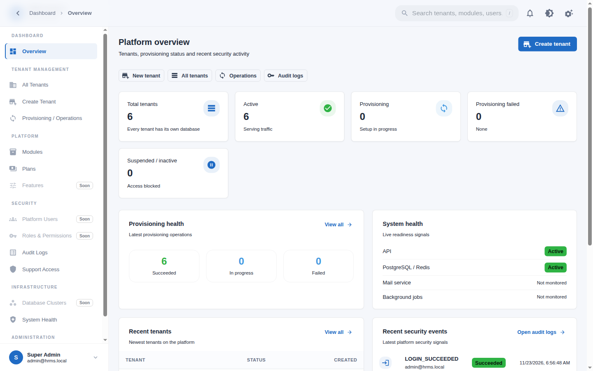
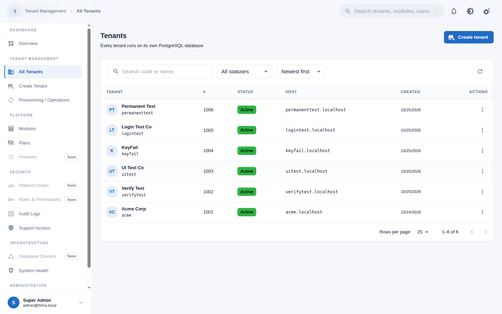
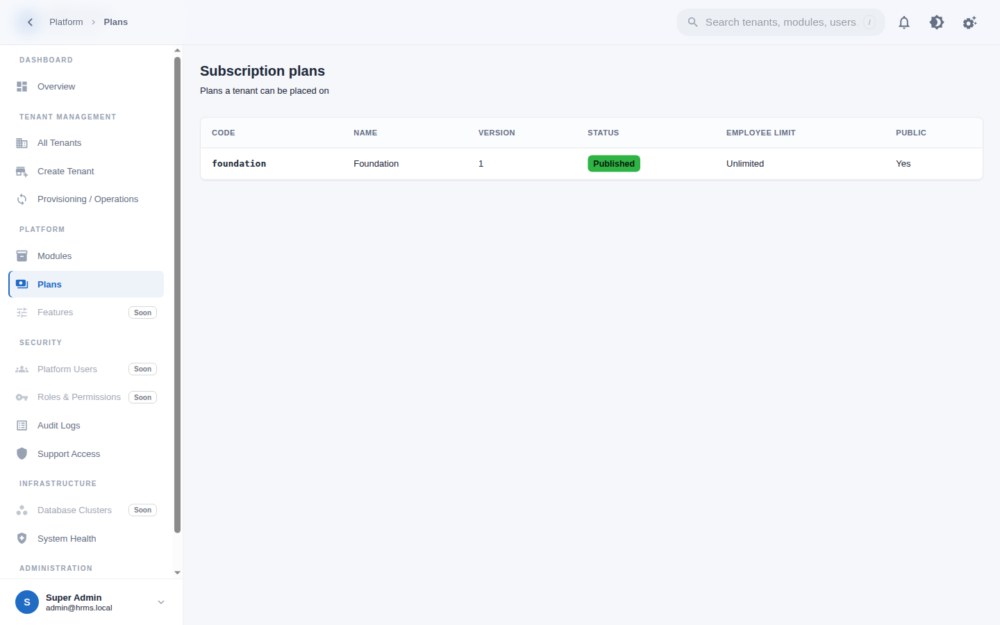
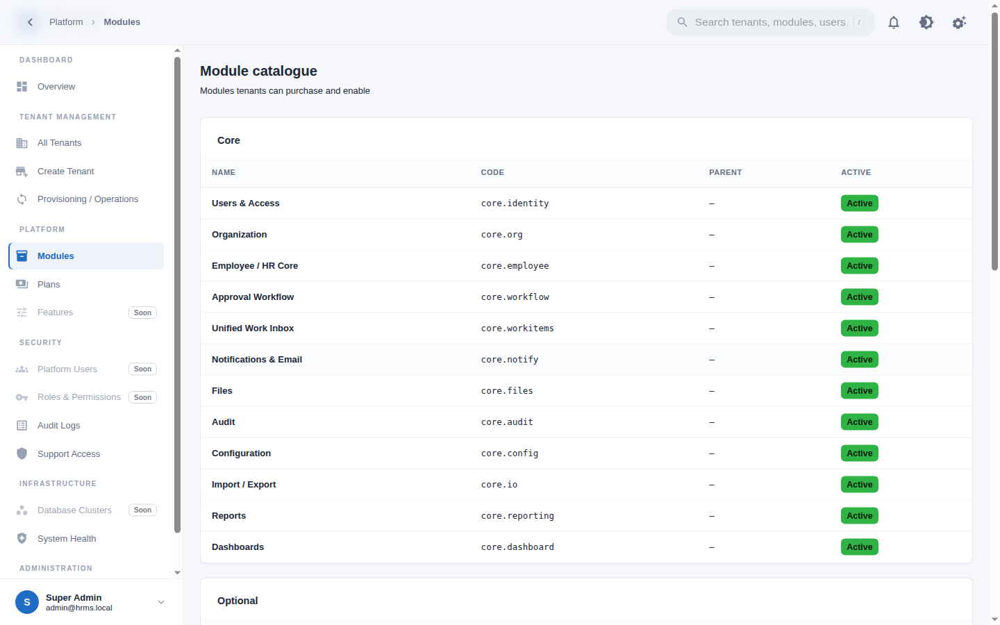
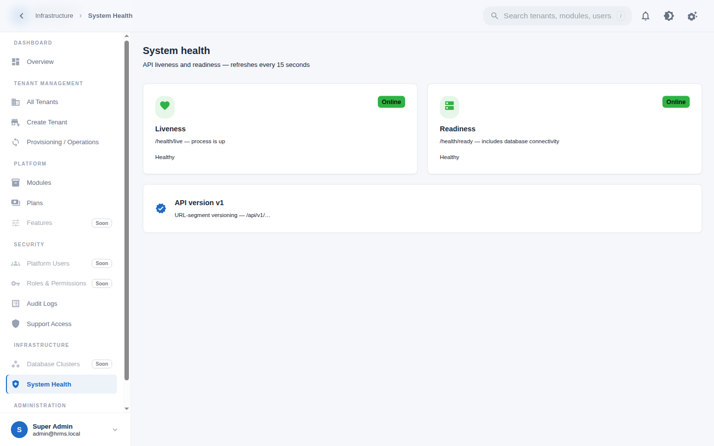

# Platform Admin Guide (Super Admin)

Version: 1.0 · Last updated: 2026-11-23 · Applies to: M1 platform foundation
Audience: Platform Admin / Super Admin, Implementation Engineer

> Screenshots are real captures from the local platform console
> (`admin.localhost`) — demo tenants only.

## 1. What a Platform Admin does

You operate the SaaS layer, not the HR data: provision tenants, manage plans
and module entitlements, watch provisioning and platform health, and audit
platform-level security. You have **no implicit access to tenant data** —
support access is a separate, time-bound, audited grant.

## 2. Sign in

Open the admin portal: `https://admin.<base-domain>`
(local dev: `http://admin.localhost:5174`) — a separate realm with its own
identity store; tenant credentials do not work here and vice versa.

## 3. Overview (`/admin`)

| Card | What it tells you |
|---|---|
| Total / Active tenants | Workspace counts; every tenant runs its own PostgreSQL database. |
| Provisioning / Failed | Tenants mid-provision or needing a retry. |
| Provisioning health | Latest operations — success/in-progress/failed. |
| System health | API + PostgreSQL/Redis readiness signals. |
| Recent security events | Sign-ins and platform security signals. |

## 4. Tenants (`/admin/tenants`)

- List every tenant: number, code, status, host domain, created date.
- **Create tenant** (also `/admin/tenants/new`): code, name, region, time
  zone, plan, admin identity — starts asynchronous provisioning (new database,
  roles, migrations, seeds, domain registration).
- Tenant detail: status controls (activate / suspend / deactivate),
  subscription, provisioning log, **Retry** for failed steps (idempotent),
  and **Reset admin password**.
- **Provisioning / Operations** — the operations queue for provisioning jobs.

## 5. Plans (`/admin/plans`)

- Each plan: code, name, version, publish status, employee limit, public flag.
- A plan binds modules + features; assigning a plan to a tenant bumps its
  entitlement version, which propagates fail-closed to the tenant's API.

## 6. Modules (`/admin/modules`)

- The catalogue of modules tenants can purchase (core + optional), synced
  from the application manifest — permissions and menus ship with each module.
- **Features** — granular flags per tenant (**Status: PENDING** — marked
  "Soon" in the console).
- Per-tenant module/feature overrides live on the tenant detail page
  (`platform.entitlement.module.manage`, `platform.entitlement.feature.manage`).

## 7. Security & support

| Screen | Permission | Purpose |
|---|---|---|
| Platform Users (`/admin/users`) | `platform.user.manage` | Manage admin accounts — **PENDING** (listed "Soon"). |
| Roles & Permissions (`/admin/roles`) | `platform.role.manage` | Platform-level roles — **PENDING**. |
| Audit Logs (`/admin/audit`) | `platform.audit.view` | Platform audit trail (hash-chained). |
| Support Access (`/admin/support-access`) | `platform.support.manage` / `.request` | Time-bound, approved, audited tenant-data access. |

## 8. Infrastructure

- **Database Clusters** (`/admin/clusters`) — PostgreSQL cluster topology —
  **PENDING**.
- **System Health** (`/admin/health`) — readiness/liveness across services
  (`platform.health.view`).

## 9. Troubleshooting

| Symptom | Cause | Fix |
|---|---|---|
| Tenant stuck provisioning | cluster unreachable, seed failure | open provisioning log → fix cause → Retry (idempotent) |
| Tenant login fails right after creation | provisioning incomplete or domain not registered | check Operations; verify domain row |
| Module missing in tenant | not in plan and no override | tenant detail → entitlement override |
| "Access blocked" for a tenant | suspended/inactive status | tenant detail → activate |

## 10. FAQ

1. **Can platform admins read tenant employee data?** No — separate realm;
   tenant data needs an explicit approved support-access grant, time-bound and
   audited.
2. **How does a tenant get its database?** Provisioning creates
   `hrms_tenant_<n>` plus migrator/app roles on the assigned cluster; secrets
   live only in the secret store.
3. **Plan vs entitlement?** A plan is a bundle template; the tenant's actual
   rights are its entitlement record (plan + overrides) — that's what the API
   enforces.
4. **Is provisioning safe to retry?** Yes — designed idempotent; a retry
   resumes from the failed step.
5. **How do I take a tenant offline?** Suspend it — entitlements fail closed
   and sessions are rejected.
