# Tenant Admin Guide

Version: 1.0 · Last updated: 2026-11-23 · Applies to: M1 + M2 + M3.1/M3.2 builds
Audience: Tenant Administrator (the person who runs one company's workspace)

> Screenshots below are real captures from a demo tenant (`permanenttest`)
> with demo data only.

## 1. What a Tenant Admin does

You own one workspace (tenant). You set up the organization (companies,
branches, departments and masters), create users and roles, and control what
each person can see and do. You cannot see or touch other tenants — every
screen and API is scoped to your workspace.

## 2. Sign in

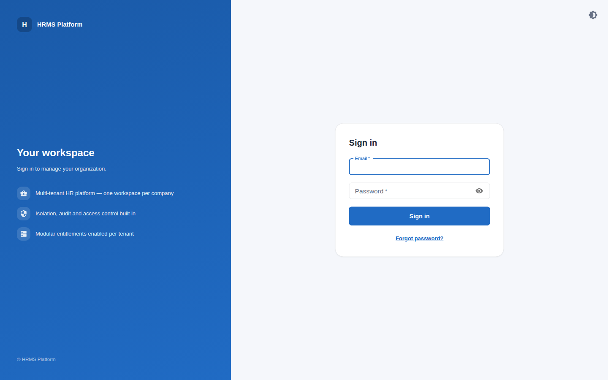

1. Open your tenant URL: `https://<tenant-code>.<base-domain>`
   (local dev: `http://<code>.localhost:5174`).
2. Enter the email and password from tenant provisioning (or the invitation).
3. **Forgot password?** requests a reset email; locked accounts unlock per the
   tenant's lockout policy.

**Expected result:** the dashboard for your tenant.

## 3. Dashboard (`/`)

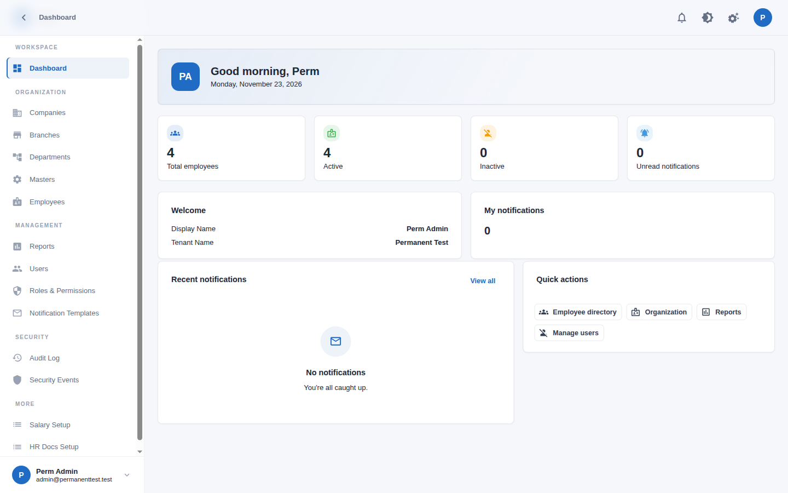

| Control | What it does |
|---|---|
| Employee counters | Headcount, active/inactive, unread notifications. |
| Quick actions | Jump to directory, organization, reports, user management. |
| Recent notifications | System + workflow notices (email + in-app). |

## 4. Organization setup — do this before onboarding

Order matters: employees reference these masters.

### 4.1 Companies (`/org/companies`)

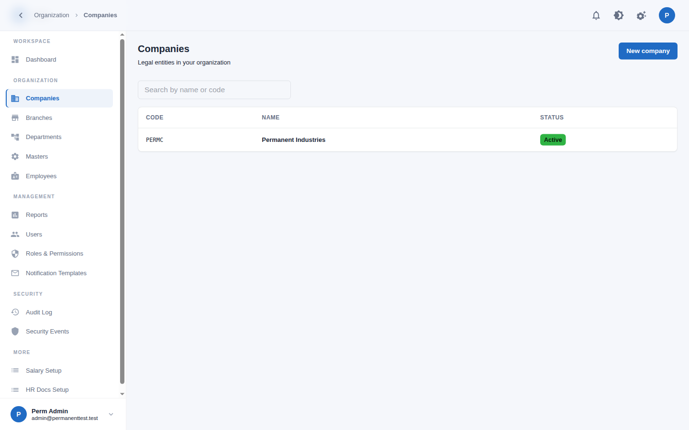

- **New company** — legal entity code + name. One tenant can hold several
  legal entities; detail pages hold addresses, contacts, bank accounts and
  statutory registrations.

### 4.2 Branches (`/org/branches`)

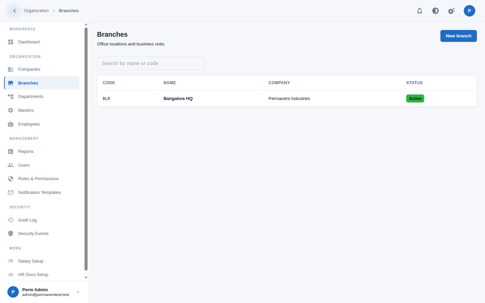

- Each branch belongs to a company and optionally a work location. Attendance
  policies and data scope can attach at branch level.

### 4.3 Departments (`/org/departments`)

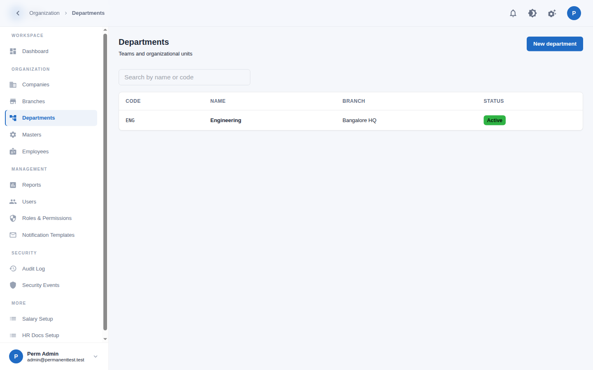

- Department → branch. Optional head-of-department with dated history.
- Departments drive data scope (a branch manager sees only their unit) and
  reporting structure.

### 4.4 Masters (`/org/masters`)

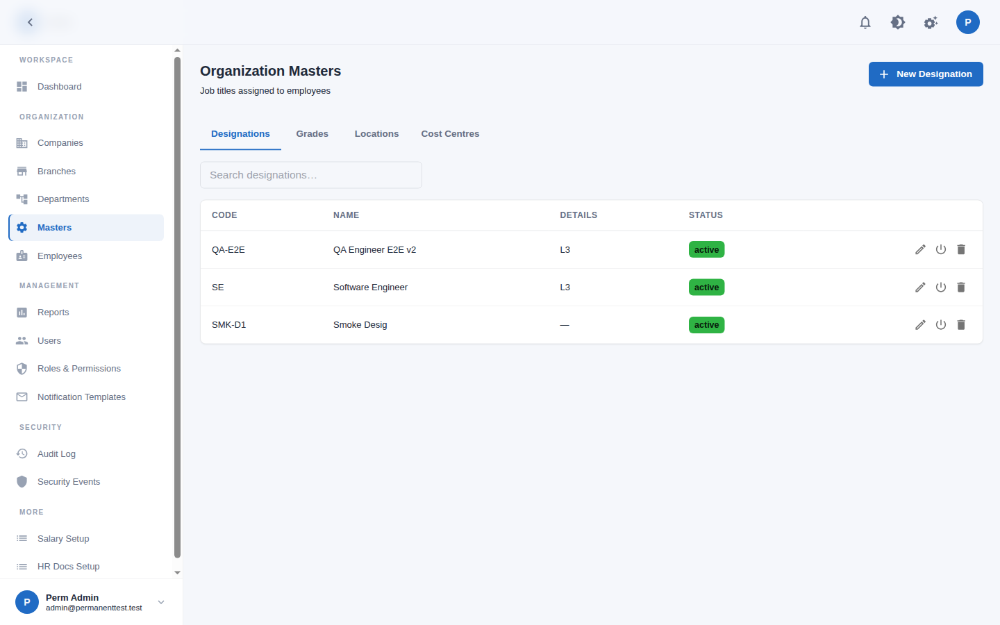

- Designations, grades, employment types, work locations, cost centres —
  the pick-lists used across employee records.

## 5. Security administration

### 5.1 Users (`/admin/users`)

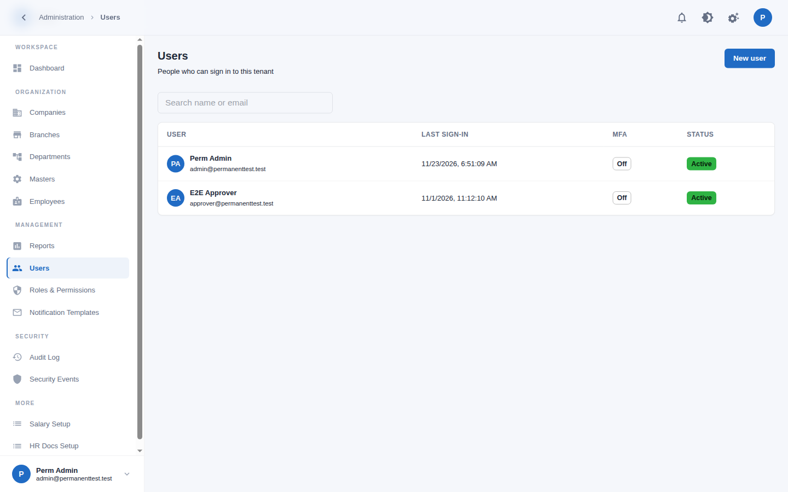

- Create users, assign roles, reset passwords, deactivate.
- A user linked to an employee can hold a **data scope** so they only see
  their org unit's people.

### 5.2 Roles & Permissions (`/admin/roles`)

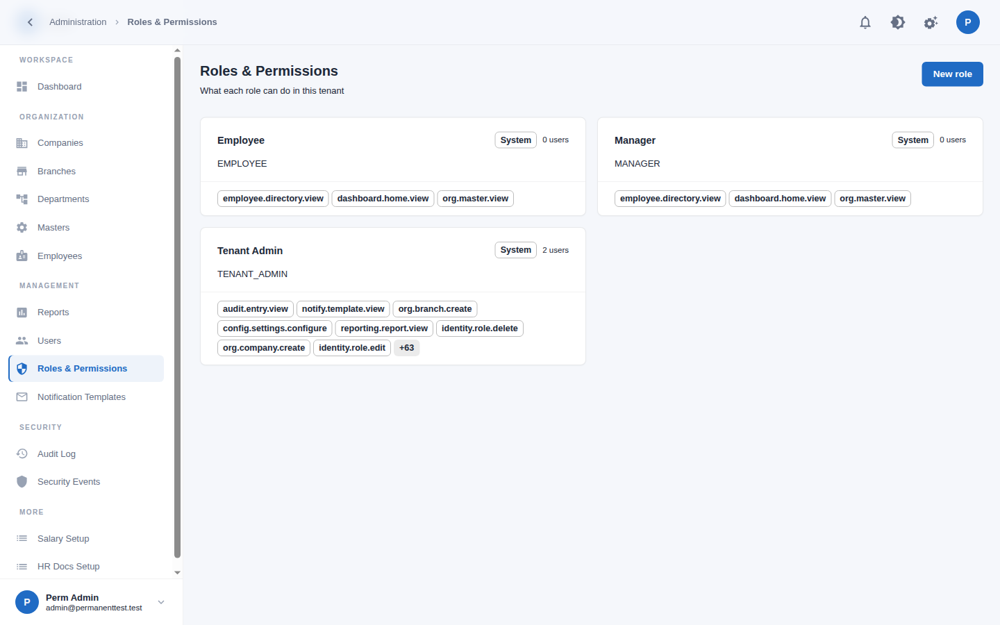

- Seeded system roles: **Tenant Admin**, **Manager**, **Employee**.
- **New role** — name + code, then grant permissions from the catalog
  (module-scoped codes like `employee.directory.view`,
  `attendance.devices.manage`).
- Per-user **permission overrides** exist for exceptions; grants can never
  exceed the assigner's own ceiling.

### 5.3 Audit Log (`/admin/audit`)

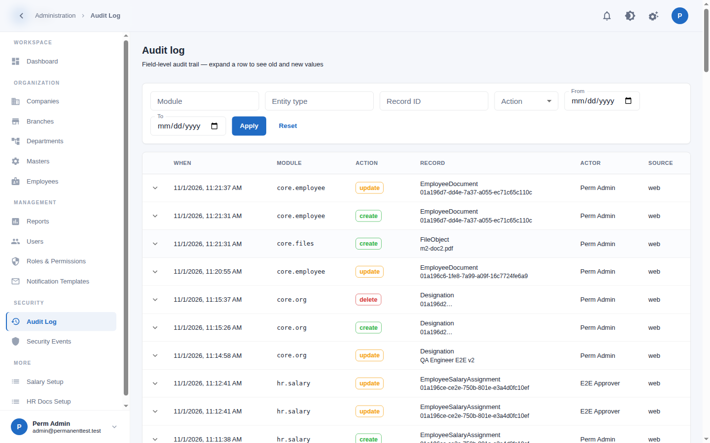

- Append-only audit of writes, permission changes, sign-ins; hash-chained and
  sealable (`audit.entry.view`, `audit.entry.export`).

### 5.4 Security Events (`/admin/security-events`)

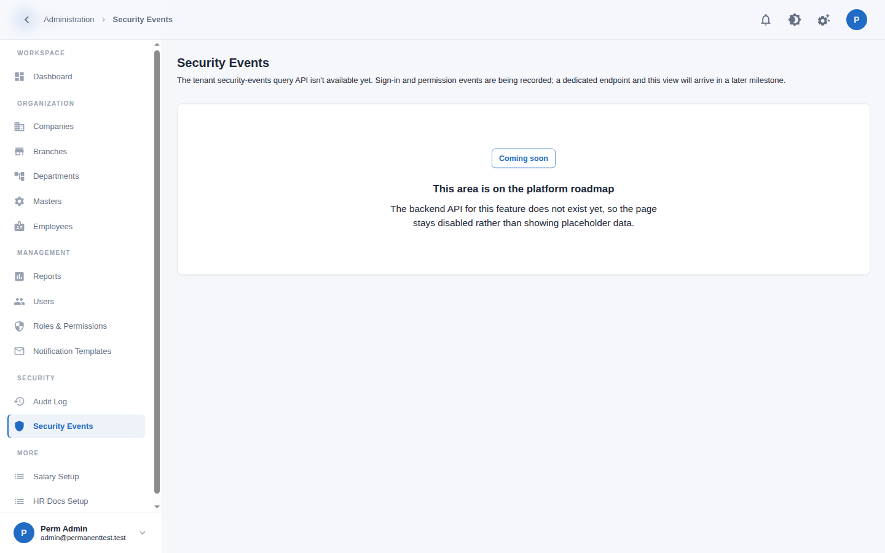

- Failed logins, lockouts, resets, suspicious activity (`audit.security.view`).

## 6. Notifications & templates

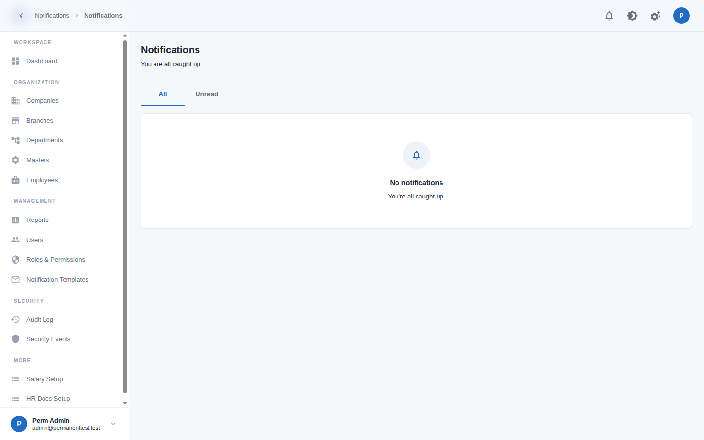
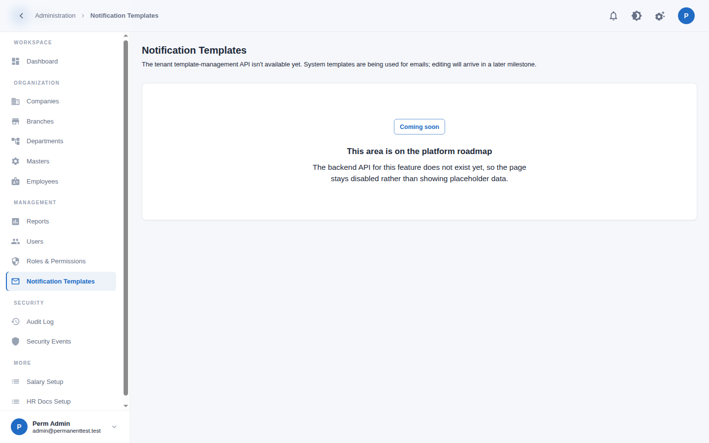

- **Notifications** (`/notifications`) — your inbox.
- **Notification Templates** (`/admin/templates`) — the email/in-app text for
  each event (`notify.template.*`).

## 7. Salary setup (`/salary`)

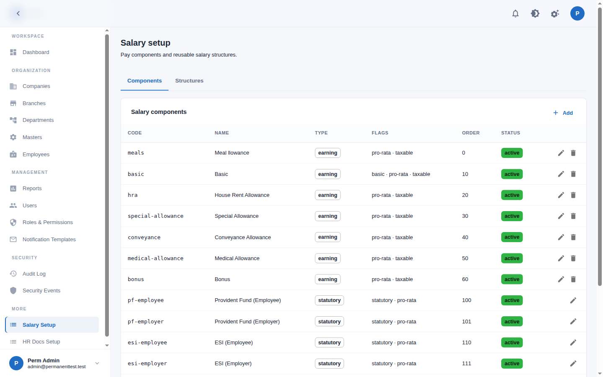

- **Salary components** (earning/deduction definitions) and **salary
  structures** (versioned bundles). Employees get a structure *assignment*
  with an effective date — assignments can require approval
  (`salary.assignment.*`).

## 8. HR Docs setup (`/hr-docs`)

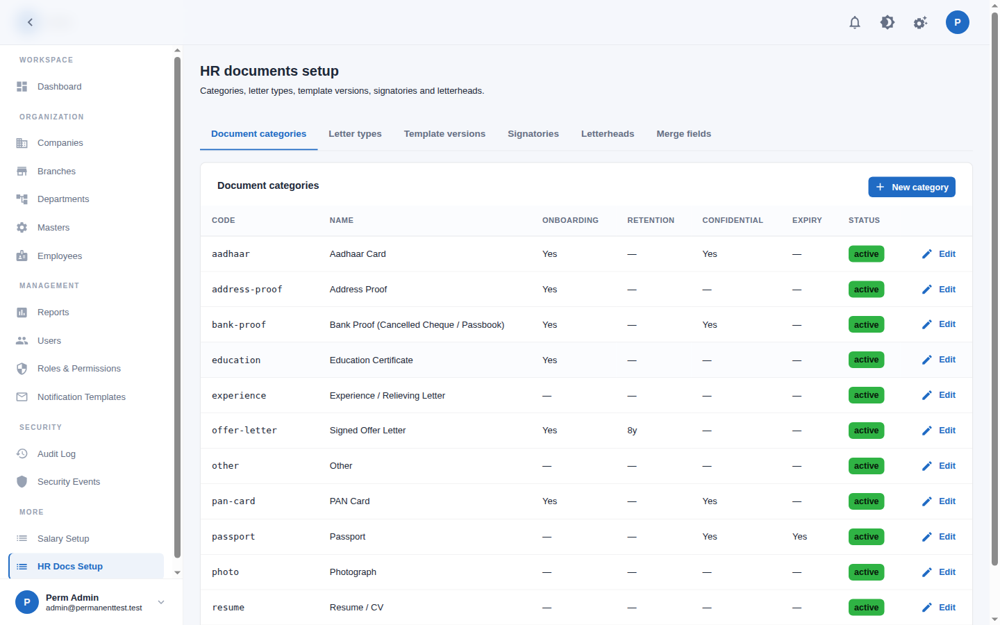

- Letter types and TipTap templates; issued letters are immutable PDFs
  (Gotenberg) — reissue/revoke keeps history.

## 9. Reports (`/reports`)

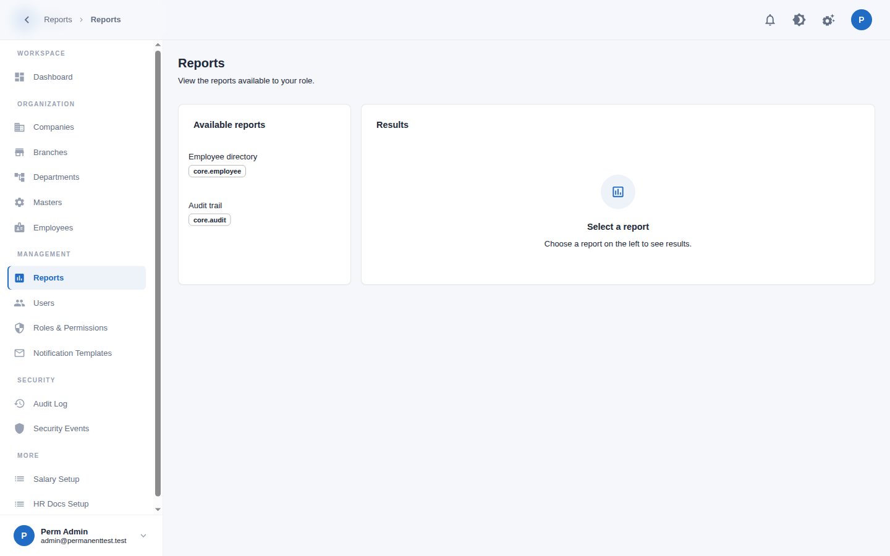

- Report framework is live; module report packs arrive with the reporting
  milestone — **Status: PENDING** for most packs.

## 10. Validation & troubleshooting

| Symptom | Cause | Fix |
|---|---|---|
| Menu item missing | module entitlement off or permission not granted | check tenant plan/entitlements + the role's grants |
| `403` on a screen | missing permission or out of data scope | grant the permission code, or widen scope |
| Can't grant a permission to someone | it exceeds your own grant ceiling | a higher-privileged admin must grant it |
| Scoped manager sees nobody | scope not assigned to the user | Users → assign org units to their scope |
| Audit gap question | entries are append-only + sealed; they can't be edited | export the audit trail for evidence |

## 11. FAQ

1. **Can I see another tenant?** No — host-based tenant resolution binds you
   to your workspace; URLs carrying another tenant are rejected.
2. **System vs custom roles?** System roles are seeded and synced; clone or
   create custom roles for your structure.
3. **Who can reset a password?** Users → select user → reset; platform admin
   can also reset the tenant admin's password (audited).
4. **Where are employee records?** People → Employees — see the
   [employee manual](../employee-management/employee-management.md).
5. **How do I give a branch manager only their branch?** Role with HR
   permissions + data scope limited to that branch's org units.
