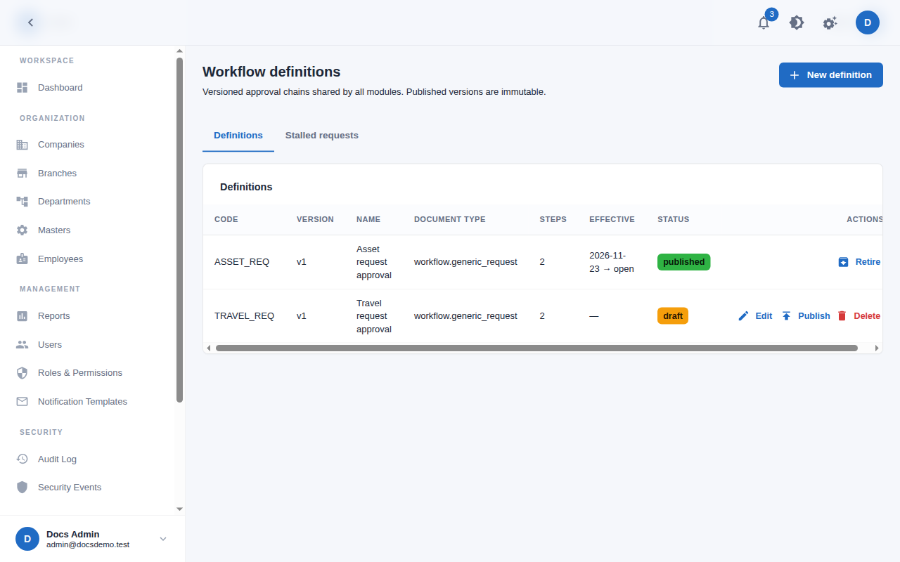
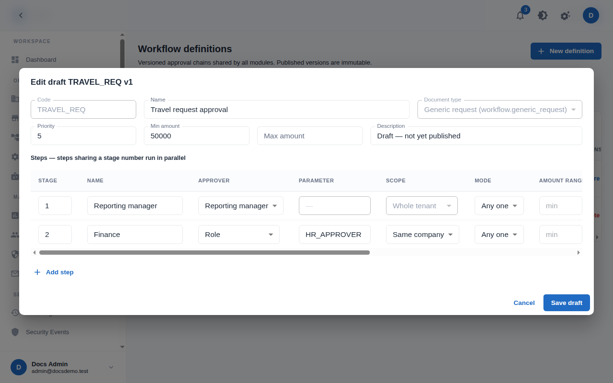
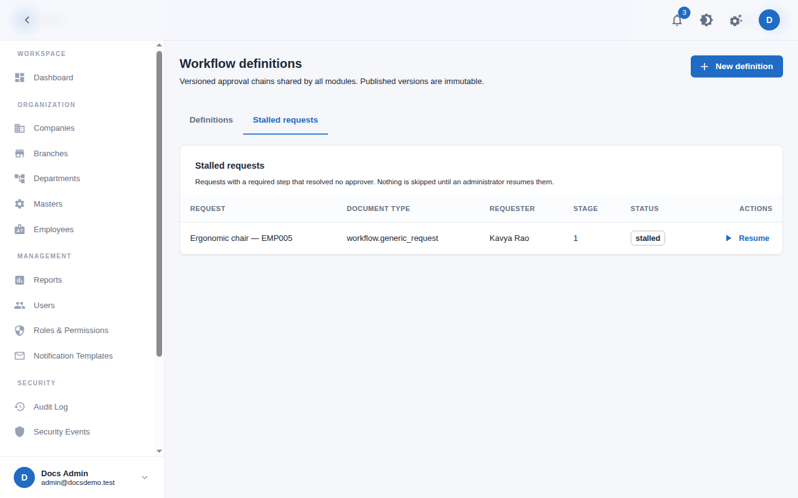
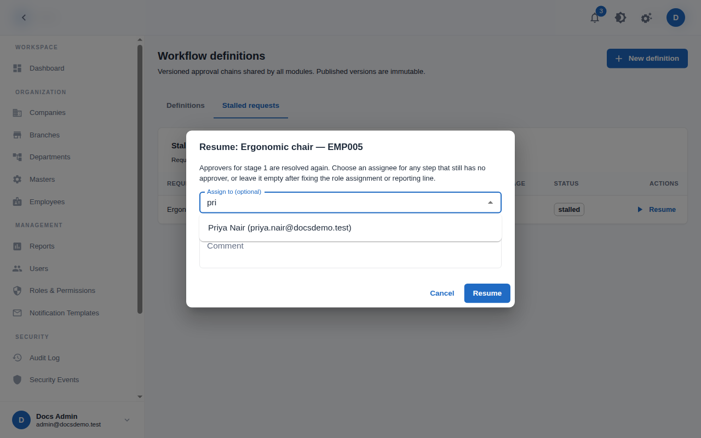
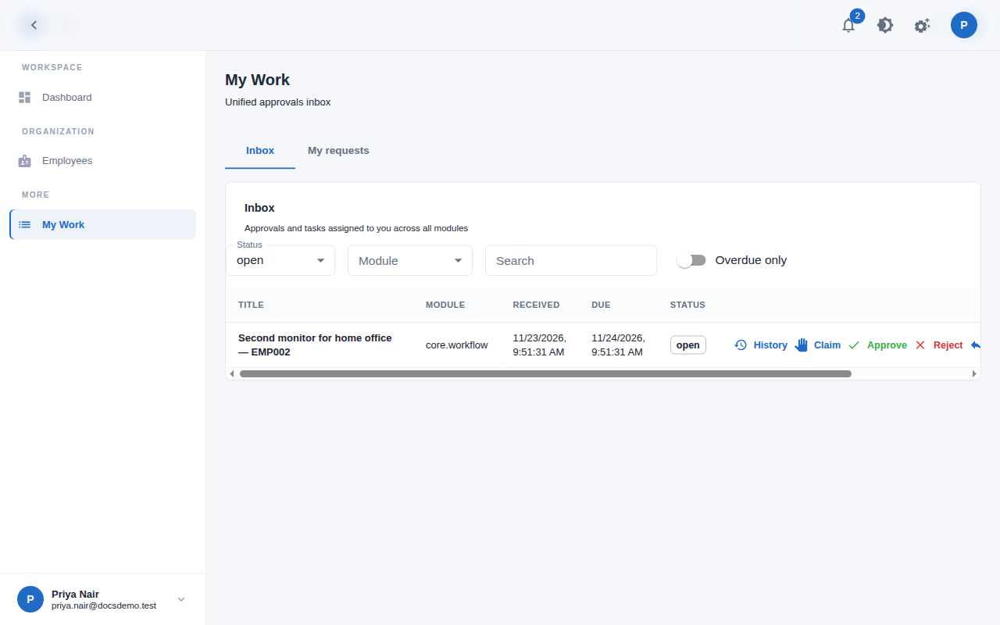
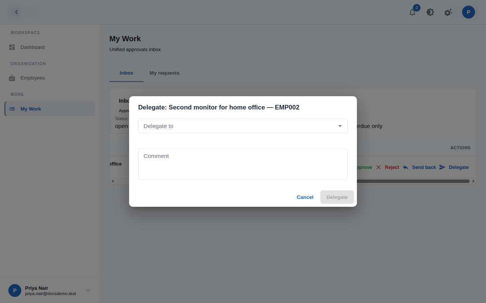
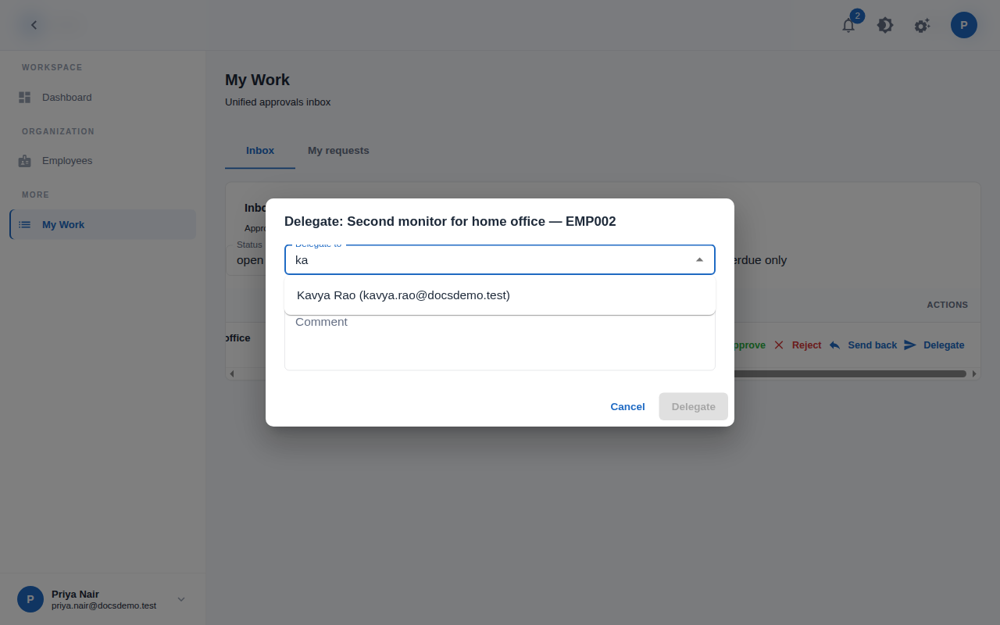
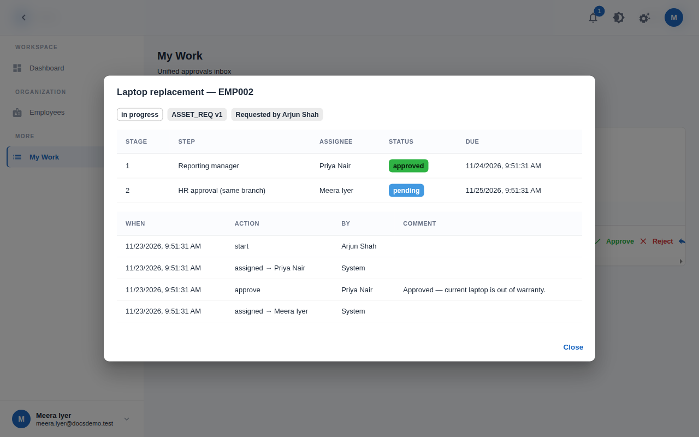
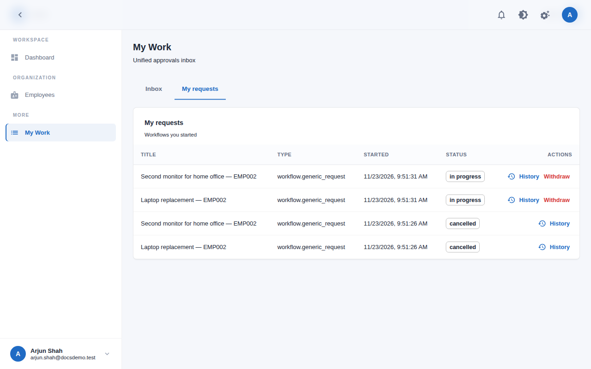
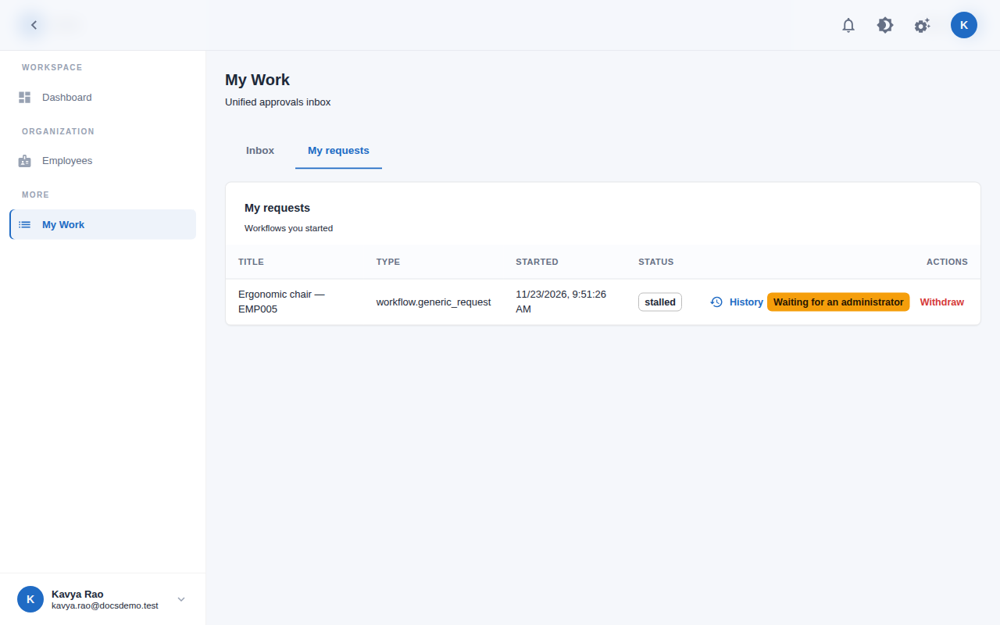

# Workflow & My Work — Shared Approvals Engine (core.workflow + core.workitems)

Version: 1.0 · Last updated: 2026-11-23 · Applies to: Workstream B (PR #5, pending merge)

> Screenshots are real captures from the running application on a local demo
> tenant `docsdemo` (dummy people and data only). Every procedure below is
> covered by the API test suite (`WorkflowEngineTests`).

## 1. Introduction

The workflow engine is the single approval engine shared by every module that
needs a sign-off: Leave, Attendance Regularization, Expense, Payroll
finalization and Exit/FNF register their document types and consume the same
engine. Generic requests (`workflow.generic_request`) can already be raised
from the API today.

* **Workflow definitions** describe the approval chain: ordered *stages*, each
  with one or more steps. Steps in the same stage run in parallel (*any one*
  or *all* must approve). Definitions are versioned: drafts are editable,
  published versions are immutable, and running requests stay on the version
  they started with.
* **My Work** (`/my-work`) is the unified inbox. Every approver sees tasks from
  all modules in one list and can claim, approve, reject, send back or
  delegate them.
* **Stalled requests**: if a required step resolves **no approver**, the
  request is never skipped or auto-approved. It becomes **Stalled**, workflow
  administrators are notified, and an administrator resumes it after fixing
  the cause or choosing an assignee.

## 2. Prerequisites

| Requirement | Where |
|---|---|
| `core.workflow` and `core.workitems` module entitlements (in the default plan) | Platform admin → tenant subscription |
| Companies, branches, departments, employees, and users linked to employees | Employee management (M2) |
| Reporting lines (employee → manager) for manager steps | Employee record |
| Roles for role-based steps, with branch/department targets where needed | Tenant admin → Roles & Permissions, Users |

## 3. Required permissions

| Permission code | Grants | Typical role |
|---|---|---|
| `workflow.definitions.view` | View definitions and document types | Tenant admin, HR admin |
| `workflow.definitions.manage` | Create, edit, publish, retire definitions | Tenant admin |
| `workflow.instances.view` | View all requests in the user's data scope | HR admin |
| `workflow.instances.start` | Raise generic workflow requests | Employees who raise requests |
| `workflow.instances.manage` | Cancel any request, escalate, **resume stalled requests**; receives stalled notifications | Tenant admin / workflow administrator |
| `workflow.delegations.manage` | Create standing (out-of-office) delegations | Manager, Employee |
| `workitems.inbox.view` | Open My Work | Manager, Employee |
| `workitems.inbox.act` | Act on tasks; **required to receive a delegation** | Manager, Employee, HR approver roles |

Tenant admins (`TENANT_ADMIN`) always receive stalled-request notifications.

## 4. Initial setup — building a definition

1. Go to **Workflow definitions** (`/workflow/definitions`) and click **New definition**.
2. Enter a code, a name and the **document type**. Optional conditions
   (amount band, company, branch, department) and a priority decide which
   published definition a request uses.
3. Add steps. For each step choose:
   * **Approver** — *Reporting manager* (parameter: level, default 1),
     *Department approver*, *Role* (parameter: role code) or *Specific user*.
   * **Scope** (role steps only) — which role holders may approve:

     | Scope | Role holders who qualify |
     |---|---|
     | Whole tenant | Every active holder of the role |
     | Same company | Holders whose role assignment targets the request employee's company — or, with no company target, whose own employee record is in that company |
     | Same branch | As above, for the employee's branch |
     | Same department | As above, for the employee's department |
     | Reporting line | Holders who are managers (any level) of the request employee |

   * **Mode** (*any one* / *all*), optional amount range, SLA hours and
     escalation (manager, role or user).
4. **Save draft**, review, then **Publish**. To change a published chain,
   create a new version; the old one is closed and running requests keep it.

## 5. Screens

### 5.1 Workflow definitions (`/workflow/definitions`)

Lists every definition version with document type, priority, effective window
and status (`draft`, `published`, `retired`). Drafts show **Edit / Publish /
Delete**; published versions show **Retire**.

The editor shows the step grid. The **Scope** column is enabled only for
*Role* steps; any other approver type always uses *Whole tenant*.

### 5.2 Stalled requests tab (`/workflow/definitions?tab=stalled`)

Lists requests waiting for an administrator, with the stage that has no
approver. Only requests inside your `workflow.instances.manage` data scope
appear. **Resume** opens a dialog:

* **Assign to (optional)** — searchable list of active users who can act on
  approvals (you can pick yourself). Leave it empty if you have fixed the cause (role assignment,
  reporting line, reactivated user); the engine re-resolves approvers.
* **Comment** — recorded in the request history.

If approvers still cannot be found and no assignee is chosen, the request
stays stalled and the dialog shows the error.

### 5.3 My Work — Inbox tab (`/my-work`)

Open tasks assigned to you across all modules, with filters for status,
module, search text and *Overdue only*. Row actions:

| Action | Effect |
|---|---|
| History | Opens the stage table and full action history |
| Claim | (Parallel *any one* stages) reserves the task so other approvers cannot act |
| Approve | Completes your step; the next stage starts when the stage is complete |
| Reject | Ends the request (comment required) |
| Send back | Returns to the requester or the previous stage (comment required) |
| Delegate | Hands this task to an eligible coworker |

**Delegate dialog.** Type part of a name or email. The list shows only active
users who hold `workitems.inbox.act` (never yourself), 20 matches at a time
with a "more matches" hint. There is no user-ID box. The server re-checks
eligibility when you confirm.

A branch-scoped HR step reaches only the HR approver of the employee's branch.
Here Meera Iyer (Headquarters) gets the task; Rohan Das (Bengaluru) does not.

### 5.4 My Work — My requests tab

Requests you raised, with status. **Withdraw** is available while the
request is in progress, sent back or stalled; **Resubmit** after a send-back.
A stalled request shows *Waiting for an administrator*.

## 6. Worked examples

**A. Manager then branch HR (demo `ASSET_REQ`).** Arjun Shah (HQ) raises
"Laptop replacement". Stage 1 goes to his manager Priya Nair. When she
approves, stage 2 (*Role HR_APPROVER, Same branch*) resolves only Meera Iyer,
whose HR Approver assignment targets the Headquarters branch. Rohan Das holds
the same role for Bengaluru and never sees the task.

**B. No approver → stalled → resumed.** Kavya Rao has no manager on her
employee record. Her request stalls at stage 1 and the tenant admin receives
"Workflow stalled (no approver)". The admin either sets Kavya's manager and
clicks **Resume** with no assignee, or picks *Priya Nair* in **Assign to**.
History shows `start → stalled → resumed → assigned`.

**C. Stall during send-back or resubmit.** HR sends a request back to the
previous stage, but the manager's account has been deactivated. The request
stalls instead of skipping the manager. The same happens if the requester
resubmits after a send-back. After the account is reactivated, **Resume**
re-assigns the manager and keeps the full history.

**D. Out-of-office delegation.** Priya creates a standing delegation to Kavya
for next week. New tasks for Priya go to Kavya during that window. If Priya
revokes it, open tasks return to Priya at once. When it expires, Kavya can no
longer act on them, and the next SLA sweep returns them
to Priya.

## 7. Validation rules

* A published version cannot be edited; only one published version per
  definition can be effective on a date.
* Scope other than *Whole tenant* is rejected on non-role steps.
* A required step with no resolvable approver stalls the request. Steps are
  skipped **only** when an amount threshold excludes them, and that skip is
  recorded in history.
* Requesters can never approve their own request (also excluded from
  delegation and resume assignment).
* Delegation targets must be active users holding `workitems.inbox.act`; a
  standing delegation is ignored if the delegate loses that permission.
* Resume requires `workflow.instances.manage`; the assignee must be active,
  able to act, and not the requester.
* Actions use optimistic concurrency and accept an `Idempotency-Key` header;
  replays return the same result.

## 8. Common errors & troubleshooting

| Message / symptom | Cause | Fix |
|---|---|---|
| Request shows **stalled** | A required step resolved no approver (no manager, no in-scope role holder, inactive user) | Fix the data, then **Resume**, or resume with an assignee |
| "No approver could be resolved" on Resume | Cause not fixed and no assignee chosen | Choose an assignee or correct the role/reporting data |
| "Delegate cannot act on approvals" | Target lacks `workitems.inbox.act` | Pick someone from the search list, or grant the permission |
| "The delegation that routed this task to you has expired or been revoked" | Standing delegation ended | No action; the task returns to the original approver |
| Branch HR never receives tasks | Role assignment has no branch target and the user's employee record is in another branch | Add a branch target to the assignment, or link the right employee |
| "This task is no longer pending" | Someone else already acted, or the request stalled/ended | Refresh My Work |

## 9. Reports & exports

**Status: PENDING — not yet implemented.** Workflow SLA and throughput reports
are planned with the reporting module. Today use the request list API
(`GET /api/v1/workflow/instances?status=…`) and the audit log.

## 10. FAQ

1. **Will a request ever be approved because nobody could be found?** No.
   It becomes stalled and waits for an administrator.
2. **Who gets the stalled notification?** Every active Tenant Admin and every
   user whose role has `workflow.instances.manage`.
3. **Does resuming lose history?** No. Every action, including `stalled`
   and `resumed`, stays in history and the audit log.
4. **Can a branch HR admin approve another branch's requests?** Not when the
   step scope is *Same branch* (or narrower). Use *Whole tenant* only for
   genuinely tenant-wide approvers.
5. **Why can't I type a user ID to delegate?** The picker shows only people
   who are allowed to act, so a task can never be stranded with someone who
   cannot open it.
6. **Does delegating give the delegate extra rights?** No. They can act on
   that task only. They still cannot view other requests, definitions or
   stalled requests.
7. **What happens to tasks when I revoke my out-of-office delegation?** Open
   tasks it routed come back to you immediately.

## Demo data (docsdemo)

| Item | Value |
|---|---|
| Users (password `Docs-Demo-9917`) | `admin@`, `priya.nair@`, `arjun.shah@`, `meera.iyer@`, `rohan.das@`, `kavya.rao@` `docsdemo.test` |
| Org | Docs Demo Co → Headquarters (HQ), Bengaluru (BLR); Engineering |
| Roles | `HR_APPROVER` (Meera → HQ, Rohan → BLR), `WF_REQUESTER` (Arjun, Kavya) |
| Definitions | `ASSET_REQ` (published: manager → HR same branch), `TRAVEL_REQ` (draft) |

See [implementation/docsdemo-recreation.md](../implementation/docsdemo-recreation.md) §6 for seeding steps.
